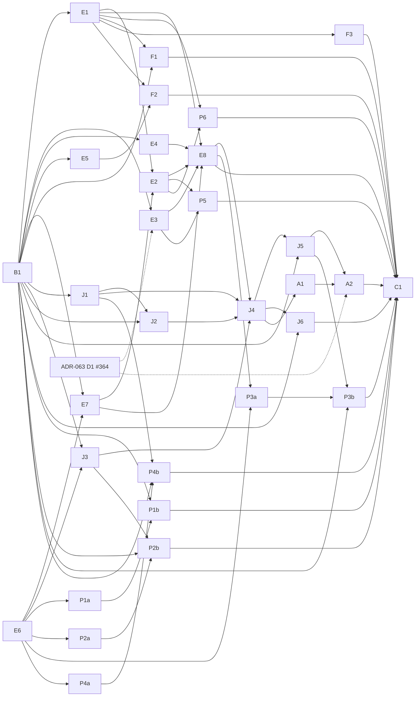

# ADR-065: Four-agent joint speculative verify and multi-slot decode

- **Status:** Accepted
- **Date:** 2026-10-31
- **Updated:** 2026-11-01 — accepted by the owner; execution waits for the ADR-063 v0.1.28 milestone to complete.
- **Deciders:** Robert E. Lee (product owner)
- **Tags:** apple-silicon, m5-max, gguf, four-slot, speculation, joint-decode, speed
- **Depends on:** ADR-063
- **Related:** ADR-044, ADR-040, ADR-059
- Stable source ID: ADR-065
- Audited baseline: hf2q `005c9707dda33fc90e19dabc29a722c777eff971` (origin/main, 2026-10-31) with mlx-native `=0.15.15`.
- Reference engine studied read-only: TensorFold `1157ea5b` (Zig + Metal, MLX affine formats).

## Context

### Where ADR-063 S3 phase 1 left four-agent decode

ADR-063 S3 phase 1 shipped one-row-per-slot joint decode for DeepSeek-V4 (#458), Qwen3.8 (#466) and Gemma 4, and Qwen3.8 shared-weight dense FFN (#480). On the M5 Max 128 GB four-agent C262144 coding workload it measured:

| Family | Serial | Joint phase 1 | Source |
|---|---|---|---|
| Qwen3.8-27B makespan | 116.4 s | 90.1 s; Q3 primary stage 88.3 s vs stock 113.6 s and peer 122.2 s | `docs/research/adr063-s3-qwen-joint-decode.md` |
| Qwen3.8 per-request decode | 8.9–9.7 tok/s | 12.2–12.5 tok/s; 13.21 tok/s with shared FFN | same; `E/qwen-joint-ffn-ab-v1` |
| DeepSeek-V4 makespan | 141.7 s | 105.0 s; per-request 8.12 → 10.98 tok/s | `docs/research/adr063-s3-ds4-joint-decode.md` |

At the audited baseline, `docs/research/adr063-s3-qwen-joint-decode.md` carries committed merge-conflict markers in its status block; the numbers above come from its unconflicted body.

The S3 document lists what phase 1 did not do: joint temporal verify (MTP or history proposals inside the joint step), batched MTP catch-up, packed routed experts, a native per-sequence DeltaNet dispatch, and an N=2 measurement. The source behind that list at the audited baseline:

1. Joint rows never speculate (`src/serve/api/engine_qwen35/joint_decode.rs:16-18`). MTP-holding lanes still pay a per-token MTP catch-up with no drafting, and the MTP cost gate never scores that cost (`docs/research/adr063-d1-speculation-qualification.md` §4). Solo K3 reached 41.86 tok/s on code with about 81.5% per-draft acceptance; its 4-row verify is 58–61 ms of a 68–75 ms round (`docs/adr/ADR-044-qwen38-native.md:332-353`).
2. In the joint graph, DeltaNet conv, L2 and gated delta net, and full-attention KV write plus SDPA, run once per slot with a memory barrier between rows (`src/inference/models/qwen35/joint_decode_core.rs:412-572,804-853`). DeepSeek runs window, compressor, indexer and sparse attention per row and allocates per-row arenas every layer and step (`src/inference/models/deepseek4/joint_decode_core.rs:174-300`).
3. `mul_mv_ext` admits at most 8 rows; above 8 rows products route to `mm`, which is different arithmetic. At 8 rows it uses four rows per threadgroup and launches two threadgroup rows, each reading the weights (mlx-native `src/ops/mul_mv_ext.rs:104-109,334-347`). Exact Q4_K/Q6_K mN tiles cap at 5 columns, so 6–8 rows issue two dispatches (`src/ops/quantized_matmul_ggml.rs:2135-2147`).
4. Partial-reject DeltaNet rollback copies capture through host memory (`src/inference/models/qwen35/kv_cache.rs:2743-3020`), measured at 5–7 ms per rejected round. Capture activity is cache-global, so joint turns refuse capture (`src/serve/api/engine/qwen35_joint_decode.rs:278`). Solo verify is fixed at three drafts (`src/serve/api/engine_qwen35.rs:5751`).
5. No per-class GPU-time split was retained for the Qwen or DeepSeek joint step. The shared-FFN bandwidth projection of up to 2.2× delivered 7–8%, and the cause is unattributed (`docs/research/adr063-k1-q8-multirow-disposition.md`). Per-dispatch GPU counters are a no-op on the M5 Max sampling interface, and the stage-boundary helper commits and waits (mlx-native `src/encoder.rs:1494-1501,2588-2621`).

### What TensorFold shows

TensorFold runs concurrent Qwen3.8-27B streams as shared lane rounds: every stream's verify window, the pending token plus its own drafted chain or tree, goes into one target forward. Its mechanisms, read at HEAD `1157ea5b`:

| Mechanism | TensorFold source | hf2q at the baseline |
|---|---|---|
| Per-stream verify windows packed into one target pass | `zig/src/core/lanes/engine.zig:256-323`, `zig/src/families/qwen27/round_plan.zig` | one row per slot |
| Multi-slot DeltaNet: per-(layer, slot) state, row logs, accepted-path replay; one-row windows step in place | `zig/src/families/qwen27/gdn_pool.zig`, `gdn_pool_gpu.zig:152-285` | per-slot loop; host rollback |
| One attention dispatch over all streams through a per-stream cache table, key chunk chosen from the row's own position | `zig/src/families/qwen27/attention_plan.zig:13-19`, `attention.zig:51-75,288` | per-row SDPA with barriers |
| Projection whose bits do not depend on row count for 1–16 rows | `zig/kernels/metal/core/lane_projection.metal` | invariant only at padded width 4 |
| Timed cost table, per-depth acceptance and learned overhead allocate draft rows; drafter skipped when no rows are granted | `zig/src/core/lanes/allocate.zig:31-75`, `depth.zig`, `cost_rule.zig` | per-proposer on/off gate; fixed depth |
| GPU-built unique-expert MoE jobs with indirect dispatch | `zig/src/families/glm_dsa/kernels.zig:262-284` | per-(row, expert) `mv_id` |

Its measured results are leads, not expected gains, because format, engine, chip and workload differ:

| Lead | Engine | Chip | Source |
|---|---|---|---|
| Aggregate 78.9 / 117.7 / 158.2 / 201.4 tok/s at 1/2/4/8 streams, DFlash2 greedy code | 0.3.5.1 Python/MLX engine | M5 Pro 64 GB | `docs/recipes/qwen3.8-27b.md:296-305,330-335` |
| Priced shared lane rounds: +18.6% at 4 greedy code streams | Zig, #1621 | M5 Ultra | `CHANGELOG.md:71` |
| One dispatch for all streams' attention and conv: about +16 / +33 / +40% at 4 / 8 / 16 streams | Zig, LFM2 | M5 Ultra | `docs/recipes/lfm2.5-24b-a2b.md:18-48` |
| Read each expert once per window: +2.6% at 1 stream, +6–10% at 2–8 | Zig, GLM, #1130 | M3 Ultra | `CHANGELOG.md:403` |

TensorFold also records losses this program will not repeat (`docs/recipes/adding-a-zig-family.md:270-284` unless noted): DeltaNet step and tensor-op kernels at 2–7 rows (`:277`), split command buffers (`:278`), grouped experts read once for all lanes (`:279`), one launch for all experts (`:282`), a persistent kernel with a GPU-wide barrier (`:284`), Metal paged KV with no speed or memory gain yet (`CHANGELOG.md:135`), and Flash Next shared sessions, where a lone request decoded 7% slower (`docs/known-issues.md:19-23`). Its +0.71% batched-MTP receipt chained one stream's drafts while streams stayed serial (`docs/receipts/flashnext-mtp-chain-2026-10-10/README.md`); it does not decide cross-slot MTP batching. TensorFold's tensor-unit lane kernel has no GGUF K-quant analogue in mlx-native, and its DeepSeek family is CUDA-only and unreleased.

## Decision

### Global acceptance and exclusions

The program MUST keep exact-transaction speculation inside the four-agent joint step for Qwen3.8-27B and make per-slot work multi-slot where measurement shows it pays, improving four-agent makespan over the phase-1 default without per-slot quality or fairness regression. DeepSeek-V4 and Gemma 4 receive only work their own traces justify, under the numeric decision rules of their stories.

The program MUST preserve every ADR-063 global acceptance rule and exclusion: Rust-owned inference, OpenAI unary/SSE and native tool semantics, conversation isolation, Q5 per-family calibrated admission, one hf2q process at a time with peers unloaded, distinct candidate authors and independent reviewers, and the native publication rule. It MUST NOT introduce approximate recurrent or non-prefix reuse, ANE offload, distributed Macs, custom training, Python or vendor production paths, new drafter architectures, tree drafting, grafted-lane joint verify, or Qwen3.6 default changes.

A negative or inconclusive measurement is recorded evidence, never a shipped feature. No TensorFold figure is an acceptance receipt.

### Relationship to ADR-063

| ADR-063 item | State at 2026-10-31 | This ADR |
|---|---|---|
| S3 #363 | phase 1 delivered with an accepted verdict | Implements the S3 "Not in phase 1" items; does not reopen #480. |
| D1 #364 | tests written; A/B planned, no result | Predecessor. D1 owns the four-slot `auto` versus `off` disposition and charging joint-turn MTP catch-up; this ADR consumes its receipt. |
| D2 #365 | not run | Predecessor of any drafter or tree successor. E and J work is drafter-neutral and proceeds alongside D2. |
| K1 #366 | closed; Q8_0 multi-row negative | P3 covers only verify widths K1 did not. |
| Q1, Q2, Q5 | in use | Consumed unchanged: Class A/B, paired quality rule, certified harness, `q5_calibration.py`, `LOG_FILTER`. |
| Q3, Q4 | open | Unchanged; peer and release claims stay there. |
| Grafts (ADR-059) | MTP off for grafted requests | Grafted lanes stay on their existing fallback. |

### Numerical and transaction contract

In this ADR "the serial M1 route" means today's one-token serial target forward, and "the N=1 control" means a single-agent run.

For window width w in 1..4, FFN mode (`SharedWeights` padded or `SerialBuilder` exact) and served KV format, the reference route REF(w) is the joint verify graph run with a cohort of exactly one window. Its arithmetic is fixed by the joint graph's routes: fixed padded projection groups, shared FFN and the window's attention bucket. It is not today's solo `forward_gpu_with_nextn_hidden_buffer`, which uses fused gate/up and a fixed width of 4.

- **Cohort invariance (Class A).** Every window's logits rows, hidden rows and complete post-commit slot state (target cursor, MTP cursor and MTP KV, DeltaNet parity, conv and recurrent buffers, KV or TQ regions, carry hidden row) MUST be byte-identical between REF(w) alone and any cohort of 1–4 windows of mixed widths, in any slot order, including windows that cross attention-bucket boundaries. Projection grouping and each window's attention bucket MUST be fixed independently of cohort composition. Padding rows MUST NOT mutate KV, recurrent, MTP or semantic state.
- **Decision envelope (Class B).** Every valid logit row of REF(w) MUST be `WithinDecisionEnvelope` (D ≤ 0.25 nat, ADR-063 Q1 numeric policy §3.2) against teacher-forced serial M1 route rows on the same frozen prefix, over real agent prompts and the accepted greedy datasets. `RouteSensitive` blocks promotion and requires localization. Production speculation MUST NOT be described as bitwise equal to the serial M1 route.
- **Transaction exactness.** Given identical logits rows, committed tokens, output stream and state MUST equal the solo K3 transaction: draft KV discarded, MTP caught up from verifier hidden rows, both cursors truncated to committed, recurrent state restored to the last valid row, carry hidden row retained, `plan_qwen35_verified_block` unchanged.
- **Failure semantics.** Lane-local refusal before submission falls back only that lane. A shared submitted-forward failure resets every participating lane and MUST leave non-participants' state and committed output prefixes unmutated. A worker-fatal error MUST fail-stop the worker: affected requests terminate with an error, no partial state is published and no slot state is reused. Capture MUST be allocated before write and cleared only for the lane whose transaction completed.
- **Native primitives.** A new mlx-native primitive MUST be bitwise equal to the REF route it replaces through both precompiled and runtime metallib paths; when it defines a new reference, REF and the joint path move together and the Class B envelope is re-run. Native issues, contracts, code and tests MUST follow mlx-native's policy of not naming external engines (`AGENTS.md:61-62`); TensorFold provenance stays in hf2q documents.
- **Sampling and quality.** Sampled requests stay excluded from speculation, and sampled lanes in a joint step MUST consume no speculative RNG draws. A candidate whose serving transcripts are `ExactTranscripts` against the previous default inherits task quality; otherwise it needs the paired 24-instance campaign against stock.

### Measurement and acceptance rules

Every hardware run MUST record source commit, binary SHA-256, artifact digest, native version and case file, and MUST pass Q5 `CalibrationPass`.

A two-arm A/B MUST use one binary with arms differing only in a kill switch, ABBA-balanced paired blocks with warm-up, and a block count fixed before qualification. This ADR extends ADR-063's 5-to-20-block bound and the F2 fixed-count rule to two arms: 6 blocks by default, or 8, 12, 16 or 20 chosen from a separately labelled pilot whose runs are never pooled, with no sequential peeking. The primary effect is the paired log-makespan Student-t 95% interval, as a percentage-point reduction. Verdicts are mutually exclusive and assigned in this order: **Loss** if the interval excludes zero unfavourably; **Win** if it excludes zero favourably with a half-width of at most 2.5 points; **Equivalent** if it contains zero and lies entirely within ±2.5 points (a bounded no-difference result); otherwise **Inconclusive**, which is never reported as neutral or as a win. Task, tool, protocol, isolation or truncation failures make a run quality-ineligible and are retained. Controls: for a change that should not engage with one agent, the N=1 control's interval MUST lie within ±2.5 points; mixed 3+1, 2+2 and 1+3 phases are reported. A story whose primary comparison is itself an N=1 A/B (J6) has no N=1 control. "The previous default" in any story means the immediately preceding default configuration of the same binary, with every other ADR-065 kill switch held at its current default.

Fairness ceilings MUST be frozen from the phase-1 baseline before any candidate run: per-run, per-slot p95 semantic TTFT and per-run maximum semantic SSE gap (ADR-063 F2 estimands), each ceiling being the largest baseline value. Every candidate run and slot MUST stay at or below both ceilings; no median or pooled aggregate may hide a violating run.

Execution prerequisites apply to every hardware run: one named integration owner schedules it; the host is reserved exclusively; no peer or other hf2q process is loaded; at least 60 seconds separate engine loads; the official artifacts and Q5 case files named in B1's campaign file are used; Q5 admission is re-established whenever the binary, artifact, workload or capture footprint changes.

A story closes by type:

| Story type | Closes on |
|---|---|
| Measurement | Retained receipt with identities, method distortion quantified, analysis reproducible from checked-in commands, independent review. |
| Decision | A decision record applying the story's numeric rule to cited receipts, independently reviewed. Any implementation it calls for is a separately approved design. |
| Native primitive | mlx-native contract and parity tests on both metallib paths; where a kernel is built, a distinct-matrix microbenchmark at served shapes, a merged and published release and verified crates.io bytes; where existing primitives suffice, a merged qualification record instead. |
| hf2q integration | Exact native pin from a clean registry build where a primitive is consumed; applicable contract tests on the official artifact; cancel smoke; four-agent A/B against the previous default; quality and fairness as above; independent verdict. |
| Refactor | Serving transcripts `ExactTranscripts` against the previous default; existing gates pass. |
| Policy | Unit tests against brute force, transaction tests re-run, four-agent A/B, quality, fairness ceilings, independent verdict. |

## Repository ownership

hf2q owns profiling wiring, measurements, decisions, the joint-window graph and encode-only helpers, scheduler admission, the K3 transaction refactor, the allocator and depth policy, family integrations, kill switches, campaigns and documentation. mlx-native owns every Metal kernel, dispatcher, parity test, microbenchmark and release. A native change is acceptance evidence only after it is merged, released, verified on crates.io and pinned exactly in hf2q. One integration owner schedules heavy builds and model runs.

## B. Baseline and fairness freeze

### B1. Freeze the phase-1 baseline and fairness ceilings

Outcome: A predeclared phase-1 baseline campaign fixes the comparison arm, the fairness ceilings and the per-family campaign parameters before any candidate runs.

Requirement: The program MUST freeze the phase-1 baseline, fairness ceilings and campaign parameters before any candidate run.

Acceptance:

- Record the phase-1 default binary, artifact digests, native version and case files for Qwen3.8 and DeepSeek-V4.
- Run the predeclared baseline campaign and retain per-run, per-slot p95 semantic TTFT and maximum semantic SSE gap; publish the ceilings.
- A checked-in campaign file names, per family, the official artifact path and digest, the Q5 case file, the run order, the block definition (one block is one paired A and B run; consecutive blocks alternate AB and BA so each pair of blocks forms ABBA), each later A/B's fixed block count, controls, cooldown and total run budget.
- A checked-in two-arm analysis tool implements the fixed-count paired log-makespan interval, the Win, Loss, Equivalent and Inconclusive verdicts, the per-run fairness checks and retention of failed runs, with unit tests on synthetic receipts.

Repository ownership: hf2q owns campaign files and receipts; no native change.

Validation: Independent review of the campaign file and baseline receipts.

Predecessors: none.

Priority: High.

Delivery boundary: Receipts and campaign files merged to main.

## E. Deciding measurements

### E1. Attribute joint and solo round time by stage

Outcome: Qwen solo K3, Qwen joint, DeepSeek joint and Gemma 4 joint steps have a per-class time split whose distortion is known.

Requirement: The program MUST attribute joint and solo round time by stage class with a supported method and quantified distortion.

Acceptance:

- Category-separated diagnostic command buffers, extending Gemma `catsplit`, cover projections, DeltaNet conv/GDN, KV write, attention, FFN/MoE, head, MTP draft, MTP catch-up, logit readback and host selection (CPU), rollback (CPU), per-row arena setup (CPU) and host gaps (CPU), plus a count of DeepSeek decode-scratch release and reallocation events per joint completion.
- Report profiled versus unprofiled complete-round time; any class the method cannot attribute is Unknown and excluded from every decision rule.
- Off by default; unprofiled serving transcripts are `ExactTranscripts` against the previous default.

Repository ownership: hf2q owns wiring and analysis; mlx-native supplies existing command-buffer timing.

Validation: Profiled and unprofiled runs on the Qwen3.8, DeepSeek-V4 and Gemma 4 official artifacts with retained receipts.

Predecessors: B1.

Priority: High.

Delivery boundary: Diagnostic merged to main with receipts.

### E2. Measure complete-round cost for valid window configurations

Outcome: Complete-round wall and GPU time is known for the configurations joint verify would run.

Requirement: The program MUST measure complete-round cost for active slots 1–4 and per-slot window widths 1–4, including ragged mixes, at three context positions.

Acceptance:

- Configurations 4×1, 4×2, 4×3, 4×4, the ragged mixes 4+4+1+1 and 4+1+1+1, and 1–3 active slots with width 4, at context positions near 2k, 16k and 64k tokens.
- Seven timed repetitions after one warm-up per configuration; distinct per-layer matrices; no repeated-matrix cache effects.
- Stage split from E1 where attributable, including logit readback and host selection for verify windows.
- E2 owns the full grid; E7 supplies the prototype it runs on.

Repository ownership: hf2q.

Validation: Retained receipts reproducible from checked-in commands.

Predecessors: E1, E7.

Priority: High.

Delivery boundary: Receipts merged to main.

### E3. Measure counterfactual draft acceptance on joint-ready states

Outcome: The acceptance that joint verify would see on the four-agent workload is known.

Requirement: The program MUST measure counterfactual MTP K3 and history acceptance on joint-ready states without changing committed output.

Acceptance:

- A diagnostic shadow drafter proposes on joint-ready states without committing; acceptance is the longest draft prefix equal to the next committed tokens.
- Report the accepted-prefix histogram (0–3) per slot, turn type and context bucket, the share of verify rows with no grammar, repetition-penalty, forced-thinking or tool-trigger transform, and shadow draft cost.
- Served transcripts with the shadow drafter on are `ExactTranscripts` against it off.

Repository ownership: hf2q.

Validation: Four-agent runs with retained receipts.

Predecessors: B1, ADR-063 D1 (#364) disposition.

Priority: High.

Delivery boundary: Receipts and diagnostic merged to main.

### E4. Measure makespan composition and eligibility

Outcome: The share of makespan that joint verify could change is known.

Requirement: The program MUST measure critical-path time of joint turns, solo turns, prefill, queue and tool gaps, and time-weighted verify eligibility.

Acceptance:

- Timestamped intervals for every joint turn, solo turn, prefill slice and idle or tool gap, joined to per-lane verify eligibility, using the delivered `LOG_FILTER` case control plus any interval events this story adds.
- A checked-in critical-path extractor computes f = eligible critical-path joint decode time divided by baseline makespan per run, with run-clustered uncertainty.
- Joint-width distribution per run.

Repository ownership: hf2q.

Validation: Four-agent runs with retained receipts.

Predecessors: B1.

Priority: High.

Delivery boundary: Receipts merged to main.

### E5. Trace DeepSeek expert union per joint step

Outcome: The real routed-expert overlap across DeepSeek joint rows is known.

Requirement: The program MUST measure unique experts per joint step per layer, separating hash and score layers, without pipeline stalls.

Acceptance:

- Per-step, per-layer unique-expert counts from the routed indices at widths 2–4.
- Report the routed-byte reduction a unique-expert path would give.

Repository ownership: hf2q.

Validation: Four-agent DeepSeek runs with retained receipts.

Predecessors: B1.

Priority: Medium.

Delivery boundary: Receipts merged to main.

### E6. Probe existing primitives for verify-window equality

Outcome: Which existing kernels can serve verify windows bitwise is known.

Requirement: The program MUST test existing primitives for row equality across widths and sequences before new kernels are designed.

Acceptance:

- `mul_mv_ext` column bitwise equality at 8 rows versus 4 rows for Qwen3.8 K-quant shapes.
- Served-KV attention (TQ batched and banked, F32 `flash_attn_vec`): row i at window w versus a single-row query at the same position, including windows that cross `(nwg, nsg)` buckets.
- `gated_delta_net_decode` with four sequences versus four single-sequence dispatches.
- Existing GPU copy primitives (mlx-native `src/encoder.rs:1554-1569`) for capture-to-state restore with the parity-aware conv re-index.
- Logical weight loads and observed bandwidth for 16 rows as four groups of 4 versus two groups of 8.

Repository ownership: mlx-native tests; no production change.

Validation: Test results on both metallib paths on the M5 Max.

Predecessors: none.

Priority: High.

Delivery boundary: Tests merged to mlx-native main.

### E7. Time a bounded joint-verify prototype

Outcome: Complete joint-verify rounds, including drafting, catch-up, rejection recovery and synchronization, have measured cost.

Requirement: The program MUST time a non-default, diagnostic-only prototype of the joint verify graph before the G0 gate (E8).

Acceptance:

- Prototype covers grouped projections, per-slot cores and per-slot capture behind a diagnostic observer; it never serves production traffic.
- It runs only after B1, the contract above and Qwen3.8 Q5 admission are frozen.
- A reproducible driver and Q5 case run the prototype; a bounded smoke receipt shows complete rounds at 4×1 and 4×4. The full grid belongs to E2.

Repository ownership: hf2q.

Validation: Prototype runs with retained receipts.

Predecessors: B1, E6.

Priority: High.

Delivery boundary: Receipts merged to main; prototype code not on any default path.

### E8. Record the G0 gate decision

Outcome: A recorded decision says whether joint verify proceeds.

Requirement: The program MUST compute the G0 projection and record go or no-go before J4 begins.

Acceptance:

- s = (expected committed tokens per verify round, from E3's accepted-prefix histograms, divided by E2's complete-round time for the matching configuration) over phase-1 joint tokens per ms from B1's baseline, weighted by E4's configuration mix.
- S = 1 / ((1 − f) + f / s) with f from E4.
- Uncertainty for s, f and S comes from a run-clustered bootstrap over the input receipts, predeclared in the decision record before computation.
- Go only if s ≥ 1.15 and S ≥ 1.05 with the lower 95% bound of S above 1.0.
- On no-go, J4, J5, J6, A1, A2, P3a and P3b close as not pursued; every other story stands on its own acceptance.

Repository ownership: hf2q.

Validation: Independent review of the computation and inputs.

Predecessors: E1, E2, E3, E4, E7.

Priority: High.

Delivery boundary: Decision record merged to main.

## J. Joint temporal verify for Qwen3.8

### J1. Share the K3 transaction between solo and joint paths

Outcome: Solo K3 draft, verify planning and commit are reusable functions with unchanged behaviour.

Requirement: The program MUST factor the solo K3 tick into draft, verify-to-plan and commit functions without changing served output.

Acceptance:

- `decode_tick_mtp_k3` calls the extracted functions; `plan_qwen35_verified_block` is unchanged.
- Existing speculation qualification tests pass; serving transcripts are `ExactTranscripts` against the previous default.

Repository ownership: hf2q.

Validation: Existing and extended unit tests; a four-agent transcript comparison.

Predecessors: B1 (source work may start earlier; the transcript comparison needs B1's campaign file).

Priority: High.

Delivery boundary: Merged to main.

### J2. Give each slot its own DeltaNet capture ownership

Outcome: Capture depth and ownership are tracked per slot, with no change to which lanes join a joint step.

Requirement: The program MUST make DeltaNet capture ownership per slot, allocated before write and cleared only for the completed lane, without changing joint admission or served output.

Acceptance:

- The cache-global capture flag is replaced by per-slot ownership; joint admission still refuses while any slot captures, exactly as today.
- Existing per-slot capture isolation and parity tests pass, plus new tests for concurrent capture in two or more slots.
- Serving transcripts are `ExactTranscripts` against the previous default.

Repository ownership: hf2q.

Validation: Unit and official-artifact cache tests; a four-agent transcript comparison.

Predecessors: B1, J1.

Priority: High.

Delivery boundary: Merged to main.

### J3. Encode KV write and multi-row attention inside the joint encoder

Outcome: KV write and multi-row attention run as encode-only helpers inside the joint step with proven scratch lifetime and submission order.

Requirement: The program MUST provide encode-only KV-write and multi-row attention helpers for the served KV formats without changing served output.

Acceptance:

- Helpers do not create encoders or wait; scratch lifetime and producer-before-consumer order are tested.
- Existing batched TQ attention is used where its bucket matches the reference window.
- Rows equal the existing wrappers' output bitwise; serving transcripts are `ExactTranscripts` against the previous default.

Repository ownership: hf2q; mlx-native unchanged.

Validation: Unit and official-artifact parity tests; a four-agent transcript comparison.

Predecessors: B1, E6.

Priority: High.

Delivery boundary: Merged to main.

### J4. Build joint verify windows behind a default-off switch

Outcome: The Qwen3.8 joint step can verify each eligible slot's K3 window, proven against the numerical and transaction contract, with the feature off by default.

Requirement: The program MUST build joint verify windows under the numerical and transaction contract behind a kill switch that defaults to off.

Acceptance:

- Joint rows become windows; projections use fixed padded groups of the width E6 proves; per-slot DeltaNet and attention run on windows with per-slot capture.
- Joint admission accepts capture-active lanes only when `HF2Q_QWEN_JOINT_VERIFY=1`; unset or `0`, admission and served output equal phase 1 (`ExactTranscripts`).
- Grafted lanes and lanes outside phase-1 joint eligibility keep their existing fallback; phase-1-eligible lanes that cannot verify contribute REF(1) rows.
- Class A cohort invariance, the Class B envelope, transaction cases (full, partial and zero acceptance mixed across lanes; EOS as accepted draft, first draft, bonus and replacement; grammar end; forced thinking close; tool trigger; length boundary; queue-drain cancellation; eight later ordinary decisions per lane) and the three failure classes pass on the official artifact with the switch on.

Repository ownership: hf2q.

Validation: Unit and official-artifact gates with the switch on and off.

Predecessors: E8, J1, J2, J3.

Priority: High.

Delivery boundary: Merged to main with the switch defaulting to off.

### J5. Qualify joint verify on the four-agent workload

Outcome: The four-agent workload has a verdict on joint verify, and the switch's default follows it.

Requirement: The program MUST qualify joint verify against the previous default on the four-agent workload and set the switch's default from the verdict.

Acceptance:

- Q5 admission for the J4 binary with the switch on, including its capture footprint.
- Cancel smoke with the switch on.
- Four-agent A/B against the previous default under the A/B rule, with quality and per-run fairness ceilings.
- The default turns on only on a Win with quality and fairness passing; otherwise it stays off and the verdict is recorded.

Repository ownership: hf2q.

Validation: Four-agent A/B receipts with an independent verdict.

Predecessors: B1, J4.

Priority: High.

Delivery boundary: Merged to main with the default set by the A/B verdict.

### J6. Decide whether solo K3 runs through the joint reference route

Outcome: A recorded decision says whether solo K3 should share arithmetic with joint verify.

Requirement: The program MUST measure solo K3 through REF(4) against today's solo verify at N=1 and record whether to migrate.

Acceptance:

- An N=1 A/B of REF(4) against today's solo verify under the A/B rule; this is J6's primary comparison, not an N=1 control.
- Migration is recommended only on a Win or Equivalent verdict; on Loss or Inconclusive the decision keeps today's route and the Class B envelope covers both routes.
- A recommended migration is a separately approved design.

Repository ownership: hf2q.

Validation: Independent review of the decision and its receipts.

Predecessors: B1, J4.

Priority: Medium.

Delivery boundary: Decision record merged to main.

## A. Cost-priced row allocation

### A1. Build a cost table for window compositions

Outcome: Joint-round cost is known per route, KV format, window composition and context bucket on the running host.

Requirement: The program MUST maintain a timed cost table keyed by route, quantization, KV format, per-slot window widths and context bucket.

Acceptance:

- Fastest of seven runs after warm-up; neighbours re-timed on dips above 3%; full re-time on drift above 15%; cached per binary hash, chip, model shape and artifact digest.
- Table cost is the joint target-forward cost only (GPU and host time of the forward); drafting, catch-up and rollback are measured separately and added by A2, so each cost is charged once.
- No interpolation across projection-group boundaries; calibration runs only at load or while idle and takes at most 60 seconds per binary, chip, model and artifact.

Repository ownership: hf2q.

Validation: Unit tests and an on-host calibration receipt.

Predecessors: J4.

Priority: Medium.

Delivery boundary: Merged to main.

### A2. Allocate draft rows across slots by expected tokens per cost

Outcome: Each joint step grants draft depth 0–3 per slot to maximise expected committed tokens per unit of measured cost.

Requirement: The program MUST choose per-slot draft depth by exhaustive allocation over expected tokens and measured cost, skipping drafting for zero grants.

Acceptance:

- Per-slot conditional per-depth acceptance with cumulative products for expected tokens.
- All 256 allocations for four slots are scored with A1's forward cost plus separately measured draft, catch-up and rollback costs; least-recently-served tie-break; unit-tested against brute force with fairness invariants.
- The allocator sits behind its own kill switch; switched off, behaviour equals the previous default.
- MTP catch-up charging and the four-slot disable policy come from ADR-063 D1.
- Transaction tests re-run; four-agent A/B against the previous default.

Repository ownership: hf2q.

Validation: Unit tests and a four-agent A/B with independent verdict.

Predecessors: A1, J5, ADR-063 D1 (#364) disposition.

Priority: Medium.

Delivery boundary: Merged to main with the default set by the A/B verdict.

## P. Multi-slot native primitives

Each "a" story is a native primitive delivered by an mlx-native issue and PR, contract, parity tests, microbenchmark and published release; its hf2q issue tracks that work and closes when the linked mlx-native issue and PR, contract, results on both metallib paths and release checksum (or qualification-only record) are attested. Each "b" story is the hf2q integration that pins that release exactly and closes on the hf2q integration row, behind its own kill switch.

### P1a. Provide slot-indexed DeltaNet conv and gated delta net

Outcome: A published mlx-native release runs DeltaNet conv and gated delta net for many slots and token ranges in one dispatch.

Requirement: The program MUST provide slot-indexed DeltaNet conv and gated delta net kernels with per-sequence token ranges, bitwise equal per slot to per-slot dispatch.

Acceptance:

- A slot table and per-sequence first-token and token-count inputs for `gated_delta_net_decode` and `ssm_conv`, with and without capture.
- Per-slot outputs, state and capture bytes equal per-slot dispatch on both metallib paths.
- A microbenchmark of one dispatch against per-slot dispatch at Qwen3.8 shapes.

Repository ownership: mlx-native.

Validation: Native parity tests, microbenchmark and release verification.

Predecessors: E6.

Priority: Medium.

Delivery boundary: mlx-native release published with crates.io bytes verified.

### P1b. Use slot-indexed DeltaNet in the Qwen joint graph

Outcome: The Qwen joint graph runs DeltaNet once per layer for all slots.

Requirement: The program MUST replace the per-slot DeltaNet loop in the joint graph with the P1a primitive under the numerical contract.

Acceptance:

- Exact pin of the P1a release from a clean registry build.
- Joint rows and, where J4 has landed, joint windows meet Class A cohort invariance and the Class B envelope.
- Four-agent A/B against the previous default with quality and fairness.

Repository ownership: hf2q.

Validation: Official-artifact gates and A/B with independent verdict.

Predecessors: B1, P1a.

Priority: Medium.

Delivery boundary: Merged to main with the default set by the A/B verdict.

### P2a. Close native attention gaps for multi-slot rows

Outcome: Multi-slot rows and windows have a qualified one-dispatch attention path for every served bucket.

Requirement: The program MUST qualify existing batched attention kernels for multi-slot rows and windows and build a native kernel only for a demonstrated gap.

Acceptance:

- Existing TQ batched, banked and hybrid batched kernels are qualified first for the served buckets, recorded per bucket.
- A new kernel, if needed, gives each row bytes equal to the reference row; a bucket rule that depends on row position moves REF and re-runs the Class B envelope.
- A microbenchmark of batched against per-row attention at served shapes.
- If existing kernels cover every served bucket, the story closes with the qualification record and no release.

Repository ownership: mlx-native.

Validation: Native parity tests, microbenchmark and, if a kernel is built, release verification.

Predecessors: E6.

Priority: Medium.

Delivery boundary: Qualification record merged to mlx-native main, plus a published release if a kernel is built.

### P2b. Use one attention dispatch for all slots in the Qwen joint graph

Outcome: The Qwen joint graph runs attention for all slots without per-row loops and barriers.

Requirement: The program MUST replace per-row attention in the joint graph with the P2a-qualified path under the numerical contract.

Acceptance:

- Exact pin of any P2a release from a clean registry build.
- Joint rows and, where J4 has landed, joint windows meet Class A cohort invariance and the Class B envelope.
- Four-agent A/B against the previous default with quality and fairness.

Repository ownership: hf2q.

Validation: Official-artifact gates and A/B with independent verdict.

Predecessors: B1, P2a, J3.

Priority: Medium.

Delivery boundary: Merged to main with the default set by the A/B verdict.

### P3a. Provide an exact projection route for more than 8 rows

Outcome: A published mlx-native release serves verify cohorts above 8 rows with measured dispatch and weight-load behaviour.

Requirement: The program MUST provide an exact projection route for more than 8 rows and report dispatch count, logical weight loads, observed bandwidth and microbenchmark effect separately.

Acceptance:

- Combining launches is credited only with its dispatch saving; real weight reuse beyond 4 rows needs a kernel holding more rows per weight read, which defines a new reference under the native-primitive rule.
- Each column equals the reference route bitwise on both metallib paths.

Repository ownership: mlx-native.

Validation: Native parity tests, microbenchmarks and release verification.

Predecessors: E6, E8.

Priority: Medium.

Delivery boundary: mlx-native release published with crates.io bytes verified.

### P3b. Use the wide projection route for joint verify cohorts

Outcome: Joint verify cohorts above 8 rows use the P3a route.

Requirement: The program MUST route joint verify cohorts above 8 rows through the P3a release under the numerical contract.

Acceptance:

- Exact pin of the P3a release from a clean registry build.
- Class A cohort invariance and the Class B envelope on the official artifact.
- Four-agent A/B against the previous default with quality and fairness.

Repository ownership: hf2q.

Validation: Official-artifact gates and A/B with independent verdict.

Predecessors: B1, P3a, J5.

Priority: Medium.

Delivery boundary: Merged to main with the default set by the A/B verdict.

### P4a. Provide GPU restore of DeltaNet state from capture

Outcome: Capture-to-state restore for a set of slots runs on the GPU.

Requirement: The program MUST provide a GPU restore of captured DeltaNet state, including the parity-aware conv re-index, using existing copy primitives where E6 shows they suffice.

Acceptance:

- Restored state equals the host path bitwise for full, partial and zero acceptance.
- If E6 shows existing copy primitives suffice, the story closes with that record and no release; otherwise a kernel is released with parity tests on both metallib paths and a microbenchmark.

Repository ownership: mlx-native.

Validation: Parity tests and, if a kernel is built, release verification.

Predecessors: E6.

Priority: Medium.

Delivery boundary: Record merged to mlx-native main, plus a published release if a kernel is built.

### P4b. Restore DeltaNet state on the GPU after partial rejection

Outcome: Solo and joint partial-reject rollback no longer copies DeltaNet state through host memory.

Requirement: The program MUST use the P4a restore for solo K3 and, where J4 has landed, joint verify rollback.

Acceptance:

- Exact pin of any P4a release from a clean registry build.
- Transaction cases for full, partial and zero acceptance pass; serving transcripts are `ExactTranscripts` against the previous default.
- Four-agent A/B against the previous default with fairness.

Repository ownership: hf2q.

Validation: Official-artifact gates and A/B with independent verdict.

Predecessors: B1, P4a, J1.

Priority: Medium.

Delivery boundary: Merged to main with the default set by the A/B verdict.

### P5. Decide GPU selection of untransformed greedy verify rows

Outcome: A recorded decision says whether untransformed greedy verify rows get GPU selection.

Requirement: The program MUST decide GPU selection of untransformed greedy verify rows by a numeric rule before any implementation.

Acceptance:

- Go only if E2 attributes at least 5% of the complete joint verify round to logit readback and host selection, and E3 shows at least 50% of verify rows untransformed.
- A go decision specifies first-max ties, non-finite rows as invalid and full-logit fallback for transformed rows; implementation is a separately approved design.

Repository ownership: hf2q.

Validation: Independent review of the decision.

Predecessors: E2, E3.

Priority: Low.

Delivery boundary: Decision record merged to main.

### P6. Decide cross-slot MTP batching

Outcome: A recorded decision says whether MTP drafting and catch-up are batched across slots.

Requirement: The program MUST decide cross-slot MTP batching by a numeric rule before any implementation.

Acceptance:

- Go only if serial MTP drafting plus catch-up is at least 20% of the complete joint verify round in E2 and E7.
- A go decision requires per-slot drafts, MTP KV and hidden rows bitwise equal to per-slot execution; implementation is a separately approved design.

Repository ownership: hf2q.

Validation: Independent review of the decision.

Predecessors: E1, E2.

Priority: Low.

Delivery boundary: Decision record merged to main.

## F. Family extensions gated by traces

### F1. Reuse DeepSeek per-row arenas across layers and steps

Outcome: DeepSeek joint decode stops allocating per-row arenas every layer and step when its trace justifies it.

Requirement: The program MUST, if E1 attributes at least 3% of the DeepSeek joint step to per-row arena setup or retained scratch is released and reallocated after at least half of joint completions, reuse per-row compressor, indexer and sparse-attention workspaces across layers and steps without changing output.

Acceptance:

- A recorded check of the rule against E1's arena-setup class and scratch release and reallocation count; if it fails, the story closes with that record.
- Otherwise the change sits behind its own kill switch, serving transcripts are `ExactTranscripts` against the previous default, existing DeepSeek joint bitwise gates pass, the decode scratch high-water mark is reported, and a four-agent A/B runs against the previous default.

Repository ownership: hf2q.

Validation: Official-artifact gates and A/B with independent verdict.

Predecessors: B1, E1.

Priority: Medium.

Delivery boundary: Decision record, or the change merged to main with the default set by the A/B verdict.

### F2. Decide DeepSeek multi-row cores and unique-expert MoE from traces

Outcome: A recorded decision says whether DeepSeek gets multi-row window and indexer cores or unique-expert MoE jobs.

Requirement: The program MUST decide DeepSeek multi-row cores and unique-expert MoE by numeric rules before any implementation.

Acceptance:

- Multi-row cores go only if window, compressor, indexer and sparse attention together are the largest attributable class in E1 and at least 25% of the joint step.
- Unique-expert MoE goes only if E5 shows at least a 10% routed-byte reduction at real widths.
- Any go is a separately approved successor design.

Repository ownership: hf2q.

Validation: Independent review of the decision.

Predecessors: E1, E5.

Priority: Low.

Delivery boundary: Decision record merged to main.

### F3. Decide Gemma 4 multi-slot attention from its profile

Outcome: A recorded decision says whether Gemma 4 joint decode gets multi-slot attention.

Requirement: The program MUST decide Gemma 4 multi-slot attention by a numeric rule before any implementation.

Acceptance:

- Go only if attention is the largest attributable class of the Gemma 4 joint step in E1's profile and at least 20% of that step.
- Any go is a separately approved successor design.

Repository ownership: hf2q.

Validation: Independent review of the decision.

Predecessors: E1.

Priority: Low.

Delivery boundary: Decision record merged to main.

## C. Closure

### C1. Report the combined effect against the frozen baseline

Outcome: The program's combined default configuration has one measured effect against phase-1 behaviour, reported beside the B1 baseline.

Requirement: The program MUST measure the combined default configuration against phase-1 behaviour in the same final binary once every other story of this ADR is closed, and report it beside the B1-frozen baseline.

Acceptance:

- A checked-in switch manifest lists every ADR-065 kill switch and its final default.
- The all-off arm of the final binary gives `ExactTranscripts` against the B1 baseline binary on the N=1 control and one four-agent run per family.
- One two-arm campaign per family with a merged change, using one final binary: one arm with every ADR-065 kill switch off (phase-1 behaviour), the other at the final defaults, under the A/B and fairness rules.
- The report lists every story's disposition and states Win, Loss or Inconclusive per family.

Repository ownership: hf2q.

Validation: Independent review of the campaign and report.

Predecessors: B1, E1, E2, E3, E4, E5, E6, E7, E8, J1, J2, J3, J4, J5, J6, A1, A2, P1a, P1b, P2a, P2b, P3a, P3b, P4a, P4b, P5, P6, F1, F2, F3.

Priority: Medium.

Delivery boundary: Report merged to main.

## Coverage and sequencing

B1 precedes every candidate run and every E story except E6. E6 has no predecessor; E7 needs B1 and E6; E2 needs E1 and E7. E8 decides whether J4, J5, J6, A1, A2, P3a and P3b proceed. J1–J3 change no served output and may proceed before E8 (their source work may start before B1; their transcript comparisons need B1); J2 changes no joint admission. J4 lands default-off; J5 sets its default. P stories follow their probes; P1b and P2b integrate into whichever joint graph is current. F stories apply their numeric rules to their traces. ADR-063 D1 (#364) precedes E3 and A2; ADR-063 D2 (#365) precedes any drafter or tree successor. C1 runs after every other story is closed; the graph shows only its leaf predecessors.

Release placement: each story ships in the first hf2q release that contains it; the owner assigns milestones.

## Consequences

### Positive

Four-agent Qwen3.8 decode can keep the speculation it loses today, decisions rest on measured stage costs with numeric rules, and native work is limited to primitives a probe has shown missing.

### Negative

The measurement phase delays implementation, every native primitive adds a release chain, and capture memory for four slots of four rows needs Q5 recalibration. Estimate, to be confirmed at recalibration: capture holds `[Dk, Dv, nv, n_tokens, n_seqs]` f32 state (`kv_cache.rs` capture states), so with Dk = Dv = 128, nv = 48 and 48 DeltaNet layers, 16 rows need 128 × 128 × 48 × 4 B × 48 × 16 ≈ 2.25 GiB.

### Neutral

The owner accepted this ADR on 2026-11-01. Execution waits until the ADR-063 v0.1.28 milestone is complete, because its measurements need the host undisturbed; stories stay in Backlog until then.

## Successor watchlist

DeltaNet tree verify with register-slot parents and MTP sibling trees (after A2 and ADR-063 D2); background warm pass after replies; keep-warm tick after idle; a K-quant tensor-unit projection spike. Each needs its own deciding receipt and approved design.

## Links

- [ADR-063](ADR-063-apple-silicon-four-agent-speed-coherence.md)
- [ADR-044: Qwen3.8](ADR-044-qwen38-native.md)
- [ADR-040: batching](ADR-040-continuous-batching-reopen.md)
- [ADR-059: graft coordinates](ADR-059-kv-grafts.md)
- [S3 Qwen joint decode](../research/adr063-s3-qwen-joint-decode.md)
- [S3 DeepSeek joint decode](../research/adr063-s3-ds4-joint-decode.md)
- [D1 speculation qualification](../research/adr063-d1-speculation-qualification.md)
- [Q1 numeric policy](../research/adr063-q1-numeric-policy.md)
- [F2 execution plan](../research/adr063-f2-execution-plan.md)
