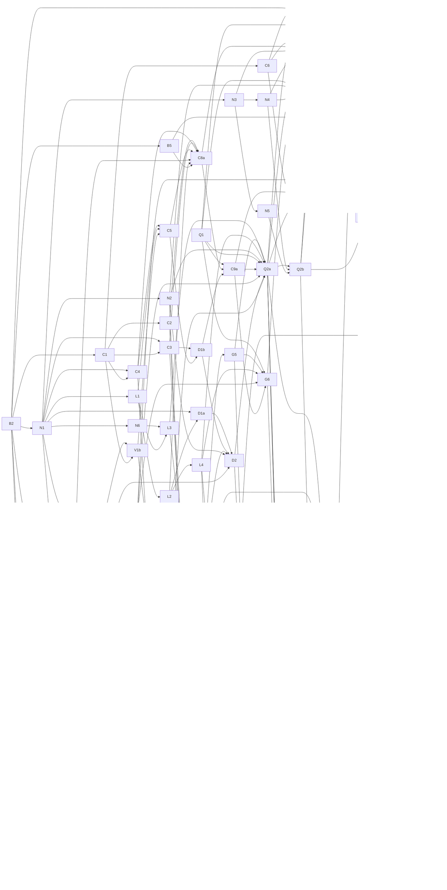

# ADR-066: DeepSeek-V4.1-Flash-1017 — conversion, loading, inference and agentic serving

- **Status:** Proposed
- **Date:** 2026-11-02
- **Deciders:** Robert E. Lee (product owner)
- **Tags:** deepseek, deepseek41, gguf, split-gguf, mxfp4, iq-quants, engram, dspark, vision, m5-ultra, agentic-serving
- **Depends on:** ADR-042, ADR-063, ADR-065
- **Amends (when the named story lands):** ADR-004 and README conversion compatibility (C4), ADR-062 D5 effort table (E3), ADR-042 variant relationship (Q6), `docs/shipping-contract.md` production and r2c matrices (Q5)
- **Related:** ADR-033, ADR-035, ADR-050, ADR-052, ADR-053, ADR-056, ADR-059, ADR-061
- Stable source ID: ADR-066
- Audited baseline: hf2q `188c277e` (origin/main, 2026-11-01) with mlx-native `=0.15.15` (`9c67e1f`). Cited hf2q lines refer to that commit.
- Model sources studied: `deepseek-ai/DeepSeek-V4.1-Flash-1017` at `1bae0e1088993b9b82de08f59de5be5a34e42170` (official FP8/FP4 checkpoint, reference `inference/` and `encoding/`); `unsloth/DeepSeek-V4.1-Flash-1017-GGUF` at `8a6ec9cf118e785a362ea94ee123c61c70553be6`.
- Reference implementations studied read-only: upstream llama.cpp `3c809f443` (DeepSeek-V4.1 merged in #31086 `74bca3950`, review fixes #31137); the unsloth llama.cpp fork (PR #298) for its GGUF type table; antirez ds4 `c97964b` (C/Metal, V4.1 text, vision, Engram, DSpark, SSD streaming); `deepseek-ai/deepseek-recipe` `935817c` (official Rust prompt toolkit).

## Context

### The model

DeepSeek-V4.1-Flash-1017 is a 748B-parameter model with 16B active parameters (`general.size_label = 748B-A16B` in the unsloth GGUF): a 552B MoE backbone and a 196.6B-parameter Engram n-gram table. Text configuration (`config.json` `text_config`):

| Area | V4.1-Flash-1017 | hf2q DeepSeek-V4-Flash-0731 (ADR-042) |
|---|---|---|
| Layers | 40 + 3 DSpark (`mtp.*`) stages | 43 + 3 DSpark stages (excluded) |
| Hidden / heads / KV heads / head dim | 5120 / 64 / 1 / 512 | 4096 / 64 / 1 / 512 |
| Routed experts | 384, top-6, intermediate 2304, no hash-routed layers | 256, top-6, intermediate 2048, first 3 layers hash-routed |
| Compression | `compress_ratios` ∈ {0, 2, 1}; compressed KV computed only on `kv_source_layer_ids` [2, 8, 14, 20] and shared by later layers | ∈ {0, 4, 128}; every compressed layer owns its KV |
| Indexer | 32 heads × 128; top-k 512 computed on `index_source_layer_ids` [2, 8, 14, 20, 24, 28, 32, 36] and shared; two-level candidate selection from layer 20 (2048 blocks × 8) | 64 heads × 128; per-layer indexer with its own compressor and Hadamard rotation |
| Hyper-connections | 4 lanes, Sinkhorn 20, pre-mix carried from the previous sublayer; no output HC head | Same constants, same-sublayer pre-mix, `output_hc_*` head |
| Engram | n-gram hash lookups (2- to 4-grams, 8 heads) injected before layers 1 and 14; table 768,022,850 rows × 256 | none |
| DSpark drafter | 3 block stages, block 5, 128 experts top-3, Markov rank 256 | 3 stages (excluded from the artifact) |
| Context | YaRN ×16 to 1,048,576 | 1,048,576 declared; launcher cap 262,144 |
| Vision | 32-layer ViT (dim 1024, patch 14) + aligner; image token 129264 | none |

The source checkpoint is 510.3 GB in 48 safetensors shards: FP8 E4M3 dense weights with 32×32 UE8M0 scales, routed experts packed FP4 E2M1 with one E8M0 scale per 32 values, and Engram tables in E4M3 with one E8M0 scale per 32 values per row. The model card ships no Jinja template; prompt format is defined by `encoding/encoding.py` (55 passing reference tests and 5 goldens) and the official Rust `deepseek-recipe`.

### The third-party GGUFs

Unsloth publishes split GGUF sets (shard 1 holds metadata only, 0 tensors; `split.count` 5–9) with `general.architecture = deepseek41` and `general.file_type = 7` on every quant. Range-read tensor headers (1,043 tensors per quant) give:

| Unsloth quant | Body GB (non-Engram) | Engram table | Routed-expert types | Admissible under this ADR |
|---|---:|---|---|---|
| UD-IQ1_S | 122.4 | IQ4_NL 110.6 | IQ1_S, IQ2_XXS | No (IQ1 quant) |
| UD-IQ1_M | 139.8 | IQ4_NL 110.6 | IQ1_M and others | No (IQ1 quant) |
| UD-IQ2_XXS | 165.3 | Q5_K 135.2 | IQ2_S, IQ2_XXS, IQ3_XXS, IQ1_S, IQ2_XS, Q2_K | Yes |
| UD-Q2_K_XL | 199.6 | Q5_K 135.2 | IQ3_XXS, IQ2_XXS, IQ2_S, IQ3_S, MXFP4, IQ2_XS | Yes |
| UD-IQ3_XXS | 233.5 | Q6_K 161.3 | MXFP4, Q3_K, IQ3_XXS, IQ2_S, IQ3_S, IQ2_XXS, IQ2_XS | Yes |
| UD-IQ3_S | 262.3 | Q6_K 161.3 | MXFP4, Q3_K, IQ3_XXS, IQ2_S, IQ3_S | Yes |
| UD-Q3_K_XL | 282.3 | type 43 202.8 | MXFP4, IQ3_S, Q3_K, IQ2_S, IQ3_XXS | Yes |
| UD-Q4_K_XL | 297.9 | type 43 202.8 | MXFP4 | Yes |
| UD-Q8_K_XL | 305.6 | type 43 202.8 | MXFP4 | Yes |

Non-expert tensors are Q8_0, Q6_K, Q5_K, BF16 or F32 in every quant. The Engram table is always one tensor alone in one shard, but not always the last shard (shard 8 of 9 for Q4/Q8). The DSpark drafter ships as a separate `general.architecture = dflash` GGUF (78 tensors, 7.98 GB Q8_0 or 8.51 GB BF16) and vision as `mmproj-BF16/F16.gguf` (0.97 GB). Unsloth's documented Engram-table swap re-stamps two header values in place (`engram/set_split.py`).

**GGML type 43 means two different layouts.** Upstream ggml defines `GGML_TYPE_F8_E4M3 = 43` with block size 1 and no scale (added 2026-10-29). The unsloth fork defines `GGML_TYPE_MXFP8 = 43` as `{u8 e8m0; u8 e4m3[32]}`, 33 bytes per 32 values. The published 202,758,032,592-byte table shard equals 768,022,850 × 264 + 192 header bytes, which only the fork layout fits. Upstream llama.cpp reads that tensor as 1 byte per value, which passes its bounds check and decodes garbage; mlx-native's byte-length check (`src/gguf/mod.rs:423-453`) would likewise not notice. ds4 uses a third, private row layout. Upstream's converter writes the Engram table as BF16 (393.2 GB).

### Where hf2q stands

hf2q serves DeepSeek-V4-Flash-0731 in production (ADR-042) and cannot load either V4.1 artifact family. In load order:

1. **Split sets.** Every loader opens one file (mlx-native `GgufFile`, `src/gguf/mod.rs:168-174`); the Hub resolver rejects `-NNNNN-of-NNNNN` names (`src/input/hf_download.rs:2643-2655`).
2. **Types.** The mlx-native header parser aborts on any type outside F32/F16/Q4_0/Q5_0/Q5_1/Q8_0/Q2_K–Q6_K/I16/IQ4_NL/IQ4_XS/I32/BF16 (`src/gguf/mod.rs:394-414`). MXFP4, IQ1_S, IQ2_XXS/XS/S, IQ3_XXS/S and type 43 have no parse, dequant or kernel. IQ4_XS kernels exist but no kernel source is registered, so they resolve only through the precompiled metallib.
3. **Architecture and identity.** `deepseek41` is rejected by `src/serve/info.rs:123-129`, the engine arch dispatch (`src/serve/api/engine.rs:3311-3330`), `src/inference/gguf_contract.rs:16-35` and `deepseek4/config.rs:138-140`. The model registry's `"deepseek-v4"` substring (`src/serve/api/registry.rs:464`) would match V4.1 model ids and select the 0731 tool-call tag set. Artifact identity uses a 6-value `QuantType` derived from `general.file_type` (`src/serve/quant_select.rs:47-76,152-185`), so every unsloth UD quant collides on one key and hf2q's MXFP4 or IQ profiles have none; `:UD-Q4_K_XL` selectors resolve to no quant (`src/model_spec.rs:91-93`).
4. **Tensor catalog and shapes.** The 0731 catalog is exact (`deepseek4/weights.rs:227-266`). MoE is fixed at 4096/256/6/2048 with hash layers required (`ffn_forward.rs:138-147`); mlx-native DeepSeek shaders bake 256 experts, top-6, intermediate 2048, hidden 4096, 64 indexer heads and compression ratios 4/128 into threadgroup arrays and loop bounds, and the MoE map kernel has no top-3 instantiation. The unsloth GGUF stores 43 `compress_ratios` entries against `block_count = 40` (`config.rs:271` requires equality).
5. **Residency.** Every mapped tensor becomes a no-copy Metal buffer in the device residency set; a single tensor larger than `maxBufferLength` is a hard error (`src/gguf/mod.rs:1904-1935`). The Engram table is one tensor of 135–203 GB. On the M5 Max `maxBufferLength` is 80.64 GiB and the recommended working set 107.52 GiB (`docs/research/ADR-030-phase1-m5max-results.json`).
6. **Graph and cache.** The V4 graph has 6 production layer loops plus a separate joint-decode attention encoder (`joint_decode.rs:276-532`), about 50 `ratio == 4/128` predicates that mean "owns an indexer", a per-layer cache and a prefill scratch pool recycled between layers. hf2q's DeepSeek state is F32 (`ffn_forward.rs:148`); the reference runs BF16 activations. Keeping V4's per-layer cache layout for V4.1 would cost about 36 GiB of KV per 1M-token slot; source-only sharing costs about 3.1 GiB (3,200 B/token, matching llama.cpp's row width). No synthetic attention-plus-FFN forward test exists even for 0731, and no frozen output golden protects 0731.
7. **Conversion.** The converter recognizes only `model_type == "deepseek_v4"` (`src/convert/source_reader.rs:437`), decodes MXFP4 experts to F32 (`:795-830`), round-trips every tensor through F16 before quantizing (`orchestrator.rs:224-230`), materializes direct tensors whole, has no MXFP4/IQ2/IQ3 codecs (placeholders in `src/quantize/ggml_quants/ggml_type.rs`), averages imatrix data across experts (`orchestrator.rs:1020-1037`) and writes one file. The pinned peer (`data/llama_cpp_pin.txt`, `e15384a5`) predates `deepseek41`, so no V4.1 output could meet README's "loads in the stock peer engine" today.
8. **Serving.** The native encoder implements the 0731 format. V4.1 changes 22 encoding details, including spaced DSML tags (`<｜DSML｜ calls>`), a `<｜System｜>` token (id 128799), numeric reasoning effort 1–100 rendered after BOS, `developer` role removal, `\n\n` content-part joins, tool placement on the leading system message, and argument normalization. The unsloth GGUF's tokenizer pre-type `joyai-llm` is refused by `deepseek4/tokenizer.rs:40`. Its embedded Jinja reproduces the reference only when tool-call arguments arrive pre-parsed. Reasoning controls route only `"deepseek4"` to the DeepSeek channel (`reasoning_controls.rs:314-322`).
9. **DSpark and vision.** DeepSeek conversion drops `mtp.*`; the weight catalog rejects draft tensors; no DeepSeek vision projector exists (`src/inference/vision/mmproj.rs` supports Mlp, Gemma4v, Qwen3VlMerger and Resampler).

### Hardware

The current host is an M5 Max with 128 GiB and 186 GB of free disk. No admissible quant fits it: the smallest admissible body is 165.3 GB. The target host is a Mac Studio M5 Ultra with 512 GB, expected December 2026; its Metal limits and SSD are unmeasured. On it, every admissible body fits with the Engram table on SSD; UD-Q4_K_XL body plus table (≈466 GiB) would exceed a working set scaled from the M5 Max ratio (≈430 GiB), so the table stays off-GPU in every mode. Storage for the full program is about 3.7 TB (source 510 GB, the hf2q profiles 1,691 GB, the three largest admissible unsloth quants 1,494 GB), about 4.4 TB with interim IQ artifacts, plus staging for the seven admissible unsloth quants (2,948 GB).

## Decision

### Product decisions (owner, 2026-11-02)

| # | Decision |
|---|---|
| P-1 | hf2q supports DeepSeek-V4.1-Flash-1017 on the 512 GB M5 Ultra through **both** paths: `hf2q serve` loads the unsloth split GGUFs, and `hf2q convert` produces hf2q-owned V4.1 GGUFs from the official checkpoint. |
| P-2 | Weight types in scope: MXFP4, IQ2_XXS, IQ2_XS, IQ2_S, IQ3_XXS, IQ3_S and IQ1_S kernels, plus the existing Q2_K–Q8_0 family. IQ1_S kernels exist only to admit UD-IQ2_XXS; the IQ1 quants UD-IQ1_S and UD-IQ1_M are out of scope. |
| P-3 | `hf2q convert` writes the Engram table as Q8_0 (MXFP4 profile), Q6_K (IQ3 profiles) or Q5_K (IQ2 profiles), **and** offers a lossless MXFP8 encoding in the fork's type-43 layout as an explicit option. |
| P-4 | The release imatrix for hf2q IQ profiles is hf2q-generated. The unsloth imatrix MAY be used as an explicit, receipt-bound operator input for interim IQ artifacts. |
| P-5 | V4.1 numerics match the DeepSeek reference exactly, including its activation fake-quantization. The Numerical contract below defines how "exactly" is proven. |
| P-6 | The release includes text, the DSpark drafter and vision. Work is ordered text first; DSpark and vision depend on the text forward pass. |
| P-7 | Four-agent joint decode is required at release, matching V4's production default. |
| P-8 | 1M-token context per slot at release. |
| P-9 | Execution starts when the M5 Ultra arrives (December 2026). Until then this ADR is the documented plan; no story starts before the hardware is available. |
| P-10 | The agentic serving gate uses omp, not OpenCode. |

### Defaults adopted in this ADR

Items marked **(owner review)** are listed again under Open questions.

- **Structure.** V4.1 is a `Deepseek4Variant::{V4Flash0731, V41Flash1017}` inside `src/inference/models/deepseek4/`, resolved only from the exact `general.architecture` string; every divergent behaviour is an exhaustive `match`, and unknown strings still fail. A per-layer `LayerPlan` resolved once at load replaces the `ratio == 4/128` predicates. V4.1-only logic lives in new focused files. One binary serves both variants. Rationale: reuses the ADR-063 scheduler, joint-decode, cooperative-prefill, anchor and supervisor machinery (about 6,300 serve LOC and 673 `engine.rs` references typed on DeepSeek), follows the `Qwen35Variant` precedent and what both peers converged on (ds4 variant enum; llama.cpp subclass), and keeps AGENTS.md's explicit-family rule.
- **Experimental gating until qualification.** `deepseek41` serve admission and `deepseek_v41` conversion require `HF2Q_UNSAFE_EXPERIMENTS=1` (shipping-contract Category 3) until E7b, which lifts both gates only for artifacts and profiles that Q2a, Q2b or Q2c qualified, and only after the M5 Ultra release gate exists (Q5). No release cut from main before E7b advertises V4.1 support.
- **MXFP4 first.** The first milestone (Q2a) proves the MXFP4 artifacts end to end on real weights: UD-Q4_K_XL, UD-Q8_K_XL and the hf2q MXFP4 profiles, with drafters and projectors. They need only one new expert kernel type and no imatrix. IQ kernels, IQ quantizers, the native imatrix, the remaining unsloth quants and kernel tuning follow that milestone.
- **Engram placement.** The table is never mapped as a Metal buffer, never joins the residency set and contributes zero resident bytes beyond a fixed staging buffer. Rows are read on the CPU with parallel `pread` on a dedicated descriptor, sorted and deduplicated per batch, decoded on the CPU into a BF16 staging buffer, and prefetched during prefill. `F_NOCACHE` is on provisionally; L3 measures it against buffered reads and keeps the faster one. No row cache in the first release, and no resident-table mode.
- **Type 43.** mlx-native classifies a type-43 tensor by its byte extent, defined as the distance to the next tensor's offset or to end of file, less at most one alignment unit of padding: 264 bytes per 256-wide row is fork MXFP8, 256 bytes is upstream F8_E4M3. Exactly one layout MUST match; a tensor whose extent fits neither layout, or fits both (possible for tiny tensors within the padding tolerance), fails closed unless an explicit `deepseek41.engram.encoding` marker names the layout and the marker agrees with the extent. hf2q-written MXFP8 tables always carry `deepseek41.engram.encoding = "mxfp8_e4m3_e8m0_32"`. ds4's private row layout is not accepted.
- **Shard sets.** A set is opened from its `-00001-of-NNNNN` path following llama.cpp's validation rules (shard 0 first, `split.no` per shard, `split.count`, no duplicate tensors, `split.tensors.count` total), plus a check that no extra shard exists. The Engram shard is located by the tensor name `per_layer_token_embd.weight`. Hub-resolved sets MUST match the B2 lock's size and LFS SHA-256 per shard; a one-time SHA-256 per shard is recorded in the managed store and not repeated on every load. Local sets opened by path have no Hub identity: they load, and receipts label them `unverified-local`; this is how an unsloth Engram swap runs. Cache fingerprints include a content hash of the Engram shard, computed once per file identity, so a swapped table never reuses another table's cached state.
- **Artifact identity.** V4.1 artifacts are identified by an explicit selector (an unsloth label such as `UD-Q4_K_XL` or an hf2q profile name) plus the shard-set identity, not by `general.file_type`.
- **Conversion output.** Split sets: a metadata-only first shard, every non-Engram shard at most 50 GB, and the Engram tensor alone in its own shard. Metadata uses upstream llama.cpp keys plus `hash_layer_count = 0`; `tokenizer.ggml.pre = "joyai-llm"`; token 128799 marked control; a Jinja chat-template port is embedded for peer interop (validated against the reference goldens) and never executed by hf2q. The converter uses an F32 intermediate for `deepseek_v41`, never F16. Default outputs are the text set plus a paired `deepseek41v` projector; the `dflash` drafter is an explicit additional output.
- **Request mapping.** Reasoning effort accepts an integer 1–100, a decimal string "1".."100", or a name: `none`/`minimal` → thinking off, `low` 50, `medium` 75, `high` 75, `xhigh` 100, `max` 100 (names follow ADR-062 D5's tiers; numbers follow `encoding.py` and deepseek-recipe); absent with thinking on → 75; bool, float and out-of-range values → 400 with `param=reasoning_effort`. ADR-062 D5's `thinking_token_budget` ceilings apply as an independent cap: by name for named efforts, and for numeric efforts 1–50 → the `low` ceiling, 51–75 → the `high` ceiling, 76–100 → no ceiling. Thinking is on by default. `developer` maps to `system` (the reference raises). Tools attach only to a leading system message (an empty one is inserted otherwise). `tool_choice` `required`/named while thinking keeps hf2q's grammar-constrained path (deepseek-recipe returns 400). Family defaults when the request omits them: temperature 1.0 and top_p 1.0 (model card); `max_tokens` 8,192 without thinking, 65,536 with thinking, 131,072 at effort 100 (deepseek-recipe; the model card's "≥ 256K" recommendation is an operator setting, not a default). Tool namespaces are deferred.
- **Not ported to V4.1 at release (owner review):** the B=4 same-position decode cohort (`decode_cohort.rs`, used only when joint decode is disabled; V4.1 falls back to serial decode), KV grafts (ADR-059) and GLP steering/calibration (ADR-053/054). Graft and GLP flags are refused at startup when a `deepseek41` model is loaded. Grammar-constrained decoding and structured output (ADR-052, ADR-056, ADR-057) ARE ported (E8).

### Global acceptance and exclusions

The program MUST deliver, on the M5 Ultra: loading and serving of every admissible unsloth quant; `hf2q convert` producing the C8a and C8b profiles from the pinned official checkpoint; text, DSpark and vision inference under the Numerical contract; four-agent joint decode; 1M-token context per slot; and an omp multi-turn agentic gate with OpenAI unary/SSE compatibility, native tool semantics, tool-result continuation, structured output and prefix reuse.

The program MUST preserve every product boundary in AGENTS.md: Rust-owned conversion, quantization and inference; no Python, peer engine or vendor converter at runtime; hosted GGUF bytes never satisfy `convert`; downloads only through `hf-hub` or operator scripts. Python and peer engines appear only in developer parity harnesses. The program MUST NOT regress DeepSeek-V4-Flash-0731 serving (the 0731 invariance gate).

Out of scope: UD-IQ1_S, UD-IQ1_M and any IQ1 output from `hf2q convert`; ds4-format GGUFs; GPU-resident Engram tables; SSD expert streaming for 128 GiB hosts (successor watchlist); tool namespaces; executing a GGUF's embedded Jinja template; a hosted admission contract for `deepseek4` (0731); new drafter architectures beyond DeepSeek's DSpark.

### Numerical contract

- **Reference semantics.** DeepSeek's `inference/model.py`, `engram.py`, `vision.py` and `image_processor.py` at the pinned source revision define V4.1. hf2q MUST reproduce its activation fake-quantization: window KV FP8 E4M3 with E8M0 scale per 32 over all 512 dims including the RoPE tail (`model.py:708`); compressed KV FP4 E2M1 with an E4M3 scale per 16 (`:761`); indexer query and key MXFP4 per 32 without Hadamard rotation (`:546,553`); attention output FP8 per 32 before `wo_a` (`:787`); and FP8 per 32 activation quantization of every linear input whose checkpoint weight is FP8 or FP4 (`:181-205`), applied by tensor class regardless of GGUF storage type. The routed-expert down-projection input is the routing-weighted activation rounded to BF16 and then FP8-quantized (`:852-853`). Candidate selection pins the newest block to +inf and returns final indices in position order (`:580,584-611`).
- **BF16 rounding points.** The reference keeps activations in BF16; hf2q keeps DeepSeek state in F32. B3 MUST enumerate every BF16 rounding point in the reference forward. hf2q MUST reproduce each rounding point that feeds a quantization, a selection (routing, top-k, candidates) or a hash, and MAY keep F32 elsewhere; each remaining F32-for-BF16 deviation is listed in B3 with its measured effect on the synthetic oracle. KV is stored as BF16 holding fake-quantized values.
- **Ties.** Top-k, candidate and routing selections break exact ties toward the lower index in both hf2q and the B3 oracle (the reference's `torch.topk` tie order is unspecified).
- **0731 invariance gate.** After every change that touches shared DeepSeek code: (a) logits, transcripts and serialized anchor images on the B1 production-route corpus (serial decode, matrix prefill, cooperative prefill, 4-lane joint decode, mixed steps) and the B1 diagnostic per-layer dumps MUST be byte-identical between the candidate binary and the pre-change main binary, both run in the same reserved window on the same macOS and Metal build; (b) performance MUST pass a paired, interleaved comparison with the pre-change binary: the candidate's decode and prefill medians are not slower by more than the larger of 2% and the noise floor of a same-window A/A run (one-sided; speedups pass); (c) the frozen B1 golden is a drift detector and is re-captured with the pre-change binary whenever the OS or Metal build changes. A story that deliberately changes 0731 arithmetic MUST say so, and then the fallback criterion (identical greedy transcripts, logit max-abs ≤ 1e-3, top-5 agreement) applies only after independent review.
- **Synthetic oracle parity.** Quantization, selection and hash kernels fed the oracle's own inputs MUST produce bit-identical outputs. Floating-point ops MUST stay within a norm-wise relative error bound expressed in BF16 rounding units. End-to-end comparisons on the B3 models are teacher-forced: per-position KL divergence and top-1 agreement within bounds. All bounds are calibrated in B3 from oracle-versus-oracle perturbation (for example a different reduction order) and frozen in B6 before the first Metal comparison.
- **Route references.** Joint decode is bitwise equal to serial decode; cooperative prefill is bitwise equal to solo prefill with the same chunk plan; a mixed step is bitwise equal to its solo parts (as ADR-063 established for 0731). Matrix and chunked prefill are compared with a token-serial, teacher-forced oracle within the synthetic bounds. DSpark speculation keeps exact transactions given identical logits, and its output stays within the decision envelope frozen in B6 against the non-speculative route; it is never described as bitwise equal.
- **Real-model correctness.** On the M5 Ultra, Q2a runs a teacher-forced, layer-by-layer comparison of hf2q against `model.py` (B3 harness at real dimensions, one layer resident at a time, never co-resident with hf2q) for layers 0, 1, 2, 14, 20, 24 and 39, within the B6 bounds. The oracle's weights are the same artifact's weights decoded independently of hf2q, so the comparison measures implementation error, not quantization loss. Against UD-Q8_K_XL, whose weights are value-equivalent to the official checkpoint (MXFP4 experts and the MXFP8 Engram table byte-exact, FP8 dense weights exactly representable in BF16), this also proves official-checkpoint semantics. Quantization loss is judged only by the quality rule below.
- **Real-model quality.** hf2q running UD-Q8_K_XL (MXFP4 experts, BF16 dense) is the in-repo quality reference; no full-precision reference fits Apple hardware. Q2a–Q2c measure KL divergence and top-1 agreement of every admitted quant and profile against it on a fixed corpus. Unsloth's published figures (llama.cpp, F32 reference, no activation fake-quantization) are a sanity check, not a threshold. Pass thresholds are frozen in B6.

### Measurement and acceptance rules

Every hardware run MUST record source commit, binary SHA-256, artifact digests (every shard), mlx-native version, macOS and Metal build, and the Q1 host receipt. Performance claims follow AGENTS.md: identical artifacts, prompts, sampling, context and batch against matched peers, warm-up, medians of at least 5 runs, and a checked-in command. The owner is the integration owner: schedules heavy builds and model loads, owns release-gate infrastructure, and assigns agent workers per area with independent agent reviewers. On any host, only one large model runtime is resident at a time. Work on the shared M5 Max follows the ADR-063/ADR-065 host-reservation rules; 0731 gate runs load the 100 GB artifact and need a reserved window.

A story closes by type:

| Story type | Closes on |
|---|---|
| Native primitive | mlx-native contract and CPU-oracle parity tests through both precompiled and runtime metallib paths; a merged and published release; verified crates.io bytes; exact pin in hf2q from a clean registry build. |
| hf2q implementation | Focused tests; the 0731 invariance gate where shared DeepSeek code changed; the 0731 served gates (`test_deepseek4_agentic.sh`, `_structured_tools.sh`, `_cached_suffix.sh`, and E6 in 0731 mode once it exists) where shared serving code changed; synthetic parity where V4.1 behaviour changed; independent review. |
| Conversion | Byte-level tests against fixtures (unsloth metadata, ggml reference quantizers, synthetic checkpoints); receipt fields; bounded-RSS evidence. |
| Threshold or decision | A record applying stated rules to cited evidence, approved by the owner where this ADR says so, independently reviewed. |
| Hardware qualification | Receipts with identities, reproducible commands, independent verdict. |

## Repository ownership

mlx-native owns every Metal kernel, GGUF type, shard-set reader, residency filter, CPU decode helper, parity test and release. hf2q owns the variant, plan, graph, cache, Engram reader orchestration, conversion, quantizers, serving, launcher, gates, receipts and documentation. The integration owner owns release-gate infrastructure, Actions variables and the peer pin. A native change is evidence only after it is merged, released, verified on crates.io and pinned exactly in hf2q (AGENTS.md). Native releases are batched: (1) N1, N2, S1; (2) N3–N6, S2, S3, L1; (3) N8 and any G3 kernel change; (4) N7.

## B. Baselines, references, oracles and thresholds

### B1. Freeze the V4-0731 production-route golden

Outcome: A frozen 0731 golden covers every production route before any shared DeepSeek code changes.

Requirement: The program MUST capture a 0731 golden from current main, on production routes and on the diagnostic dump route, before G1 or G2 land.

Acceptance:

- Production routes: greedy transcripts and SHA-256 of final F32 logits for serial decode, one-shot and sequential matrix prefill, cooperative cold prefill (2 and 4 lanes), 4-lane joint decode at different positions, and a mixed step, over a fixed corpus (the agentic fixture plus prompts of 128, 2,048 and 9,000 tokens).
- Serialized anchor-image SHA-256 after prefill.
- Diagnostic route, recorded separately: per-layer state dump hashes (`HF2Q_DEEPSEEK_DUMP_LAYER_DIR`, which selects a non-production route and is refused by joint decode).
- Decode and prefill medians over 5 runs.
- Hashes, corpus, macOS/Metal build and small top-k logit excerpts are checked in; large dumps stay local; a checked-in command runs the 0731 invariance gate.

Repository ownership: hf2q.

Validation: A second capture on the same binary reproduces every hash; independent review.

Predecessors: B4.

Priority: High.

Delivery boundary: Golden, corpus and gate command merged to main.

### B2. Pin the V4.1 reference identities

Outcome: Every V4.1 oracle and source is pinned in one checked-in lock.

Requirement: The program MUST pin the source checkpoint, unsloth repository, prompt references and peer engines it compares against.

Acceptance:

- `docs/research/adr066-reference-lock.md` records: official checkpoint `1bae0e10…` with per-shard sizes; unsloth repository `8a6ec9cf…` with every shard's size and LFS SHA-256 for the admissible quants, the DSpark files, the mmproj files and `imatrix_unsloth.gguf_file`; `encoding.py` and its 5 golden fixtures; deepseek-recipe `935817c`; llama.cpp `74bca3950`/`3c809f443`; the unsloth fork commit used for type tables; ds4 `c97964b`.
- The lock records the type-43 layout evidence and the published Engram type per quant.
- A later revision change is a deliberate lock update with its own review.

Repository ownership: hf2q.

Validation: A script re-derives every recorded size and hash from the Hub API.

Predecessors: none.

Priority: High.

Delivery boundary: Lock merged to main.

### B3. Build the synthetic V4.1 oracle

Outcome: V4.1 correctness can be checked before real weights are loaded.

Requirement: The program MUST provide a developer-only parity harness that runs DeepSeek's reference model on CPU against small synthetic V4.1 checkpoints and real-dimension single layers.

Acceptance:

- The harness under `scripts/` runs the pinned `model.py`, `engram.py`, `vision.py` and `image_processor.py` on CPU with plain-torch stand-ins for the six tilelang kernels the model calls (`act_quant`, `fp4_act_quant`, `fp8_gemm`, `fp4_gemm`, `sparse_attn`, `hc_split_sinkhorn`), a lower-index-stable top-k, and shims for the Engram lookup and token map. Production code never invokes it.
- It provides a token-serial, teacher-forced mode (the reference itself supports only prefill from position 0 or single-token decode) and captures full per-position logits.
- Synthetic configs keep kernel-fixed dimensions (64 heads × 512, index dim 128, HC 4, window 128, top-k 512) and use exactly the S1 synthetic shapes: hidden 1024, 16 experts top-6, intermediate 512, 32 indexer heads; DSpark stages with 8 experts top-3. They have 8 layers with ratios {0,0,2,2,2,1,1,1}, a small vocabulary and Engram table, and candidate parameters small enough that level one prunes. Variants with DSpark stages and with a vision tower exist.
- Each fixture is an HF-format checkpoint (FP8/FP4 encoded as in the real source) plus oracle logits, per-layer states, hash ids, routing, top-k and candidate indices.
- The list of reference BF16 rounding points, and the calibrated bounds for the Numerical contract (from oracle-versus-oracle perturbation), are written down for B6.

Repository ownership: hf2q.

Validation: Two runs reproduce every output bit for bit; independent review of the stand-ins against `kernel.py`.

Predecessors: B2.

Priority: High.

Delivery boundary: Harness and fixtures merged to main.

### B4. Repair the 0731 release-gate identity

Outcome: The 0731 release gate runs against one canonical artifact.

Requirement: The integration owner MUST reconcile the 0731 artifact identity and the broken gate step.

Acceptance:

- One canonical artifact is named: today the host artifact is SHA-256 `50df7e3d…` (107,431,343,264 B) while `scripts/run_agentic_cache_release_gate.sh:508-511` pins `936a97e6…` (107,431,343,168 B).
- The Actions variables (`vars.DEEPSEEK4_MODEL_SHA256` and path), the prompt-contract fixture and the provenance comment in `forward_support.rs` agree with it.
- The gate's call to a missing test (`:812`) is fixed and the gate passes.

Repository ownership: hf2q; integration owner.

Validation: A passing gate run receipt.

Predecessors: none.

Priority: High.

Delivery boundary: Merged to main with the gate receipt.

### B5. Pin a deepseek41-capable peer

Outcome: The pinned peer can load V4.1 GGUFs.

Requirement: The integration owner MUST bump `data/llama_cpp_pin.txt` to a llama.cpp commit at or after `74bca3950` and MUST re-run ADR-033's byte-identity fixtures.

Acceptance:

- Every existing peer-compatibility fixture still passes, or each change is explained and accepted.

Repository ownership: hf2q; integration owner.

Validation: Fixture receipts; independent review.

Predecessors: B2.

Priority: Medium.

Delivery boundary: Merged to main.

### B6. Freeze V4.1 acceptance thresholds

Outcome: Every numeric pass criterion in this ADR is fixed before the evidence it judges exists.

Requirement: The program MUST record, with owner approval: the synthetic-oracle bounds (from B3); the real-model layer-parity bounds; the quality thresholds for Q2a–Q2c; time-to-first-semantic-token bounds for cold 8K, 128K and 1M prompts and for a cached suffix (proposed: a provisional ceiling of one hour for a cold 1M prompt, and much tighter bounds for cached turns); the prefix-reuse slack used by E5 and E6; performance targets against matched peers (proposed: at least 1.0× matched-peer throughput with no regression in time to first semantic token; any shortfall needs the owner's sign-off); and the DSpark decision envelope.

Acceptance:

- One checked-in threshold file referenced by E5, E6, G4–G6, D3, D4, Q2a–Q2c, Q3 and Q4.
- Hardware-dependent values MAY be revised once, at Q1 and before any V4.1 hardware run, with owner approval; any later change is an amendment.

Repository ownership: hf2q.

Validation: Threshold or decision closure.

Predecessors: B3.

Priority: High.

Delivery boundary: Merged to main.

## N. Native quantized types (mlx-native)

### N1. Register and parse every V4.1 storage type

Outcome: mlx-native can open every admissible unsloth shard and every hf2q V4.1 profile, and every kernel resolves without the precompiled metallib.

Requirement: mlx-native MUST parse GGML types 16, 17, 18, 19, 21, 22, 39 and 43 with correct block geometry and CPU dequantization, MUST classify type 43 by byte extent as defined under Defaults, and MUST register kernel sources for every kernel name.

Acceptance:

- `GgmlType` gains IQ2_XXS, IQ2_XS, IQ2_S, IQ3_XXS, IQ3_S, IQ1_S, MXFP4, MXFP8 and F8_E4M3 with frozen serde names; block sizes match ggml and, for MXFP8, the fork.
- A type-43 tensor whose extent matches neither layout, or matches both without an agreeing encoding marker, fails with a typed error.
- CPU dequantization for every new type matches ggml's `dequantize_row_*` bit for bit on random blocks.
- Every existing kernel name, including IQ4_XS, has a registered source; a test resolves every `GgmlType` kernel name with `MLX_PRECOMPILED_METALLIB=0`.
- Capability rows report "no kernel" until N2–N5 land.

Repository ownership: mlx-native.

Validation: Native primitive closure.

Predecessors: B2.

Priority: High.

Delivery boundary: Released and pinned in hf2q.

### N2. Provide MXFP4 routed-expert kernels

Outcome: MXFP4 experts run on Metal for the main model and the DSpark drafter.

Requirement: mlx-native MUST provide MXFP4 `mv_id`, `mm_id` and tensor-API `mm_id` kernels with CPU-oracle parity.

Acceptance:

- Parity at K = 5120/2304, N = 2304/5120, 384 experts top-6 and 128 experts top-3, for row counts from 1 to 4,096.
- The paired gate/up entry point works with MXFP4 over one shared expert map.
- Microbenchmarks at served shapes recorded.

Repository ownership: mlx-native.

Validation: Native primitive closure.

Predecessors: N1.

Priority: High.

Delivery boundary: Released and pinned in hf2q.

### N3. Provide IQ grid infrastructure, IQ3_XXS and IQ2_S expert kernels

Outcome: The two IQ types present in every admissible IQ/Q2/Q3 quant run on Metal.

Requirement: mlx-native MUST provide the IQ grid and sign tables in Rust and Metal and IQ3_XXS and IQ2_S `mv_id`, `mm_id` and tensor `mm_id` kernels with CPU-oracle parity.

Acceptance:

- Grids (`iq2xxs`, `iq2xs`, `iq2s`, `iq3xxs`, `iq3s`, `iq1s`, signs and masks) generated from one checked source and verified against ggml.
- Parity and microbenchmarks at V4.1 expert shapes.

Repository ownership: mlx-native.

Validation: Native primitive closure.

Predecessors: N1.

Priority: High.

Delivery boundary: Released and pinned in hf2q.

### N4. Provide IQ3_S, IQ2_XXS and IQ2_XS expert kernels

Outcome: Every IQ2/IQ3 expert type used by the admissible quants runs on Metal.

Requirement: mlx-native MUST provide `mv_id`, `mm_id` and tensor `mm_id` kernels for IQ3_S, IQ2_XXS and IQ2_XS with CPU-oracle parity.

Acceptance:

- Parity and microbenchmarks at V4.1 expert shapes for each type.
- Together with N2, admission of UD-Q2_K_XL, UD-IQ3_XXS, UD-IQ3_S and UD-Q3_K_XL needs no further weight kernel.

Repository ownership: mlx-native.

Validation: Native primitive closure.

Predecessors: N3.

Priority: High.

Delivery boundary: Released and pinned in hf2q.

### N5. Provide IQ1_S expert kernels

Outcome: UD-IQ2_XXS, whose 20 gate/up tensors in 10 layers are IQ1_S, runs on Metal.

Requirement: mlx-native MUST provide IQ1_S `mv_id`, `mm_id` and tensor `mm_id` kernels with CPU-oracle parity. This does not admit IQ1 quants.

Acceptance:

- Parity and microbenchmarks at V4.1 expert shapes.

Repository ownership: mlx-native.

Validation: Native primitive closure.

Predecessors: N3.

Priority: Medium.

Delivery boundary: Released and pinned in hf2q.

### N6. Provide Engram row decoding

Outcome: hf2q can decode any admissible Engram row on the CPU.

Requirement: mlx-native MUST expose a public CPU API that decodes arbitrary rows of a 256-wide table in MXFP8 (fork 43), F8_E4M3, Q8_0, Q6_K, Q5_K and BF16 to BF16, with 64-bit row offsets.

Acceptance:

- Bit-exact against ggml's dequantization and, for MXFP8, against DeepSeek's `e4m3 × 2^(e8m0-127)` lookup.
- Throughput measured for a 2,048-token batch (98,304 rows).

Repository ownership: mlx-native.

Validation: Native primitive closure.

Predecessors: N1.

Priority: High.

Delivery boundary: Released and pinned in hf2q.

### N7. Tune expert kernels on the M5 Ultra

Outcome: Expert and attention matvec kernels are tuned at served shapes on the target host.

Requirement: The program MUST evaluate fused decode kernels (gate/up pair with SwiGLU, down projection fused with the top-k sum), an exact MXFP4 half-precision lookup, small-M prefill tiles, `expert_mm_threshold` tuning and the Q8_0 attention matvec path, and MUST adopt a change only when it is bitwise equal to the route it replaces and a paired A/B on the M5 Ultra shows a decode or prefill gain larger than the A/A noise floor.

Acceptance:

- One decision record per evaluated change with its paired receipts.

Repository ownership: mlx-native kernels; hf2q measurements.

Validation: Native primitive closure plus measurement receipts.

Predecessors: N2, N4, Q1, Q2a.

Priority: Medium.

Delivery boundary: Released and pinned in hf2q.

### N8. Provide the vision encoder's native kernels

Outcome: Every operation of the DeepSeek V4.1 vision encoder has a Metal route.

Requirement: mlx-native MUST provide, or record as already present, kernels for the ViT and aligner operations named in V2 at their real shapes.

Acceptance:

- An inventory of each V2 operation against existing mlx-native vision kernels; CPU-oracle parity for every new kernel.

Repository ownership: mlx-native.

Validation: Native primitive closure.

Predecessors: V1a.

Priority: Medium.

Delivery boundary: Released and pinned in hf2q.

## S. Shape-generic DeepSeek kernels

### S1. Parameterize the existing DeepSeek kernels without changing 0731

Outcome: DeepSeek kernels accept V4.1, DSpark and synthetic shapes while the 0731 pipelines are unchanged.

Requirement: mlx-native MUST support the shape set {0731; V4.1 main: 5120 hidden, 384 experts top-6, intermediate 2304, 32 indexer heads; V4.1 DSpark: 128 experts top-3; synthetic main: 1024 hidden, 16 experts top-6, intermediate 512, 32 indexer heads; synthetic DSpark: 8 experts top-3} for MoE routing, the selection witness, the index sanitizer, SwiGLU, weighted reduce, the MoE map kernel (including top-3), indexer score heads, tiles and ratio, and the compressor (ratio 2 without overlap or APE). V4.1 behaviour MUST use new entry points or instantiations; the existing 0731 kernels MUST NOT gain switches.

Acceptance:

- The 0731 instantiations are generated from source that is byte-identical after preprocessing, and their compiled function hashes match the pre-change build on both the precompiled and runtime-compile paths.
- Existing `tests/deepseek_*` pass unchanged; new tests cover every other shape in the set against CPU oracles.

Repository ownership: mlx-native.

Validation: Native primitive closure.

Predecessors: none.

Priority: High.

Delivery boundary: Released and pinned in hf2q.

### S2. Provide V4.1 activation-quantization kernels

Outcome: Every reference fake-quantization point has a Metal kernel.

Requirement: mlx-native MUST provide, as new entry points, FP8 E4M3/E8M0 block-32 quantization over the V4.1 widths (window rows of 512, attention-output groups of 4,096, and linear inputs of 1,280, 2,304, 5,120, 6,144, 8,192 and 15,360), MXFP4 per-32 quantization without Hadamard, and FP4 E2M1 with an E4M3 scale per 16 for compressed KV, each matching `kernel.py` given BF16 inputs.

Acceptance:

- Bit-exact against the B3 stand-ins on identical inputs, including amax floors and rounding.
- The existing 0731 MXFP8 (block 64 over 448) and Hadamard-MXFP4 entry points are unchanged.

Repository ownership: mlx-native.

Validation: Native primitive closure.

Predecessors: S1, B3.

Priority: High.

Delivery boundary: Released and pinned in hf2q.

### S3. Provide candidate selection and Engram gate kernels

Outcome: The two V4.1-only graph operations have Metal kernels.

Requirement: mlx-native MUST provide (a) level-one candidate selection: per-block max over 8 positions, the newest block pinned to +inf, top-2,048 blocks with lower-index tie-break, and the level-two mask; and (b) the Engram gate: per-lane normalized dot product, signed-square-root sigmoid gate and the add into all 4 hyper-connection lanes (`model.py:328-365`).

Acceptance:

- Candidate indices bit-identical to the oracle on identical scores, including ties, at up to 1M positions (131,072 blocks).
- Gate output within the B6 bound.

Repository ownership: mlx-native.

Validation: Native primitive closure.

Predecessors: S1, B6.

Priority: High.

Delivery boundary: Released and pinned in hf2q.

### S4. Prove V4-0731 unchanged after parameterization and plan refactor

Outcome: The shared-code changes V4.1 needs are proven inert for 0731.

Requirement: The program MUST pass the 0731 invariance gate after the S1 pin bump and the G2 refactor.

Acceptance:

- Hosted checks: `cargo check --locked --all-targets --all-features`; `cargo test --locked --bin hf2q deepseek4` with CI skips; mlx-native `tests/deepseek_*`.
- Metal synthetic tests without skips, including the G2 0731 plan-table test; the 5 ignored real-artifact tests, one at a time.
- The 0731 served gates.
- The 0731 invariance gate against the pre-change main binary.

Repository ownership: hf2q.

Validation: Independent verdict on the receipts.

Predecessors: B1, B4, S1, G2.

Priority: High.

Delivery boundary: Receipts merged with the pin bump.

## L. Loading, identity and admission

### L1. Read shard sets and exclude tensors from residency

Outcome: mlx-native opens a split GGUF set as one logical file and can leave named tensors unmapped.

Requirement: mlx-native MUST merge a shard set behind the existing `GgufFile` API when opened from shard 1, MUST validate it with the rules under Defaults, MUST plan mappings per shard, and MUST let callers exclude tensors from mapping and residency.

Acceptance:

- Metadata comes from shard 0; each tensor records its shard; a shard with zero tensors is valid.
- Typed errors for a non-first entry shard, wrong `split.no`, missing or extra shards, duplicate tensor names and a tensor total different from `split.tensors.count`.
- An excluded tensor is never wrapped as a Metal buffer, never joins the residency set and is reported separately by the storage plan.

Repository ownership: mlx-native.

Validation: Native primitive closure, with fixtures built from the real unsloth shard-1 metadata and synthetic body shards.

Predecessors: N1.

Priority: High.

Delivery boundary: Released and pinned in hf2q.

### L2. Load local split sets in hf2q

Outcome: `hf2q info` and `hf2q serve --model <shard-00001>` handle split sets with the Engram table excluded from residency.

Requirement: hf2q MUST accept split sets wherever it accepts a local GGUF path, MUST exclude `per_layer_token_embd.weight` through L1, and MUST compute resident bytes from the storage plan.

Acceptance:

- `info` reports per-shard ranges and separates body bytes from Engram bytes.
- The model id strips `-NNNNN-of-NNNNN`.
- Every resident-byte site that uses file size (`src/serve/multi_model.rs:1438-1446,1592`, `src/serve/api/control.rs:748`, `src/serve/mod.rs:5248`, `src/serve/api/local_artifacts.rs:422-425`) uses the storage plan instead.
- Launcher preflight sums shards and excludes the Engram shard from resident bytes.

Repository ownership: hf2q.

Validation: hf2q implementation closure with synthetic split sets and the real unsloth shard-1 metadata.

Predecessors: L1.

Priority: High.

Delivery boundary: Merged to main.

### L3. Read Engram rows from SSD

Outcome: Engram contributions for any decode or prefill batch are produced from the table on disk, with bounded memory.

Requirement: hf2q MUST produce, for each batch, the BF16 Engram rows the reference would gather, reading the table from disk as described under Defaults and decoding through N6.

Acceptance:

- Hash ids equal `engram.py` exactly for synthetic and real metadata, including look-back stops at sequence start and at image (DEAD) positions.
- Gathered rows equal an independent decode of the same rows.
- Staging memory has a fixed bound that admission (L4) reads; the table adds no resident bytes.
- Measured with a synthetic 100 GB-class table: decode-step latency and 2,048-token prefill throughput, with `F_NOCACHE` and with buffered reads; prefill reads overlap layer execution.
- Cancellation of an in-flight prefill leaves no reader running.

Repository ownership: hf2q.

Validation: hf2q implementation closure.

Predecessors: N6, L1.

Priority: High.

Delivery boundary: Merged to main.

### L4. Refuse loads that do not fit

Outcome: A V4.1 load that cannot fit is refused before tensor mapping, with every term named.

Requirement: hf2q MUST refuse a load when resident body bytes + expanded norms + planned KV for the configured slots and context + prefill scratch high-water + Engram staging + reserve exceeds either `recommendedMaxWorkingSetSize − currentAllocatedSize` or `hw.memsize` minus an OS reserve.

Acceptance:

- One shared check serves `info` (as a report), serve load and hot-swap.
- The V4.1 KV estimate uses the shared-source layout, not the 0731 constant (`src/serve/info.rs:243-253`).
- The scratch high-water term is measured for 0731; for V4.1 it is a stated provisional bound from the synthetic model and the cache plan, replaced by the G6 measurement on the M5 Ultra.
- hf2q never sets `iogpu.wired_limit_mb`; the report states when the configured working set is the binding term.

Repository ownership: hf2q.

Validation: hf2q implementation closure; the 0731 artifact is still admitted.

Predecessors: L2.

Priority: High.

Delivery boundary: Merged to main.

### L5. Identify and resolve shard-set artifacts

Outcome: Unsloth labels and hf2q profile names select V4.1 artifacts, locally and from the Hub.

Requirement: hf2q MUST identify V4.1 artifacts by selector plus shard-set identity in the Hub resolver, managed store, pool keys, kv-persist keys and cache CLI, and MUST verify Hub-resolved sets against the B2 lock.

Acceptance:

- `hf2q serve unsloth/DeepSeek-V4.1-Flash-1017-GGUF:UD-Q4_K_XL` resolves to the exact shard list; two UD quants with the same `general.file_type` never share a key.
- Hub artifacts carry ordered (filename, bytes, LFS SHA-256) lists; set identity is the SHA-256 over that list.
- Local sets carry `unverified-local` identity in receipts.

Repository ownership: hf2q.

Validation: hf2q implementation closure with recorded Hub fixtures.

Predecessors: L2, B2.

Priority: Medium.

Delivery boundary: Merged to main.

### L6. Admit `deepseek41` as a hosted architecture

Outcome: Hosted V4.1 artifacts pass a bounded admission contract before download completes.

Requirement: hf2q MUST add a `deepseek41` hosted admission contract over the merged shard view.

Acceptance:

- The contract checks split keys, every V4.1 metadata key and consistency rule, the exact tensor catalog, per-tensor executable capability, the Engram type and size against the B2 lock, and resource admission (L4).
- `deepseek4` remains without a hosted contract.

Repository ownership: hf2q.

Validation: hf2q implementation closure.

Predecessors: L4, L5, E7a.

Priority: Medium.

Delivery boundary: Merged to main.

## G. V4.1 graph and cache

### G1. Add the V4.1 variant, configuration and tensor catalog

Outcome: hf2q parses and validates a `deepseek41` GGUF into a V4.1 model description.

Requirement: hf2q MUST add `Deepseek4Variant::V41Flash1017`, selected only by `general.architecture = "deepseek41"`, with its own key prefix, validation and exact tensor catalog.

Acceptance:

- V4.1 validation requires `hash_layer_count == 0`, ratios ∈ {0, 1, 2}, `compress_ratios` of length `block_count` plus trailing DSpark zeros, consistent KV/index/candidate sources, Engram layout and token map.
- The catalog has no hash tables, APE, per-layer indexer compressor or `output_hc_*`, and adds `indexer.attn_k`, `indexer.k_norm`, `engram_kv`, `engram_gate`, `exp_probs_b_vl` and `per_layer_token_embd`; compressor and indexer tensors exist only on source layers; Q8_0 and BF16 compressor/indexer weights are both accepted.
- The tokenizer accepts pre-type `joyai-llm` and asserts 128799 and 129264 are atoms.
- 0731 parsing is unchanged.

Repository ownership: hf2q.

Validation: hf2q implementation closure with the real unsloth metadata and synthetic catalogs.

Predecessors: N1, B1.

Priority: High.

Delivery boundary: Merged to main.

### G2. Replace ratio predicates with a resolved layer plan

Outcome: Every per-layer DeepSeek decision comes from one plan.

Requirement: hf2q MUST resolve a `LayerPlan` per layer at load (attention kind, compressor kind, KV owner, index role, candidate role, Q-norm, HC pre-mix source, quantization points, Engram slot) and MUST replace every `ratio == 4/128` and `0|4|128` predicate with plan queries.

Acceptance:

- A test asserts the full 0731 plan table.
- No `_ =>` arm hides V4.1 behind V4 semantics.
- Hosted and synthetic DeepSeek tests pass. (The 0731 invariance proof is S4.)

Repository ownership: hf2q.

Validation: hf2q implementation closure.

Predecessors: G1, B1.

Priority: High.

Delivery boundary: Merged to main.

### G3. Build the shared-KV cache

Outcome: V4.1 cache state costs about 3.1 GiB per 1M-token slot and supports growth, snapshots and anchors.

Requirement: hf2q MUST allocate a 128-row window per layer and compressed and index-key rows only per KV source, MUST carry ratio-2 compressor state for sources 2, 8 and 14, and MUST hold cross-layer data (top-k indices, candidate masks, the lagged pre-mix, shared rows) in a per-forward arena outside the per-layer scratch pool.

Acceptance:

- The layout is chosen in this story between group slabs (no kernel change) and two-buffer attention kernels (a native change released per the batching plan), with measurements, and recorded by amendment.
- Growth, migration, prefix plan checks and serialization work for both variants.
- V4.1 anchors use a new image version (new magic, per-source sections, a fingerprint covering variant, KV/index/candidate topology, compression schedule, Engram layout, Engram artifact identity and a model content digest); 0731 anchor images stay byte-identical.
- A new hostile-fill proof covers the per-forward arena.
- Per-slot bytes at 1M tokens are reported by the plan.

Repository ownership: hf2q; mlx-native if two-buffer kernels are chosen.

Validation: hf2q implementation closure.

Predecessors: S4.

Priority: High.

Delivery boundary: Merged to main.

### G4. Run the single-slot V4.1 forward pass

Outcome: Serial decode, matrix prefill and flash prefill produce reference-correct V4.1 logits.

Requirement: hf2q MUST implement the V4.1 forward pass: Engram injection before layers 1 and 14 on the 4-lane stream; HC pre-mix carried across sublayers from an identity seed; no per-head Q norm; every Numerical-contract quantization and BF16 rounding point; ratio-2 gated and ratio-1 projection compressors on sources with `compress_rope_theta`; shared index keys and top-k; two-level candidates; 384-expert MoE without hash routing; and the head collapsed with the carried pre-mix (`forward_logits` takes the pre-mix).

Acceptance:

- Synthetic parity against B3 within B6 bounds for one-shot prefill, chunked prefill across chunk boundaries and serial decode, using fixtures converted by `hf2q convert`.
- Per-op parity at real V4.1 dimensions.

Repository ownership: hf2q.

Validation: hf2q implementation closure.

Predecessors: G3, S2, S3, L3, B3, B6, C2, C3, C4, N2.

Priority: High.

Delivery boundary: Merged to main (serving stays closed until E7a).

### G5. Extend cooperative prefill, joint decode and mixed steps to V4.1

Outcome: V4.1 runs the four-agent production paths.

Requirement: hf2q MUST implement V4.1 in the cooperative cold-prefill cohort, the joint decode attention encoder and mixed steps, with per-row top-k, candidates, pre-mix and Engram history.

Acceptance:

- Route references hold on the synthetic fixtures: joint decode bitwise equal to serial decode; cooperative prefill bitwise equal to solo prefill with the same chunk plan; mixed steps bitwise equal to their solo parts; the existing isolation tests ported to V4.1.
- The joint-route proof covers the V4.1 tensor types.
- Joint decode is the V4.1 default; serial decode is the fallback.
- ADR-065 F1's DeepSeek arena changes are merged first or rebased onto this story by agreement of the two owners.

Repository ownership: hf2q.

Validation: hf2q implementation closure.

Predecessors: G4.

Priority: High.

Delivery boundary: Merged to main.

### G6. Serve 1M-token context

Outcome: Four slots of 1M tokens are admitted, correct and within the B6 bounds on the M5 Ultra.

Requirement: hf2q MUST support 1,048,576 tokens per slot with four slots, including YaRN at full length, cache growth to 1M and indexer prefill tiled for long context.

Acceptance:

- L4 admits four 1M slots for UD-Q4_K_XL and `deepseek41-mxfp4`, using the V4.1 scratch high-water measured here.
- Long-context retrieval tests at 512K and 1M pass.
- Cold 1M time to first semantic token, cached-suffix time to first token and decode rate meet the B6 bounds.

Repository ownership: hf2q.

Validation: Hardware qualification closure.

Predecessors: G5, L4, Q1, B6, C9a.

Priority: High.

Delivery boundary: Merged to main with receipts.

## E. Encoding and serving

### E1. Implement the V4.1 prompt encoder and parser

Outcome: hf2q renders and parses V4.1 prompts byte-identically to the reference.

Requirement: hf2q MUST add a V4.1 native encoding beside the 0731 one, implementing the reference for every case it covers and deepseek-recipe for the request mapping it defines.

Acceptance:

- The 5 reference goldens and ports of all 55 `test_encoding.py` cases pass; the 0731 goldens are unchanged.
- Covered: spaced DSML tags and rejection of the unspaced form; `<｜System｜>`; numeric effort rendering; last-user rules including tool-result-only turns and mid-conversation system messages; `\n\n` part joins; tool placement; argument normalization including double-encoded JSON; tool-result ordering by `id` or `function.id`; strict trailing-content rejection; rejection of a literal `<｜deepseek_image｜>` in text.
- The GGUF's embedded Jinja is never executed for `deepseek41`.

Repository ownership: hf2q.

Validation: hf2q implementation closure.

Predecessors: B2.

Priority: High.

Delivery boundary: Merged to main.

### E2. Route V4.1 through its own registration and DSML plumbing

Outcome: No V4.1 request can reach 0731 tool syntax, and no 0731 behaviour changes.

Requirement: hf2q MUST add a `deepseek41` registration ordered before `deepseek4`, MUST make the 0731 registration fail closed on V4.1 ids, and MUST make every DeepSeek-keyed serving site variant-aware.

Acceptance:

- Sites include: registration tags and leak markers, the GBNF tool-call grammar, the raw-string close guard in `src/serve/api/grammar/dsml_lexical.rs` (today a static codepoint array), `registry_dsml_string.rs`, the multi-call combiner and family checks in `handlers.rs` (including `:1310` and `:1738`), `reasoning_channel_for`, the stream router, `info`, `info_catalog`, the engine arch dispatch, `hf2q generate` routing (`src/serve/mod.rs:924`), chat-template dispatch by encoding kind, operator settings and memory-ledger family categories.
- Tests for both variants on every site; streaming splitter tests with the spaced tags; the 0731 served gates pass.

Repository ownership: hf2q.

Validation: hf2q implementation closure.

Predecessors: E1, G1.

Priority: High.

Delivery boundary: Merged to main.

### E3. Map OpenAI requests to V4.1 controls

Outcome: Effort, thinking, roles, tools and sampling defaults follow the Defaults section.

Requirement: hf2q MUST implement the Defaults request mapping for `deepseek41` and MUST amend ADR-062 D5's family table accordingly.

Acceptance:

- `reasoning_effort` and `reasoning.effort` accept integer or string; errors are 400 with `param=reasoning_effort`.
- `thinking_token_budget`, `reasoning.max_tokens` and the tool-thinking budget behave per ADR-062 for V4.1.
- Family sampling defaults apply only when the request omits them.
- The 0731 served gates pass with unchanged 0731 behaviour.

Repository ownership: hf2q.

Validation: hf2q implementation closure.

Predecessors: E1, E2.

Priority: High.

Delivery boundary: Merged to main.

### E4. Tokenize plain text without injecting control tokens

Outcome: Literal control-token text in user or tool content tokenizes as plain text for `deepseek41`.

Requirement: hf2q MUST tokenize V4.1 prompts with explicit special-token spans emitted by the encoder, as deepseek-recipe does.

Acceptance:

- A tool result containing `<｜User｜>`, `<｜System｜>` and `｜DSML｜` text produces no control-token ids.
- Token counts for prompts without such text are unchanged; 0731 tokenization is unchanged.

Repository ownership: hf2q.

Validation: hf2q implementation closure.

Predecessors: E1.

Priority: High.

Delivery boundary: Merged to main.

### E5. Define V4.1 prefix-cache behaviour

Outcome: Agentic turns reuse their prefix; incompatible state is never reused.

Requirement: hf2q MUST restore Engram history from the token ledger (last 3 tokens), MUST treat an effort or thinking change as a full-prefix change, and MUST use the G3 fingerprint for live, recovery and disk anchors.

Acceptance:

- Append-only agentic sessions on the synthetic model reuse at least the previous prompt minus the B6 slack.
- Two artifacts differing only in Engram table type never share anchors.
- The recovery tail (`RECOVERY_TAIL_TOKENS`) is re-verified against V4.1 header token counts.
- 0731 cache behaviour and the 0731 served gates are unchanged.

Repository ownership: hf2q.

Validation: hf2q implementation closure.

Predecessors: G3, E1, B6.

Priority: High.

Delivery boundary: Merged to main.

### E6. Build the omp agentic gate

Outcome: A family-parametric omp gate exercises real multi-turn agent work and judges it on the raw wire.

Requirement: The program MUST provide `scripts/test_deepseek_omp.sh`, which runs pinned omp sessions against hf2q through a recording proxy and enforces the AGENTS.md agentic serving contract.

Acceptance:

- omp's version and configuration hash are pinned and recorded; omp runs isolated (own config directory, a provider entry for hf2q, extensions/skills/rules/context files disabled, restricted tool set).
- At least 6 resumed turns on a fixture crate with a scripted success check (tests pass and an expected diff); every tool call names the expected tool with schema-valid and semantically expected arguments.
- 4-client mode with per-agent sentinels proving no state leaks between conversations.
- Wire assertions: every call answered once; one `[DONE]` per stream; no `<｜DSML｜`, `<think>`, `</think>` or `<｜` in content; reasoning deltas while thinking; `finish_reason` consistency; effort constant per session; unary replay of captured bodies.
- Prefix reuse per turn from `cached_tokens` within the B6 slack; client-measured time to first semantic token from the proxy, against the existing 0731 cold and cached bounds in 0731 mode and the B6 bounds in V4.1 mode.
- Ported 0731 checks: mid-transaction cancellation and recovery, a cached suffix across three transactions, cold SSE progress and cold bounds.
- Rehearsed end to end on 0731.

Repository ownership: hf2q.

Validation: Independent review of a 0731 receipt.

Predecessors: B6; E7a for V4.1 mode.

Priority: High.

Delivery boundary: Script and 0731 receipt merged to main.

### E7a. Admit V4.1 serving behind the experimental gate

Outcome: `hf2q serve` loads `deepseek41` only with `HF2Q_UNSAFE_EXPERIMENTS=1`.

Requirement: hf2q MUST open serve admission for `deepseek41` behind shipping-contract Category 3, only after G4, with a canonical launcher that follows the `scripts/serve_*_opencode.sh` convention.

Acceptance:

- Without the acknowledgement, loading `deepseek41` fails with a typed error naming it.
- The launcher validates port, shard set, Engram shard, optional DSpark and mmproj files, memory admission (L4) and storage before loading.
- Graft and GLP flags are refused at startup for `deepseek41`; images without a projector fail with the existing 400.

Repository ownership: hf2q.

Validation: hf2q implementation closure.

Predecessors: G4, L4, L5, E2, E3, E4, E5.

Priority: High.

Delivery boundary: Merged to main.

### E7b. Lift the experimental gate for qualified artifacts

Outcome: Qualified V4.1 artifacts serve and convert without the experimental acknowledgement.

Requirement: hf2q MUST lift the serve gate for each unsloth quant or hf2q artifact, and the conversion gate for each hf2q profile, that Q2a, Q2b or Q2c qualified, and only for those, once Q5's release gate exists.

Acceptance:

- Unqualified quants and profiles still require the acknowledgement for serving and conversion.

Repository ownership: hf2q.

Validation: hf2q implementation closure.

Predecessors: E7a, Q2a, Q2b, Q2c, Q3, Q5.

Priority: High.

Delivery boundary: Merged to main.

### E8. Port structured output and grammar-constrained decoding

Outcome: `response_format` and grammar-constrained decoding work for V4.1 as they do for 0731.

Requirement: hf2q MUST support ADR-052 structured output and the ADR-056/057 grammar-constrained decoding conformance battery for `deepseek41`.

Acceptance:

- The conformance battery passes on the synthetic model with the V4.1 tool and thinking syntax.

Repository ownership: hf2q.

Validation: hf2q implementation closure.

Predecessors: E2, E3.

Priority: High.

Delivery boundary: Merged to main.

## C. Conversion

### C1. Recognize the V4.1 source

Outcome: `hf2q convert` maps the official checkpoint to the upstream `deepseek41` naming and metadata contract, behind the experimental gate.

Requirement: hf2q MUST add a `deepseek_v41` source arch that reads `text_config`, emits the upstream key set (43-entry `compress_ratios`, `hash_layer_count = 0`, KV/index/candidate sources, `ple.*`, `engram.*`), maps every tensor to its upstream name (folding `engram.q_weight · k_weight` into `engram_gate` in F32), uses an F32 intermediate, embeds a Jinja template port, and counts excluded namespaces in the receipt.

Acceptance:

- Metadata and the tensor directory of a converted synthetic checkpoint match upstream `conversion/deepseek41.py` output names, shapes and keys.
- The embedded template renders the 5 reference goldens byte-identically when tool arguments are pre-parsed.
- No value loses range in the intermediate (a test counts zero overflows and underflows on the synthetic and real-shape fixtures).
- V4-only names fail closed; `deepseek_v4` conversion is unchanged; without `HF2Q_UNSAFE_EXPERIMENTS=1` V4.1 conversion fails with a typed error.

Repository ownership: hf2q.

Validation: Conversion closure.

Predecessors: B2.

Priority: High.

Delivery boundary: Merged to main.

### C2. Compute Engram metadata in Rust

Outcome: hf2q derives every Engram metadata value without Python.

Requirement: hf2q MUST compute bucket primes and offsets, the per-layer hash multipliers (a port of numpy `SeedSequence` + PCG64 + bounded draw) and the compressed token map (the reference normalizer sequence through the `tokenizers` crate).

Acceptance:

- Output equals the unsloth shard-1 values exactly: 48 head vocab sizes and offsets, 8 multipliers, 129,280 token-map entries with 99,092 classes.

Repository ownership: hf2q.

Validation: Conversion closure.

Predecessors: C1.

Priority: High.

Delivery boundary: Merged to main.

### C3. Pass MXFP4 experts through without requantization

Outcome: Routed experts reach the GGUF as value-exact MXFP4 blocks.

Requirement: hf2q MUST add a raw-payload lane that repacks E2M1 nibbles and E8M0 scales into `block_mxfp4`, streamed per expert, with evidence over raw bytes.

Acceptance:

- Every repacked block decodes to the same values as the source; an E8M0 byte of 0xFF fails closed.
- Peak RSS stays within ADR-042's 20 GiB bound.

Repository ownership: hf2q.

Validation: Conversion closure.

Predecessors: C1, N1.

Priority: High.

Delivery boundary: Merged to main.

### C4. Stream and encode the Engram table

Outcome: The 196.6B-element table converts in bounded memory to every chosen encoding.

Requirement: hf2q MUST decode the source's per-row 1×32 E8M0 scales, stream row chunks of both layer tables into one `per_layer_token_embd.weight`, and encode it as Q8_0, Q6_K, Q5_K or MXFP8 (fork type-43 layout with the encoding marker).

Acceptance:

- MXFP8 output is byte-identical to the source codes and scales.
- K-quant outputs match ggml's quantizers bit for bit on sampled rows.
- ADR-004 and README's conversion sentence are amended: MXFP8-Engram artifacts load in hf2q and the unsloth fork but are misread by upstream llama.cpp, whose type 43 means F8_E4M3; receipt and metadata say so, and MXFP8 is never a default.

Repository ownership: hf2q.

Validation: Conversion closure.

Predecessors: C1, N1.

Priority: High.

Delivery boundary: Merged to main.

### C5. Write split GGUF sets and paired outputs atomically

Outcome: hf2q writes Hub-uploadable split sets plus the paired projector as one commit.

Requirement: hf2q MUST write split sets as defined under Defaults and MUST define a multi-file commit protocol covering the text set and the paired `deepseek41v` projector (ADR-004 automatic pairing, `hf2q.mmproj_sha256`), extensible to the `dflash` drafter (D1b).

Acceptance:

- L1's validation accepts the output.
- An interrupted conversion leaves no partially promoted set; a completed one is discoverable as one artifact.

Repository ownership: hf2q.

Validation: Conversion closure.

Predecessors: C4, L1, V1b.

Priority: High.

Delivery boundary: Merged to main.

### C6. Port the IQ quantizers and per-expert imatrix

Outcome: hf2q quantizes experts to IQ2_XXS, IQ2_XS, IQ2_S, IQ3_XXS and IQ3_S.

Requirement: hf2q MUST port ggml's quantizers for those five types, including grid neighbour maps, MUST mark IQ2_XXS and IQ2_XS as requiring an imatrix, and MUST slice imatrix data per expert instead of averaging across experts.

Acceptance:

- Byte parity with ggml's quantizers on fixed inputs and imatrix data.
- Per-expert slicing matches llama.cpp's use of each expert's own row.

Repository ownership: hf2q.

Validation: Conversion closure.

Predecessors: C1.

Priority: High.

Delivery boundary: Merged to main.

### C7a. Accept a third-party imatrix as explicit input

Outcome: Interim IQ artifacts can use the unsloth imatrix with full provenance.

Requirement: hf2q MUST accept the unsloth imatrix only through an explicit operator flag, verified against the B2 lock, and MUST record its SHA-256, origin URL and dataset in the receipt and GGUF metadata; it MUST never be selected automatically.

Acceptance:

- Tensor-name and shape compatibility with hf2q V4.1 names verified; mismatches fail closed.

Repository ownership: hf2q.

Validation: Conversion closure.

Predecessors: C6, B2.

Priority: Medium.

Delivery boundary: Merged to main.

### C7b. Collect a native V4.1 imatrix

Outcome: hf2q generates its own V4.1 imatrix.

Requirement: hf2q MUST add a DeepSeek V4.1 imatrix collector over the hf2q forward pass and a pinned calibration corpus.

Acceptance:

- Collected from `deepseek41-mxfp4` after Q2a qualified it; per-expert statistics; receipt with corpus identity.

Repository ownership: hf2q.

Validation: Hardware qualification closure.

Predecessors: C6, C9a, Q2a.

Priority: High.

Delivery boundary: Merged to main with receipts.

### C8a. Define the MXFP4 profiles

Outcome: The two MXFP4 conversion profiles exist and load in hf2q and, where the format allows, in the pinned peer.

Requirement: hf2q MUST define these profiles (non-expert tensors Q8_0, control tensors F32):

| Profile | Routed experts | Engram | Body GB | Total GB |
|---|---|---|---:|---:|
| `deepseek41-mxfp4` | MXFP4 passthrough | Q8_0 | 298.0 | 506.9 |
| `deepseek41-mxfp4-lossless` | MXFP4 passthrough | MXFP8 | 298.0 | 500.8 |

Acceptance:

- Each profile converts a synthetic checkpoint end to end, with its projector, and loads in hf2q.
- `deepseek41-mxfp4` loads and generates in the pinned peer (B5).
- Receipts record profile, passthrough byte counts and Engram encoding.

Repository ownership: hf2q.

Validation: Conversion closure.

Predecessors: C2, C3, C4, C5, G1, L2, B5.

Priority: High.

Delivery boundary: Merged to main.

### C8b. Define the IQ profiles

Outcome: The two IQ conversion profiles exist and load in hf2q and in the pinned peer.

Requirement: hf2q MUST define these profiles (non-expert tensors Q8_0, control tensors F32):

| Profile | Routed experts | Engram | Body GB | Total GB |
|---|---|---|---:|---:|
| `deepseek41-iq3` | gate/up IQ3_XXS, down IQ3_S | Q6_K | 225.8 | 387.1 |
| `deepseek41-iq2` | gate/up IQ2_XXS, down IQ2_S | Q5_K | 160.6 | 295.8 |

Acceptance:

- Each profile converts a synthetic checkpoint end to end, with its projector, and loads in hf2q and in the pinned peer.
- Receipts record profile, imatrix identity and origin, and Engram encoding.

Repository ownership: hf2q.

Validation: Conversion closure.

Predecessors: C6, C8a, N3, N4.

Priority: High.

Delivery boundary: Merged to main.

### C9a. Convert the MXFP4 profiles on the M5 Ultra

Outcome: Real hf2q MXFP4 artifacts, with their drafter and projectors, exist with conversion receipts.

Requirement: The program MUST convert the pinned checkpoint on the M5 Ultra to both MXFP4 profiles, each with its paired `deepseek41v` projector, and to a `dflash` drafter (D1b).

Acceptance:

- Peak RSS, duration and disk use recorded per artifact, including the drafter and projectors.

Repository ownership: hf2q.

Validation: Hardware qualification closure.

Predecessors: C8a, D1b, Q1.

Priority: High.

Delivery boundary: Receipts merged to main; artifacts stay local.

### C9b. Convert interim IQ profiles with the third-party imatrix

Outcome: Interim IQ artifacts exist for early comparison, if the owner wants them.

Requirement: The program MAY convert `deepseek41-iq2` and `deepseek41-iq3` with the C7a imatrix.

Acceptance:

- Interim artifacts are labelled interim in metadata and receipts and never published as release artifacts.

Repository ownership: hf2q.

Validation: Hardware qualification closure.

Predecessors: C8b, C7a, Q1.

Priority: Low.

Delivery boundary: Receipts merged to main; artifacts stay local.

### C10. Convert the release IQ profiles with the native imatrix

Outcome: Release IQ2 and IQ3 artifacts are calibrated by hf2q itself.

Requirement: The program MUST convert `deepseek41-iq2` and `deepseek41-iq3` with the C7b imatrix.

Acceptance:

- Same receipts as C9a.

Repository ownership: hf2q.

Validation: Hardware qualification closure.

Predecessors: C7b, C8b.

Priority: High.

Delivery boundary: Receipts merged to main; artifacts stay local.

## D. DSpark drafter

### D1a. Load the DSpark drafter

Outcome: hf2q loads the unsloth `dflash` GGUFs as a drafter for a matching V4.1 target.

Requirement: hf2q MUST load both unsloth drafter files with an exact catalog and metadata check, borrowing the target's embedding and head.

Acceptance:

- Both files validate; a drafter paired with a mismatched target is refused with a typed error.

Repository ownership: hf2q.

Validation: hf2q implementation closure.

Predecessors: N1, L2.

Priority: Medium.

Delivery boundary: Merged to main.

### D1b. Convert the DSpark drafter

Outcome: `hf2q convert` produces a `dflash` drafter from the official checkpoint.

Requirement: hf2q MUST convert `mtp.*` into a separate `dflash` GGUF (MXFP4 experts passed through, FP8 projections Q8_0 or BF16, Markov and confidence heads) following upstream naming, as an explicit additional output under the C5 commit protocol.

Acceptance:

- The converted synthetic drafter matches upstream names, shapes and keys and loads through D1a.

Repository ownership: hf2q.

Validation: Conversion closure.

Predecessors: C3, C5.

Priority: Medium.

Delivery boundary: Merged to main.

### D2. Run the DSpark forward pass

Outcome: DSpark stages produce reference-correct draft blocks.

Requirement: hf2q MUST implement the three DSpark stages: attention over a window of projected main hidden states plus the block, 128-expert top-3 MoE, the noise-token input, and the Markov and confidence heads. The main hidden state is the mean over the 4 hyper-connection lanes of the inputs to layers 37, 38 and 39, taken after Engram injection (`model.py:1268-1269`).

Acceptance:

- Synthetic parity against B3 DSpark fixtures within B6 bounds.

Repository ownership: hf2q.

Validation: hf2q implementation closure.

Predecessors: D1a, D1b, G4, N2, S1.

Priority: Medium.

Delivery boundary: Merged to main.

### D3. Speculate with DSpark on one slot

Outcome: Single-slot V4.1 decode uses DSpark with exact transactions and correct prefix reuse.

Requirement: hf2q MUST define a DSpark transaction contract (what is drafted, verified, committed and rolled back) and implement it on single-slot routes: verify draft blocks with the target, commit accepted tokens and roll back window, compressor, shared-KV, Engram history and DSpark windows on rejection, including inside tool-call and structured-output grammars. Serial decode and matrix prefill MUST capture the main hidden states that seed the DSpark window, and snapshots, anchors and the fingerprint MUST carry the DSpark window or a defined rebuild of it.

Acceptance:

- Transaction exactness given identical logits; greedy output within the B6 DSpark decision envelope against the non-speculative route; sampled requests consume no speculative randomness.
- After a prefix-cache hit, the drafter's acceptance rate matches a cold run on the same prompt within the B6 envelope.
- Block size clamped to 5.

Repository ownership: hf2q.

Validation: hf2q implementation closure.

Predecessors: D2, E2, E5, E8.

Priority: Medium.

Delivery boundary: Merged to main.

### D4. Speculate with DSpark in four-agent joint decode

Outcome: DSpark speeds up the four-agent workload, or is recorded as not doing so.

Requirement: The program MUST integrate DSpark verify into V4.1 joint decode under the D3 contract, coordinated with ADR-065's joint-verify work, and MUST make it default only on a win under ADR-065's paired-A/B verdict rules.

Acceptance:

- Cooperative prefill and mixed steps capture the DSpark seed states as the single-slot routes do.
- Cohort invariance per ADR-065's Class A definition applied to DSpark windows; four-agent A/B against joint decode without DSpark on the M5 Ultra; fairness ceilings from ADR-065 B1 respected.

Repository ownership: hf2q.

Validation: Hardware qualification closure.

Predecessors: D3, G5, Q2a.

Priority: Medium.

Delivery boundary: Merged to main with receipts.

## V. Vision

### V1a. Load the vision projector

Outcome: hf2q loads unsloth `mmproj-BF16/F16.gguf` for V4.1.

Requirement: hf2q MUST add a `deepseek41v` projector family to the projector loader with an exact catalog and metadata check.

Acceptance:

- Both unsloth projector files validate; a projector paired with a mismatched text model is refused.

Repository ownership: hf2q.

Validation: hf2q implementation closure.

Predecessors: N1.

Priority: Medium.

Delivery boundary: Merged to main.

### V1b. Convert the vision projector

Outcome: `hf2q convert` produces a `deepseek41v` projector from the official checkpoint.

Requirement: hf2q MUST convert `vision.*`, `aligner.*` and `image_*` into a projector GGUF following upstream naming.

Acceptance:

- The converted synthetic projector matches upstream names and shapes and loads through V1a.

Repository ownership: hf2q.

Validation: Conversion closure.

Predecessors: C1, V1a.

Priority: Medium.

Delivery boundary: Merged to main.

### V2. Run the vision encoder

Outcome: The ViT and aligner produce reference-correct image embeddings.

Requirement: hf2q MUST implement the 32-layer ViT (patch 14, dim 1024, RMSNorm, fused QKV, 2D RoPE, SwiGLU), the 3×3 aligner and the reference preprocessing contract: fit with bicubic resampling, centred padding with value 127, normalization and BF16 conversion as in `image_processor.py:118-127`, `max_image_tokens` 1024 and `min_pixels`.

Acceptance:

- Parity against `vision.py` from identical decoded RGB arrays within B6 bounds; preprocessing parity measured separately against Pillow output and reported.

Repository ownership: hf2q.

Validation: hf2q implementation closure.

Predecessors: V1a, V1b, N8, B3, B6.

Priority: Medium.

Delivery boundary: Merged to main.

### V3. Serve images

Outcome: OpenAI image inputs work for V4.1.

Requirement: hf2q MUST emit the image token layout (start, rows of image tokens with newline, end, all id 129264, distinguished by token type) with learned start/end/newline embeddings, apply `exp_probs_b_vl` routing on image tokens, mark image positions DEAD for Engram, encode placeholders per the reference, and key prefix caches on image content.

Acceptance:

- Synthetic parity for mixed text/image prompts; image-bearing prefixes never collide with text-only prefixes.
- The reference's single-chunk image prefill constraint (`model.py:1258`) is either preserved or lifted with its own parity proof.

Repository ownership: hf2q.

Validation: hf2q implementation closure.

Predecessors: V2, G4, E1, E5.

Priority: Medium.

Delivery boundary: Merged to main.

## Q. Qualification on the M5 Ultra

### Q1. Record the M5 Ultra host

Outcome: The target host's limits are measured before any V4.1 run.

Requirement: The program MUST record `maxBufferLength`, `recommendedMaxWorkingSetSize`, `iogpu.wired_limit_mb`, memory bandwidth, SSD sequential and random-read rates, free storage, and macOS and Metal versions.

Acceptance:

- A checked-in receipt in the ADR-030 format.
- At least 8 TB of usable internal SSD (the program needs about 3.7–4.4 TB plus staging), with active Engram tables on internal storage; external storage only for idle artifacts.

Repository ownership: hf2q.

Validation: Hardware qualification closure.

Predecessors: none (hardware arrival).

Priority: High.

Delivery boundary: Receipt merged to main.

### Q2a. Prove the MXFP4 artifacts end to end (bootstrap milestone)

Outcome: The first real V4.1 models run correctly on real weights: UD-Q4_K_XL, UD-Q8_K_XL, `deepseek41-mxfp4` and `deepseek41-mxfp4-lossless`, with their drafters and projectors.

Requirement: The program MUST run each through the G4/G5 routes and compare against references before any IQ work starts.

Acceptance:

- The real-model correctness and quality rules of the Numerical contract, with B6 thresholds.
- DSpark: teacher-forced stage-by-stage parity against `model.py` on real weights, separately for the unsloth drafter and the hf2q drafter from C9a, each against its own decoded weights.
- Vision: parity against `vision.py` on real weights from identical decoded RGB arrays, separately for the unsloth projector and the hf2q projector from C9a.
- Greedy transcripts and logits compared with the unsloth fork of llama.cpp on the same unsloth file, and with ds4 as unmatched behavioural context; every disagreement localized to a layer and explained.
- Engram reads verified against an independent decode of sampled rows.

Repository ownership: hf2q.

Validation: Hardware qualification closure.

Predecessors: G5, L3, L4, N2, Q1, C9a, B6, D2, V2.

Priority: High.

Delivery boundary: Receipts merged to main.

### Q2b. Prove the remaining unsloth quants

Outcome: Every other admissible unsloth quant (UD-IQ2_XXS, UD-Q2_K_XL, UD-IQ3_XXS, UD-IQ3_S, UD-Q3_K_XL) runs correctly on real weights.

Requirement: The program MUST apply Q2a's correctness and quality rules to each.

Acceptance:

- Q2a's acceptance items for each quant, compared with upstream llama.cpp (B5 pin) where it reads the file correctly and with the unsloth fork otherwise.

Repository ownership: hf2q.

Validation: Hardware qualification closure.

Predecessors: Q2a, N4, N5.

Priority: High.

Delivery boundary: Receipts merged to main.

### Q2c. Prove quality of the release IQ profiles

Outcome: The release IQ profiles meet the quality thresholds.

Requirement: The program MUST measure `deepseek41-iq2` and `deepseek41-iq3` under the Numerical contract and compare them with the unsloth quants of nearest body size and, where C9b produced them, with their interim counterparts.

Acceptance:

- B6 thresholds met. A profile worse than the unsloth quant of nearest size is revised and re-measured; dropping it needs an owner amendment.

Repository ownership: hf2q.

Validation: Hardware qualification closure.

Predecessors: C10, Q2b.

Priority: High.

Delivery boundary: Receipts merged to main.

### Q3. Pass the omp agentic gate on V4.1

Outcome: Real multi-turn agent work succeeds on V4.1.

Requirement: The program MUST pass E6 in V4.1 mode with 1 and 4 clients, with DSpark on and off, with a structured-output turn and with an image turn, in two arms: UD-Q4_K_XL resolved from the Hub with the unsloth drafter and mmproj, and `deepseek41-mxfp4` with the hf2q drafter and projector from C9a.

Acceptance:

- All E6 assertions and B6 bounds; cached-token counts, prefill and decode rates, time to first semantic token, exact prompts and settings, and the agent task outcome recorded.
- The same scripted task run once against the fork or upstream llama.cpp serving the same unsloth file is recorded as the matched reference result.

Repository ownership: hf2q.

Validation: Hardware qualification closure.

Predecessors: Q2a, E5, E6, E7a, E8, D4, V3, G6, L6.

Priority: High.

Delivery boundary: Receipts merged to main.

### Q4. Measure performance against matched peers

Outcome: V4.1 performance is known against matched peers on the same host.

Requirement: The program MUST measure prefill, decode and time to first token at 8K, 128K and 1M contexts, single and four-agent, under AGENTS.md's performance rules. The matched pairs are upstream llama.cpp (B5 pin) on a Q6_K-table quant such as UD-IQ3_S, and the unsloth fork on the MXFP8-table quants; ds4 on its own artifact is reported as unmatched context.

Acceptance:

- Medians of at least 5 warm runs per cell; peers and hf2q never co-resident; checked-in commands; each peer's support for 1M context and concurrent clients recorded; B6 performance targets met or the shortfall referred to the owner.

Repository ownership: hf2q.

Validation: Hardware qualification closure.

Predecessors: Q2a, Q2b, N7, G6, B5, B6.

Priority: Medium.

Delivery boundary: Receipts merged to main.

### Q5. Add V4.1 to the release gates

Outcome: Every release is checked against V4.1 on the M5 Ultra.

Requirement: The integration owner MUST add `deepseek41` to the shipping-contract production and r2c matrices, run them on an M5 Ultra runner with shard-set artifact identity in the Actions variables, and freeze a V4.1 production-route golden for later regression checks.

Acceptance:

- A passing release-gate run on the M5 Ultra for the qualified artifacts.

Repository ownership: hf2q; integration owner.

Validation: Hardware qualification closure.

Predecessors: Q2a, B4.

Priority: High.

Delivery boundary: Merged to main with the gate receipt.

### Q6. Document and release

Outcome: V4.1 support is documented and released.

Requirement: The program MUST update README, `docs/ARCHITECTURE.md`, `docs/arch-onboarding.md`, ADR-017 per-family status, `docs/shipping-contract.md`, ADR-042 (variant relationship), the QE playbook journeys (ADR-061) and the reference lock, and release.

Acceptance:

- Supported quants, profiles, hardware, limits and known deviations documented; release follows ADR-061.

Repository ownership: hf2q.

Validation: Independent review.

Predecessors: Q2b, Q2c, Q3, Q4, Q5, E7b.

Priority: High.

Delivery boundary: Included in a published hf2q release.

## Coverage and sequencing

Execution starts when the M5 Ultra arrives. B4 precedes B1, and B1 precedes every hf2q change to shared DeepSeek code (G1, G2) and S4. B2 precedes everything that cites a reference. The plan runs in three phases. **Phase 1, foundations and MXFP4 bootstrap:** B1–B6, N1, N2, N6, N8, S1–S4, L1–L5, G1–G5, E1–E7a, E8, C1–C5, C8a, C9a, D1a–D3, V1a–V3, Q1 and Q2a. **Phase 2, IQ and remaining quants:** N3–N5, N7, C6, C7a, C7b, C8b, C9b, C10, Q2b, Q2c, G6, D4. **Phase 3, qualification and release:** L6, Q3–Q6, E7b. Unit, synthetic and 0731 work MAY use the M5 Max under host-reservation rules. E6 rehearses on 0731 once B6 exists; its V4.1 mode needs E7a (dotted). Open DeepSeek-V4 pull requests (#420, #421, #439, #453) and ADR-065 F1 change files that G2, G3 and G5 rewrite; whichever lands first, the pre-change binary for the 0731 invariance gate is taken from the resulting main.

**Critical paths.** Phase 1: Q1 and B4 → B1 → G1 → G2 → S4 → G3 → G4 → G5 → Q2a, with C9a (the first real conversion) feeding Q2a. Phase 2: Q2a → C7b → C10 → Q2c (release IQ profiles), the longest path because the native imatrix needs the qualified MXFP4 forward pass. Phase 3: Q2a → D4 → Q3 → E7b → Q6.

**Effort.** Estimated engineer-weeks for one engineer familiar with the code, to be revised as stories close: B 3–4; N 6–8; S 4–6; L 6–8; G 10–13; E 6–8; C 9–11; D 5–7; V 5–8; Q 3–4 of engineering. Total about 57–77 engineer-weeks, excluding hardware-bound runtime (conversions, imatrix collection and qualification campaigns). This is a planning range, not a schedule: the owner executes with agent workers per area and independent agent reviewers, and sets the release date after Q2a.

Release placement: stories merge to main as they close, behind the experimental gate where it applies; the V4.1 feature ships in the first hf2q release after Q6.

## Consequences

### Positive

hf2q gains DeepSeek-V4.1-Flash-1017 on its target hardware through both an owned conversion path and third-party GGUFs, plus split-set loading, MXFP4 and IQ kernels and off-GPU table reads that later families can reuse. The 0731 invariance gate and B1 golden close a gap that exists today: no frozen output oracle protects 0731 production routes.

### Negative

The program is large, and execution waits for the M5 Ultra, so the first end-to-end proof (Q2a) comes after its foundations are built on that host. Matching reference fake-quantization on every linear input adds work per token that neither llama.cpp nor ds4 does. The MXFP8 Engram option produces files that upstream llama.cpp silently misreads, contained only by metadata, receipts and documentation. Unsloth's type-43 choice and the fork it relies on can change; B2's lock and N1's extent check make that visible rather than silent. Cold 1M-token prefill will take minutes even on the M5 Ultra (indexer cost grows with the square of context), which pressures AGENTS.md's time-to-first-semantic-token requirement; B6 makes the owner set that bound explicitly.

### Neutral

DeepSeek-V4-Flash-0731 remains supported in the same binary. The canonical V4.1 launcher keeps the `serve_*_opencode.sh` naming convention while its gate uses omp.

## Owner confirmations

An independent review (GPT-6.1 Sol, 2026-11-02) recommended the defaults below, and this ADR adopts them. The owner confirms or changes each when accepting the ADR.

1. **What "matches DeepSeek exactly" means.** Bit-identical wherever inputs are identical, measured tolerances elsewhere, plus a real-weight layer-by-layer check. Default: accept.
2. **Storage to buy.** The plan needs about 4 TB plus staging, the Engram table must sit on fast internal storage, and the internal SSD can't be upgraded later. Default: 8 TB internal.
3. **When V4.1 becomes generally available.** It stays behind the experimental switch until it is qualified on the M5 Ultra and covered by the release gate. Default: accept.
4. **Speed bar.** hf2q does extra work to match DeepSeek's training-time numerics, which costs speed. Default: at least as fast as llama.cpp on the same file; any shortfall needs your sign-off.
5. **First-read wait for a 1M-token prompt.** The first read of a whole-codebase prompt takes minutes; follow-ups are fast. Default: provisional one-hour ceiling, revisited after measuring the M5 Ultra; follow-ups held to much tighter limits.
6. **"Think harder" limits and request mapping.** Default: as in Defaults → Request mapping, including tiered thinking limits for numeric effort.
7. **Features skipped for V4.1 at first.** KV grafts, GLP steering and the B=4 fallback decode mode. Default: skip.
8. **If our own compressed version loses to Unsloth's.** Default: revise and re-measure; dropping it needs your amendment.
9. **Lossless Engram option.** Default: offered only with the MXFP4 profiles.
10. **Engram swaps and caching.** Default: allow local swaps as unverified, with caches tied to the table's contents; keep page-cache bypass only if measurement favours it.
11. **Staffing and date.** Default: the owner acts as integration owner, with agent workers per area and independent agent reviewers; the release date is set after the MXFP4 milestone (Q2a).
12. **MXFP4 first.** Default: prove the MXFP4 artifacts end to end before IQ work (Phase 1 above).

## Successor watchlist

SSD expert streaming for 128 GiB hosts (ds4 measured 11.9–19.3 tok/s decode on an M5 Max with an 86 GiB expert cache for a 145 GiB model); a bounded Engram hot-row cache or a resident-table mode; GPU-side Engram gather if CPU decode shows in profiles; tool namespaces; KV grafts and GLP steering on V4.1; a hosted admission contract for 0731.

## Links

- [ADR-042: DeepSeek-V4-Flash-0731](ADR-042-deepseek-v4-flash-rust-native.md)
- [ADR-063: four-agent speed and coherence](ADR-063-apple-silicon-four-agent-speed-coherence.md)
- [ADR-065: joint speculative verify](ADR-065-four-agent-joint-speculative-verify.md)
- [ADR-062: serve family parity](ADR-062-serve-family-parity.md)
- [ADR-052: structured output compatibility](ADR-052-structured-output-compatibility.md)
- [ADR-056: GCD serving conformance battery](ADR-056-gcd-serving-conformance-battery.md)
- [ADR-059: KV grafts](ADR-059-kv-grafts.md)
- [ADR-050: operator context and static info](ADR-050-operator-context-and-static-info.md)
- [ADR-033: unified quant convert pipeline](ADR-033-unified-quant-convert-pipeline.md)
- [ADR-004: GGUF compatibility](ADR-004-gguf-compatibility.md)
- [Shipping contract](../shipping-contract.md)
- DeepSeek-V4.1-Flash-1017: https://huggingface.co/deepseek-ai/DeepSeek-V4.1-Flash-1017
- Unsloth GGUFs: https://huggingface.co/unsloth/DeepSeek-V4.1-Flash-1017-GGUF
- deepseek-recipe: https://github.com/deepseek-ai/deepseek-recipe
- llama.cpp DeepSeek-V4.1: https://github.com/ggml-org/llama.cpp/pull/31086
- ds4: https://github.com/antirez/ds4
