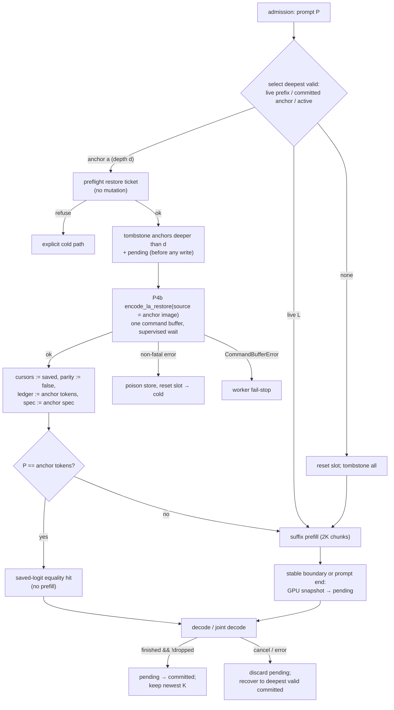

# ADR-063 C2: Qwen multi-depth prompt reuse on the P4a/P4b DeltaNet restore — HLD/LLD

Story: [C2 #360](https://github.com/robertelee78/hf2q/issues/360), [ADR-063 §C2](../adr/ADR-063-apple-silicon-four-agent-speed-coherence.md#c2-implement-and-qualify-qwen-multi-depth-prompt-reuse).

Predecessors:
- C1 #359 (closed). Its contract is [adr063-anchor-state-contract.md](adr063-anchor-state-contract.md), its oracle is `src/inference/anchor_contract.rs`, and the C1 final verdict carries O1 over to C2.
- ADR-065 P4a #526 and P4b #527, designed in [adr065-p4-design.md](adr065-p4-design.md). P4b itself requires B1 #503 and J1 #512 ([adr065-j1-design.md](adr065-j1-design.md)).

Story type: qualified implementation with hardware gates. It is built regardless of measured divergent-turn demand (operator decision, 2026-11-03).

Authored against `main` `d817dffa7371a2db85a43ed1d6502350906c33f5`. Source identities are listed at the end. Line numbers help reading only.

This is a design. Nothing was built, run or measured for it. Byte figures are arithmetic from the artifacts' published geometry. Anything else that is not read from source is marked [INFERENCE].

## 1. Acceptance map

| C2 acceptance item | Where this design meets it |
|---|---|
| Bounded slot-local anchors with pending publication, atomic restore, lineage pruning, saved-logit equality hits, right-sized payloads and owned-byte telemetry. The recurrent restore builds on P4a/P4b | §3.1 store, §3.6 publication, §3.7 atomic restore, §3.5 lineage, §3.4 equality hits, §3.2 payload, §3.9 telemetry, §3.3 restore via P4a/P4b |
| An approved HLD/LLD states how anchor-snapshot→state restore reuses P4a, whose contract covers capture→state only. If an extension is needed, link the mlx-native issue | §3.3. **No extension is needed.** The anchor payload *is* a capture image (`T = S = 1`), which is inside P4a's contract (P4 design §2.1, "Anchor images"). The reverse direction, the snapshot, uses existing byte-exact primitives or a host copy, and needs no native contract |
| Cold-versus-resumed exactness on both Qwen artifacts with graft absent, present and identity-changed; speculation off and auto; cancellation; failed restore; four concurrent clients | §7.2 exactness matrix |
| O1 success-path twin: a cold (non-restore) divergent prefill completes and then refuses the older anchor whose rows it overwrote | §7.3 |
| Zero `NotEligible` caused by anchor capture or restore (reason-tagged counter); joint eligibility rate with anchors on within the Q3 CI of anchors off | §3.8, §8.5 |
| Frozen limits: divergent-turn worst-slot semantic TTFT CI excludes 0 (improving); append-only makespan, worst-slot TTFT p95 and SSE-gap max ratios ≤ 1.025; footprint ≤ 1.25× a fresh Q5 calibration | §8.2–§8.4 |
| Fresh Q5 calibration for both Qwen artifacts with the declared anchors per slot precedes any C2 hardware run | §8.1 |
| Qwen3.6 judged by bitwise exactness and `ExactTranscripts`; Qwen3.8 also passes the paired task-quality gate | §7.2, §7.5, §8.6, open decision D1 (§10) |
| Primary Qwen3.8 evidence on the vanilla official 27B; grafted variants are separate arms; Gemma and DeepSeek are successors | §8 (case files), §9 |

## 2. Current state (what C2 changes)

| Concern | Today | Source |
|---|---|---|
| Anchors per slot | One `Option<Qwen35PromptAnchor>` | `src/serve/api/engine.rs:18132-18139` |
| Anchor payload | `HybridKvSlotAnchor`: per-layer full-attention cursors, MTP cursor, and **host `Vec<u8>`** copies of the slot's current conv and recurrent regions. No full-attention K/V copy; the live append-only rows are a dependency | `src/inference/models/qwen35/kv_cache.rs:1017-1038` |
| Snapshot | `snapshot_slot_anchor`: CPU `copy_slot_region_out` of the parity-current buffers | `kv_cache.rs:1555-1626`, `1404-1426` |
| Restore | `restore_slot_anchor`. It validates *and* rewinds the full-attention cursors inside one loop, then checks MTP, then CPU-copies the linear state into the named buffers and sets `pp_flipped[slot] = false`. **Not preflight-all-then-mutate** (C1 plan: "Current Qwen restore interleaves validation/mutation") | `kv_cache.rs:1631-1718` |
| Validity | `live_cursor >= saved_cursor`. This does not prove lineage after a divergent overwrite (C1 contract, "Identity and coordinates") | `kv_cache.rs:1663-1678` |
| Capture points | (a) The stable prompt boundary at a bounded-prefill chunk end (`engine_qwen35.rs:4316-4339`), **installed immediately** via `install_qwen35_stable_prompt_checkpoint` (`engine.rs:18181-18199`, called at 20276 and 20321). (b) The prompt end, when no stable boundary exists (`engine.rs:20493-20524`) | |
| Selection | `qwen35_slot_affinity` picks the most cached tokens over live retained prefix, the single anchor and active prompt (`engine.rs:18249-18321`). `use_prefill_logits` is set on exact equality (18279) | |
| Restore sites | Admission (`engine.rs:19915-19946`; on error it resets and fails the request). Cancellation recovery (`engine.rs:17517-17621`; on restore error it resets) | |
| Invalidation | Cold admission clears ledger and anchor (`engine.rs:19910-19913`). Embedding clears them (20708-20709). Reset paths clear them | |
| Joint eligibility | `run_qwen35_joint_decode` returns an untagged `NotEligible` when `kv.la_capture_active()` (cache-global, `qwen35_joint_decode.rs:278-280`) or when fewer than 2 lanes are `joint_decode_ready` (`:281-293`; `engine_qwen35/joint_decode.rs:55-73`) | |
| Success publication | `settle_qwen35_decode_lane`, `tick.finished && !client_dropped` (`engine.rs:20981-21010`) | |

## 3. HLD



### 3.1 Per-slot anchor store (mirrors the C1 oracle)

`Qwen35AnchorStore` replaces `Option<Qwen35PromptAnchor>` per slot. Its fields:
- `committed: Vec<Qwen35Anchor>` (ascending depth, `len ≤ K`);
- `pending: Option<Qwen35Anchor>`;
- `lineage_generation`, `epoch`, `poisoned`;
- an owned-byte ledger.

Its transitions are those of `anchor_contract::Store` (`src/inference/anchor_contract.rs:149-532`): `begin_capture`/`finish_capture`, `stage` (pending), `complete` (commit or discard), `cancel`, `preflight` → ticket, `apply`, `before_writes`, `partial_failure`, `replace_identity` and `reset`.

C2 does not reuse the oracle type in production, because it is a test oracle over CPU byte vectors. A differential test drives both with the same transition script and compares observable outcomes (§7.4).

`K` (committed anchors per slot) comes from `HF2Q_QWEN_ANCHOR_DEPTH`. It is read once at engine load and accepts 1–8; invalid values fail closed. The declared campaign value is `K = 4`, matching C1's policy fixture. `K = 1` is the anchors-off arm: it reproduces today's single-anchor selection through the same store. Pending is excluded from `K` (C1 contract).

### 3.2 Anchor payload, right-sized

`Qwen35Anchor` contains:

| Field | Content |
|---|---|
| `prompt_tokens: Vec<u32>` | Logical tokens; graft excluded, as today |
| `kv: HybridKvSlotAnchor` | Now holds per-layer full-attention cursors, the MTP cursor, and **one `LaAnchorImage`**: a single `MlxBuffer` of exactly `L·(E + C·(K−1))·4` bytes. Layer `ℓ`'s recurrent image sits at `ℓ·(E + C·(K−1))·4`, and its conv image follows immediately in **capture layout** `[K−1, C]` |
| `prefill_logits: Vec<f32>` | Exactly `vocab` entries, as today |
| `vision_fingerprint` | As today |
| `spec: Option<Qwen35SpecPrefixBoundary>` | `pending_target_hidden` is copied into a dedicated `hidden_size·4`-byte buffer (20,480 B on Qwen3.8). Retaining a view of a chunk-sized parent is refused (C1 "Byte ownership") |
| `identity: Qwen35AnchorIdentity` | §3.5 |

The ledger asserts `byte_len() == data_byte_len()` for every anchor-owned `MlxBuffer`. A view pinning a larger parent fails capture, and the anchor is skipped with reason `oversized_owner`.

Sizes per anchor (arithmetic, from P4 design §1.2):

| Artifact | DeltaNet image | Logits | Hidden | Tokens |
|---|---|---|---|---|
| Qwen3.8-27B | 156,893,184 B (149.6 MiB) | 248,320 × 4 = 993,280 B | 20,480 B | 4·len |
| Qwen3.6-35B-A3B | 65,863,680 B (62.8 MiB) | `vocab·4` | `hidden_size·4` | 4·len |

Today's single CPU anchor holds the same 149.6 MiB per slot in `Vec<u8>`s. C2 moves it to one GPU-visible allocation. At `K = 4` with four slots, Qwen3.8 retains up to 16 committed images plus up to 4 pending: 20 × ≈150.6 MiB ≈ 2.94 GiB, against ≈0.59 GiB today. Q5 must admit this (§8.1).

### 3.3 Anchor snapshot → state restore via P4a/P4b

This answers the C2 HLD/LLD acceptance item.

**Restore.** A `LaAnchorImage` layer is, byte for byte, a capture row with `T = S = 1`:
- recurrent `[E]`;
- conv `[K−1, C]`, channels innermost, the layout `ssm_conv_capture_forward_f32` writes (mlx-native `src/shaders/ssm_conv_capture.metal:21-30`).

Restoring slot `s` from an anchor is therefore the P4a operation `DeltaNetCaptureRestore` with `rec_cap`/`conv_cap` = the image's layer views, `(s_j, t_j) = (0, 0)`, and destinations = slot `s`'s regions of the **named** `recurrent`/`conv_state` buffers. P4a §2.1 explicitly admits this geometry, and T-P4a-4 tests it. After completion, `pp_flipped[s] := false`, exactly as `restore_slot_anchor` does today (`kv_cache.rs:1715`). The restored bytes and parity therefore equal today's host restore.

P4b's hf2q interface (P4 design §3.1) is used, not duplicated. Its plan item gains a source and a destination policy:

```rust
pub enum LaRestoreSource<'a> { CaptureRow(u32), AnchorImage(&'a LaAnchorImage) }
pub enum LaRestoreDestination { CurrentByParity, NamedResetParity }
pub struct LaRestoreItem<'a> { pub slot: SlotId, pub source: LaRestoreSource<'a>,
                               pub destination: LaRestoreDestination }
```

- Rollback uses `(CaptureRow(row), CurrentByParity)`.
- Anchor restore uses `(AnchorImage(img), NamedResetParity)`.
- Both lower to the same `plan_la_restore` / `encode_la_restore` and therefore the same P4a primitive: path A composition or path B kernel.

That is the single restore path ADR-063 requires. The P4 design document is amended accordingly (§3.1 there).

**Snapshot (state → image).** This direction is outside P4a's contract and needs no native extension:
- **Recurrent:** `CommandEncoder::blit_copy_bytes` from the slot's parity-current recurrent region to the image. A blit is a byte copy by Metal definition (mlx-native `src/encoder.rs:1563`); the layouts are identical, so no re-index is needed.
- **Conv:** if E6/P4a qualified path A (`strided_copy_f32` bitwise on both metallib paths), one `dispatch_strided_copy_f32` per layer with `rows = K−1`, `cols = C`, `stride_row = 1`, `stride_col = K−1`. That computes `img[k·C + c] = state[c·(K−1) + k]`, the inverse of the restore re-index. Otherwise, a host transpose after the blit command buffer completes: `L·C·(K−1)·4` = 5,898,240 B on Qwen3.8, written into the shared-storage image. It is exact by construction (`copy_from_slice` of 4-byte groups, as at `kv_cache.rs:3667-3676`).
- **Spec hidden:** one blit into the dedicated hidden buffer.

All of this goes into one command buffer, committed and waited under a supervisor lease ("Qwen35 anchor snapshot"). The snapshot runs at the same two capture points as today, at a point where the slot's prefill chunk has completed and been validated (`engine_qwen35.rs:4302-4304`). Every source is therefore final.

If a future owner prefers a native state→image op, its contract is §2.1's with source and destination roles exchanged. It would need its own mlx-native issue. C2 does not require it.

### 3.4 Selection: deepest valid, equality hits

For each slot, `store.deepest_prefix_of(prompt)` returns the committed anchor with the largest `prompt_tokens.len()` such that:
- `prompt.starts_with(anchor.prompt_tokens)`;
- the identity matches the current request (vision fingerprint, graft identity, effective config);
- the anchor is not tombstoned.

`qwen35_slot_affinity` keeps its tuple shape. The anchor element becomes that deepest match, and `Qwen35SlotPreference` gains `anchor_id: Option<u64>` so that admission restores exactly the anchor the planner chose. A mismatch at admission is an invariant failure, as today's `expect` at 19919.

Ties keep today's order: live prefix (no restore) beats an anchor of equal depth, and an idle slot beats an active one.

**Equality hit.** If `prompt == anchor.prompt_tokens`, restore and then seed decode from the saved `prefill_logits` (and the spec hidden row), skipping prefill. This is today's `use_prefill_logits` behaviour, now available at any committed depth.

### 3.5 Identity and lineage pruning

`Qwen35AnchorIdentity` binds:
- the artifact digest;
- the tokenizer and template fingerprints (the readiness `measurement_snapshot` domains);
- the effective cache configuration: TQ KV mode and codebook bits, `max_seq_len`, `n_seqs`, MTP presence and layer types;
- the slot handle generation and the store's `lineage_generation`;
- graft generation, digest and length;
- the vision fingerprint.

Qwen has no wire-level conversation id. Isolation is exact token-prefix identity within one slot lineage, so two clients with identical prefixes legitimately share exact bytes. A mismatch refuses before any mutation.

**Lineage invariant.** Every committed anchor of a slot is a prefix of the slot's live token ledger, and no write since its capture touched a row below its depth.

Qwen writes are append-only at the live cursor, apart from reset, embedding and the graft splice. So the invariant is maintained by one rule: **whenever a slot's live cursor is set to `c`, tombstone every anchor (committed and pending) with depth > `c` before any GPU work for that slot is encoded.** The cursor is set to `c` by:
- an anchor restore to depth `c`;
- a reset, including the cold-admission reset and failure resets (`c` = 0, graft rows aside);
- an embedding (reset);
- a graft replant, which also bumps `lineage_generation`.

K3 commit truncation never goes below the prompt end, so it never crosses an anchor. That is asserted.

This is C1 rule 5 ("tombstone every descendant … before the FIRST possible divergent write"), applied conservatively at the cursor change rather than at the write. Pruning before a write that never executes is allowed by C1.

### 3.6 Publication

- **Capture → pending.** At a capture point (§3.3), the snapshot is staged as `pending`, replacing any earlier pending anchor of the same request. A pending anchor is invisible to selection, cancellation recovery and telemetry hit counts. Today's immediate install at `engine.rs:20276/20321` and `20517` becomes `store.stage(...)`.
- **Pending → committed** exactly once, in `settle_qwen35_decode_lane` after the retained ledger publication for `tick.finished && !client_dropped` (`engine.rs:20981-21010`) and before the success reply is fired. Then keep the newest `K`. Newest equals deepest in a lineage, because any shallower re-capture after a restore has already tombstoned the deeper ones. Eviction drops the oldest payload; its `MlxBuffer` is released at its last owner. Restores are synchronous, so no reader outlives the restore call.
- **Cancellation, client drop, error, poison:** discard pending. Recovery (`recover_qwen35_slot_after_cancellation`, `engine.rs:17517`) restores the deepest valid *committed* anchor at or below the live cursor, through the atomic protocol (§3.7), or resets.

This is a deliberate behaviour change. Today a cancelled request's own stable checkpoint is already installed and can be restored. Under C1's publication rule it is discarded (risk R4).

### 3.7 Atomic restore (preflight-all-then-mutate)

**Phase A, preflight; nothing mutates.** It produces an immutable `SlotAnchorRestorePlan` bound to `(store epoch, anchor id)`. It checks:
- the store is not poisoned, and the identity equals the current one;
- the anchor is committed and live, and its depth is at most the live cursor of every full-attention layer and of the MTP cursor (presence matches);
- the anchor is a prefix of the live ledger (the lineage invariant);
- no open speculative or capture transaction: `!kv.la_capture_active()`, and the slot is idle in admission or recovery with no `pending_speculation_output`;
- full-attention and linear layer counts, and the image extent equals `L·(E + C·(K−1))·4`;
- `plan_la_restore` for one `(AnchorImage, NamedResetParity)` item, which preflights every range against `data_byte_len()` (P4 design §3.3).

**Phase B, mutate, in this order:**
1. `store.before_writes(depth)`: tombstone anchors deeper than `d`, and the pending anchor.
2. Encode the restore and commit-and-wait under a supervisor lease ("Qwen35 anchor restore").
3. Set every full-attention cursor and the MTP cursor to the saved values, and set `pp_flipped[slot] := false`.
4. Set `retained_tokens := anchor.prompt_tokens` and `spec := anchor.spec` (validated by `validate_speculative_cursors_for_slot`, as today at `engine.rs:17573-17597`).
5. `epoch += 1`.

Phase B steps 3–5 cannot fail after the preflight: they are plain field writes with pre-validated indices.

**Failures:**

| Failure | Handling |
|---|---|
| Preflight refusal | No mutation. Counted as `restore_refused{reason}`. The request takes the explicit cold path: reset, which tombstones everything, then full prefill |
| Non-fatal error in step 2 | Poison and clear the whole store (no shallower fallback; C1 rule 6), `reset_for_slot`, clear the ledger, then serve the request cold. Cold output must equal the cold twin (§7.2, "failed restore") |
| `MlxError::CommandBufferError` in the error chain | The worker fails stop through the existing fatal path. The error is wrapped with `.context`, never stringified |

`restore_slot_anchor` is replaced by `plan_slot_anchor_restore` + `apply_slot_anchor_restore`. All callers move: `engine.rs:17560`, `19924`, `speculation_qualification_tests.rs:716`, and the `slot_anchor_*` tests in `kv_cache.rs:12323`, `12940`.

### 3.8 Joint-decode eligibility protection

**Structural guarantee.** No C2 operation arms DeltaNet capture: snapshot reads state, and restore reads an image. Every C2 GPU operation runs to completion (commit-and-wait) inside admission, prefill-completion or settle code, never between `run_qwen35_joint_decode`'s eligibility check and its forward. A lane is therefore never observed by `joint_decode_ready` in the middle of an anchor operation.

**Reason-tagged refusal.**
- `Qwen35JointRun::NotEligible` (`qwen35_joint_decode.rs:233-241`) becomes `NotEligible(Qwen35JointIneligible)`:
  - `CaptureActive(LaCaptureOwner)`;
  - `TooFewReady { ready, refusals: [Qwen35LaneRefusal; ≤4] }`;
  - `DuplicateSlots`;
  - `MaxRowsBelowTwo`.
- `joint_decode_ready` (`engine_qwen35/joint_decode.rs:55-73`) becomes `joint_decode_readiness(&self, kv) -> Result<(), Qwen35LaneRefusal>`:
  - `StepBound`, `PendingSpeculationOutput`, `NoSeed`, `TargetCursor`, `MtpCursor`;
  - plus `ClientClosed` and `HandleMismatch` from the partition closure;
  - plus `AnchorTransaction` when the slot's store has an open ticket or construction.
- The cache-global `la_capture_active_tokens: Option<u32>` (`kv_cache.rs:928`) gains an owner tag, `la_capture_owner: Option<LaCaptureOwner>`, with values `K3Verify`, `HistoryVerify`, `RecoveryCapture` and `AnchorSnapshot`. `ensure_la_capture` callers pass their owner. C2 itself never uses `AnchorSnapshot`; it exists so that any future capture-based snapshot is attributed. This is compatible with J2, which replaces the global flag with per-slot ownership and keeps the owner tag.

**Counter.** `hf2q_qwen_joint_not_eligible_turns_total{reason}` is a static atomic set exported in `/metrics` beside the speculation counters (`src/serve/api/handlers.rs:8657-8700`). A NotEligible turn increments exactly one reason:
- `capture_<owner>`;
- `too_few_ready`;
- `duplicate_slots`;
- `max_rows`;
- `anchor_capture` or `anchor_restore`, assigned when any refusal is `AnchorTransaction` or the capture owner is `AnchorSnapshot`. This attribution is conservative.

A second counter set, `hf2q_qwen_joint_lane_refusals_total{reason}`, counts lane refusals. The acceptance reads `anchor_capture + anchor_restore == 0` over every C2 run. The debug line `Qwen joint decode turn` gains `reason=` so that `cancel_smoke.py widths` and E4's extractor can join it.

### 3.9 Owned-byte telemetry and quota

The per-slot ledger has classes `payload_image`, `logits`, `hidden`, `tokens` and `metadata`, for committed and for pending, with the C1 alias rule: unique owner extents are charged once.

Exported:
- `hf2q_qwen_anchor_owned_bytes{slot, class, state}`;
- `hf2q_qwen_anchor_committed{slot}`;
- `hf2q_qwen_anchor_restores_total{rank}` (rank 0 = deepest);
- `hf2q_qwen_anchor_equality_hits_total`;
- `hf2q_qwen_anchor_restore_refused_total{reason}`;
- `hf2q_qwen_anchor_tombstoned_total{cause}`;
- `hf2q_qwen_anchor_evicted_total`;
- `hf2q_qwen_anchor_capture_skipped_total{reason}`;
- sums and counts of snapshot and restore milliseconds.

The idle conservation check (C1) holds: ledger total == Σ unique anchor owners. Pending and construction are 0 at idle.

**Quota.** The Q5 case declares `anchors_per_slot` and `anchor_bytes_per_slot_max`. If a capture would exceed the slot's declared reservation (K committed + 1 pending), it is skipped with reason `quota` and nothing is allocated. Eviction happens only at commit. There is no implicit growth beyond the declaration.

## 4. LLD

### 4.1 Files

| File | Change |
|---|---|
| `src/serve/api/engine_qwen35/anchor_store.rs` (new) | `Qwen35AnchorStore`, `Qwen35Anchor`, `Qwen35AnchorIdentity`, ledger and telemetry statics |
| `src/inference/models/qwen35/kv_cache.rs` | `HybridKvSlotAnchor` holds `LaAnchorImage`. `snapshot_slot_anchor` becomes a GPU snapshot (§3.3). `restore_slot_anchor` is replaced by `plan_slot_anchor_restore` / `apply_slot_anchor_restore`. `la_capture_owner` tag. `copy_slot_region_out` and `copy_slot_region_in` lose their last callers and are deleted |
| `src/inference/models/qwen35/kv_cache/la_restore.rs` (P4b) | `LaRestoreSource` and `LaRestoreDestination` |
| `src/serve/api/engine.rs` | `prompt_anchors: &mut [Option<Qwen35PromptAnchor>]` becomes `anchor_stores: &mut [Qwen35AnchorStore]` at every signature: 17523, 17629, 18183, 19696, 20174, 20442, 20664, 20758, 20895, plus `run_qwen35_joint_decode`. Selection (18249, 18675, 19764), admission restore (19915), cancellation recovery (17557), capture install (18181, 20493-20524), success commit (20981-21010), invalidation sites (19910, 20708 and resets) |
| `src/serve/api/engine/qwen35_joint_decode.rs`, `engine_qwen35/joint_decode.rs` | Tagged `NotEligible` and lane readiness reasons (§3.8) |
| `src/serve/api/handlers.rs` | `/metrics` families (§3.8, §3.9) |
| `scripts/four_agent/coding_divergent_edit.py` (new), `q5_case.py`, `q5_admission.py`, `quality_campaign.py` | The divergent-edit workload variant (§8.2), the anchor declaration in Q5 cases, and variant + instance composition for the paired quality gate |
| `docs/operating-kv-cache.md` | Operator notes for `HF2Q_QWEN_ANCHOR_DEPTH`, metrics and quota |

### 4.2 Store API

```rust
impl Qwen35AnchorStore {
    pub fn new(identity: Qwen35AnchorIdentity, keep: usize) -> Self;
    pub fn deepest_prefix_of(&self, prompt: &[u32], id: &Qwen35AnchorIdentity) -> Option<&Qwen35Anchor>;
    pub fn on_cursor_set(&mut self, cursor_tokens: usize, cause: TombstoneCause); // lineage rule §3.5
    pub fn stage(&mut self, request: u64, anchor: Qwen35Anchor) -> Result<(), CaptureSkip>;
    pub fn commit(&mut self, request: u64);      // exactly once; no-op if no pending of this request
    pub fn discard_pending(&mut self, request: u64);
    pub fn ticket(&self, anchor_id: u64) -> Result<AnchorTicket, RestoreRefusal>; // binds epoch
    pub fn poison_and_clear(&mut self);
    pub fn replace_identity(&mut self, identity: Qwen35AnchorIdentity); // graft/model/config change
    pub fn owned(&self) -> AnchorOwnedBytes;
}
```

`HybridKvCache` functions:

```rust
pub(crate) fn snapshot_slot_anchor(&self, slot, prompt_len, registry, supervisor_lease) -> Result<HybridKvSlotAnchor>;
pub(crate) fn plan_slot_anchor_restore(&self, slot, &HybridKvSlotAnchor) -> Result<SlotAnchorRestorePlan>;
pub(crate) fn apply_slot_anchor_restore(&mut self, plan: SlotAnchorRestorePlan, registry) -> Result<()>;
```

`apply_slot_anchor_restore` consumes the plan, so a plan cannot be applied twice. The plan holds the anchor's epoch, and the engine refuses a stale ticket.

## 5. Data flow per request (slot `s`)

1. **Admission.**
   - Select the preference (§3.4).
   - **Anchor hit:** ticket, then preflight (Phase A), then `on_cursor_set(d)`, then Phase B. On equality, seed from the saved logits.
   - **Live hit (L):** no mutation. Anchors are untouched, because L equals the live cursor.
   - **Miss:** `reset_for_slot`, then `on_cursor_set(graft_len)`.
2. **Prefill.** Suffix chunks at today's 2K quantum (`engine.rs:17920`). At the stable boundary or prompt end, GPU snapshot → `stage`.
3. **Decode.** Serial or joint. K3 rollback uses P4b (`CaptureRow`). Anchors are not touched.
4. **Settle.**
   - Success: `commit`.
   - Cancellation or drop: `discard_pending`, then recovery (atomic restore of the deepest valid committed anchor at or below the live cursor, else reset).
   - Error: `discard_pending`, then the existing reset (which tombstones).

## 6. Failure semantics summary

| Event | Store | Slot | Request |
|---|---|---|---|
| Capture refused (quota, oversized owner, identity) | Unchanged; skip counted | Unchanged | Continues |
| Snapshot command buffer, non-fatal | Pending dropped (nothing published) | Unchanged (snapshot only reads) | Continues |
| Snapshot `CommandBufferError` | — | — | Worker fail-stop |
| Restore preflight refusal | Unchanged | Reset (cold) | Continues cold |
| Restore GPU non-fatal error | Poisoned and cleared | Reset | Continues cold |
| Restore `CommandBufferError` | — | — | Worker fail-stop |
| Cancellation before or after capture | Pending discarded; deeper anchors tombstoned at any cursor rewind | Recovered or reset | Cancelled |
| Graft, model or config identity change | `replace_identity` clears it before any new write | — | — |

## 7. Tests

### 7.1 Unit (CI, Metal tiny configs under `hf2q_gpu_test_lock`)

| ID | Test |
|---|---|
| U1 | Image round trip: snapshot then restore equals today's host `copy_slot_region_out`/`in` bytes for both parities and every slot, with §2.1 bit classes in the state. Peer slots are byte-identical |
| U2 | Restore atomicity: inject a failure at the last layer's preflight; cursors, bytes, parity and store are unchanged. Inject a failure after GPU submit; the store is poisoned, the slot reset, and no shallower anchor is attempted |
| U3 | Lineage rule: A@d1 < B@d2 < C@d3. Restore B, and C is tombstoned before encode. A cold reset tombstones all. The pending anchor is tombstoned by a cursor rewind below its depth |
| U4 | Publication: pending is invisible to selection and recovery; commit happens exactly once; a duplicate completion is a no-op; cancellation discards; keep-newest-K evicts the shallowest |
| U5 | Right-sizing: a spec hidden row given as a view of a chunk parent is copied, never retained. A payload with `byte_len != data_byte_len` is refused with `oversized_owner` |
| U6 | Ledger conservation at idle with K = 4, pending, eviction, poison and reset (C1 "Byte ownership") |
| U7 | `qwen35_slot_affinity` with multiple anchors: deepest wins; live beats equal depth; equality sets `use_prefill_logits`. The existing tests at `engine.rs:45403-45600` are kept and extended |
| U8 | Joint reason tagging: synthetic slot states for each `Qwen35LaneRefusal`; the counter increments exactly one reason per NotEligible turn; `anchor_*` stays 0 when anchor transactions are closed and becomes 1 under an injected open ticket (the counter is not vacuous) |

### 7.2 Cold-versus-resumed exactness matrix (real artifacts; GPU lane)

**Definition.** "Cold" is the ADR-063 Q1 Class A same-route twin (`docs/research/adr063-q1-numeric-policy.md` §2, row A: "resume vs cold at the same chunk boundaries; cancel+restore vs never-cancelled"). A fresh slot replays exactly the transaction sequence that produced the anchor's state up to depth `d`: the same prefill chunk boundaries, the same decode or K3 steps. It then runs the resumed request's suffix transactions with identical boundaries, but never executes the diverging history in between.

"Resumed" executes that history, then the divergent turn that restores the anchor, then the same suffix.

Bitwise equality is required for:
- every logits row, hidden row and token id;
- target and MTP cursors, MTP K/V region and TQ/K/V rows below the cursor;
- DeltaNet current state and parity;
- the retained ledger.

The comparison uses Q1 stores (`hf2q.adr063.invariance`) and `scripts/four_agent/q1_decision_policy.py` → `ExactEqual`. A run from 0 with different chunk boundaries is a Class B alternate route, not this test.

**Harness.** An ignored real-artifact test module, `src/serve/api/engine_qwen35/anchor_exactness_tests.rs`, scripts token-level turns through the slot-aware engine functions (pattern: `speculation_real_artifact_tests.rs`). It records Q1 stores at each transaction.

| Axis | Values |
|---|---|
| Artifact | Qwen3.8-27B vanilla (`HF2Q_QWEN38_GGUF`), Qwen3.6-35B-A3B vanilla (`HF2Q_QWEN36_GGUF`) |
| Graft | absent; present (same graft for the twin); identity change between capture and restore. Expected: restore refused, cold path, output equal to the twin without the anchor |
| Speculation | `HF2Q_QWEN_SPECULATION=off`; `auto` (anchors carry the spec boundary; K3 rounds after resume) |
| Restore depth | rank 0 (deepest) and rank 2 of K = 4, plus an equality hit |
| Cancellation | cancel before capture, after capture before commit, and mid-decode after a resumed admission. Recovery state equals the never-cancelled twin at the recovered depth |
| Failed restore | injected preflight refusal and injected post-submit failure; output equals the cold twin, the store is poisoned in the second case |
| Concurrency | four slots: slot 0 resumes while slots 1–3 decode (joint on, `HF2Q_QWEN_JOINT_DECODE` at its default). Slot 0 equals its single-slot twin by the existing per-slot joint parity (Q1 policy §2 row A, "Qwen four-slot per-slot parity"). Slots 1–3 state digests are unchanged across slot 0's restore (Class A: no peer mutation) |

### 7.3 O1 success-path twin (C1 carry-over)

1. Slot 0 serves request A to success, so anchor A@d is committed.
2. Request B, a different prompt with `|B| > d` and a shared prefix shorter than `d`, is admitted to slot 0 **cold** (miss: `reset_for_slot`). It completes successfully and writes rows `[0, |B|)`. The live cursor is now ≥ d, so today's `live >= saved` check would pass.
3. Request C, with `C.starts_with(A.tokens)`, must not restore A:
   - `restore_refused` and `tombstoned{cause=cold_reset}` are observed;
   - C's output and state equal the cold twin of C.

Variant 3': B restores a shallower anchor A0@d0 < d and prefill writes `[d0, …)`. C must miss A (tombstoned) and may hit A0.

Negative control (test-only fault injection disables `on_cursor_set`): C restores A, and the comparison against the twin reports `DivergedExactInvariant`. This shows the test can fail.

### 7.4 Differential against the C1 oracle

A transition script generator emits the same sequences of capture, stage, commit, cancel, before_writes, preflight, apply, partial_failure, identity replacement and reset. It drives `Qwen35AnchorStore` (with CPU-mocked payload owners) and `anchor_contract::Store`. Visibility, refusal reasons, tombstones, poison and owned bytes must match. This sits under the existing `anchor_c1` filter so CI runs it.

### 7.5 Serving-level transcript gates (hardware)

- **Refactor gate:** `HF2Q_QWEN_ANCHOR_DEPTH=1` on the C2 binary vs the pre-C2 main binary, canonical workload. Expected `ExactTranscripts`: the GPU restore and snapshot are bitwise equal to the host copies, and the selection is identical. The one exception is the cancellation-pending change (§3.6), so cancel runs are excluded from this gate and judged separately.
- **Anchors on vs off** (K = 4 vs K = 1, same binary) on the canonical append-only workload: `ExactTranscripts` (deepest valid = live prefix on every turn, so routes are identical).
- **Divergent-edit variant:** transcripts K = 4 vs K = 1 are compared and classified. See open decision D1 (§10).

## 8. Measurement plan

Every hardware run:
- needs the GPU lane granted by the root and the host lock;
- runs one model process, with peers unloaded and at least 60 s between loads;
- records source commit, binary SHA-256, artifact digest, native version and case file;
- passes Q5 `CalibrationPass`.

Evidence goes under `/Users/robert/.local/state/hf2q/v0130/c2-360/`.

### 8.1 Fresh Q5 calibration (precedes every C2 hardware run)

For both `q5_cases/qwen38.json` (vanilla 27B) and `q5_cases/qwen36.json` (vanilla 35B-A3B), derive C2 cases declaring `anchors_per_slot = 4` and the per-anchor bytes from §3.2, on both the canonical and the divergent-edit workloads. Run `scripts/four_agent/q5_calibration.py`. Admission is re-established on any binary, artifact, workload or footprint change (ADR-065 execution prerequisites).

### 8.2 Divergent-edit workload variant (C2 authors it)

The new `scripts/four_agent/coding_divergent_edit.py` follows the `coding_long_context.py` `Variant` mechanism: `select`, `derive_case`, the approval key `workload_variant = divergent-edit-v1`, and a fixture digest.

At turns 3 and 5 of every agent, the client applies a deterministic context edit before sending. It truncates the tool-result message of turn `t−2` to its first 16 lines plus a fixed elision marker. That divergence point lies inside turn `t−1`'s prompt: below the latest anchor (turn `t−1`) and above the turn-`t−2` anchor. Under K = 4 the deepest valid anchor is turn `t−2`; under K = 1 the turn is cold.

`estimate` reports per-turn wire bytes. The variant must compose with `--instance` so the paired quality gate can run on it (`quality_campaign.py` currently refuses variants, at line 126).

### 8.3 Divergent-turn worst-slot semantic TTFT (frozen limit 1)

- Arms on the same binary: K = 4 vs K = 1.
- Q3 Williams-block design (`q3_stats.williams`/`block_order`), with a block count fixed before the campaign in 5–20. Proposed: 8.
- Estimand per run: the worst slot's semantic TTFT over turns 3 and 5, from each turn's `semantic_timing_v3.semantic_ttft_seconds` (the field `scripts/four_agent/q3_metrics.py:82-91` reads). `q3_metrics.slot_metrics` pools all turns, so a turn-filtered variant is added beside it.
- Paired log-ratio 95% CI. **Pass:** it excludes 0 in the improving direction.

### 8.4 Append-only limits and footprint (frozen limits 2–3)

- Canonical workload, K = 4 vs K = 1, the same Williams-block design.
- Four-agent makespan, worst-slot TTFT p95 (`q3_metrics` worst-slot p95 semantic TTFT) and `worst_slot_sse_gap_max_s` (`q3_metrics.py:134`), each as a paired ratio (K = 4 over K = 1). **Pass** if the 95% CI upper bound of each is ≤ 1.025. This makes "≤ 1.025" checkable at the same confidence as the ADR-065 Equivalent rule; see open decision D2.
- Footprint: per-run `peak_footprint_bytes` (the Q5 calibration summary field, `scripts/four_agent/q5_calibration.py:338`) with K = 4, divided by the fresh calibration's peak, ≤ 1.25 in every run.

### 8.5 Joint eligibility (acceptance item 5)

- Over all C2 runs (§8.3, §8.4 and §7.2 hardware runs), `hf2q_qwen_joint_not_eligible_turns_total{reason=~"anchor_.*"} == 0`, read from `/metrics` at run end and retained in the receipt.
- Per-run eligibility rate `r` = joint lane-steps ÷ (joint + serial lane-steps among decode-ready lanes on turns with at least 2 decode lanes), from the tagged turn lines.
- **Pass:** the K = 4 arm's mean `r` lies inside the 95% CI of the K = 1 arm's mean `r` (q3_stats, same blocks), on each workload.

### 8.6 Quality

- **Qwen3.8:** the paired 24-instance task-quality gate (`scripts/four_agent/quality_campaign.py`) between K = 4 and K = 1, on the divergent-edit variant composed with instances.
- **Qwen3.6:** bitwise exactness (§7.2) and `ExactTranscripts` against anchors off (§7.5); no task pass rate (Q4-QWEN36).

### 8.7 Independent review

A reviewer distinct from the implementer reproduces the §7.2 matrix verdicts and the §8.3 paired TTFT effect from the raw receipts with the checked-in commands.

## 9. Risks and non-goals

| ID | Risk | Mitigation |
|---|---|---|
| R1 | Footprint: up to about 2.94 GiB of anchors on Qwen3.8 at K = 4 | Q5 declaration and quota (§3.9). The 1.25× limit. K is configurable for the arms |
| R2 | Snapshot latency at the prefill chunk end delays peers [INFERENCE: one 150 MiB blit command buffer] | Measured as `snapshot_ms`. The append-only ratio limits catch regressions |
| R3 | The lineage rule misses a write path | The rule keys on cursor changes. Every `reset_for_slot`, `embed` and graft-splice caller is enumerated in review. O1 negative control (§7.3) |
| R4 | The pending rule makes cancel-and-retry lose its same-prompt hit (behaviour change vs today) | It follows C1 rule 3. Cancel smoke records it. Not an acceptance regression; reported |
| R5 | Divergent-edit TTFT gain is small if the edited region is near the anchor | The edit position is chosen so the restored depth is turn `t−2` (§8.2); `estimate` reports the prefix shares |
| R6 | E6 rejects f32 copies (path B), so snapshot conv uses the host transpose | 5.9 MiB per snapshot; exact; off the decode path |

**Non-goals:**
- Gemma and DeepSeek multi-anchor (C1 carry-overs O2–O4 stay successors).
- Disk promotion of anchors.
- Stride or intra-turn checkpoints.
- Non-prefix or approximate recurrent reuse.
- Changing the 2K prefill quantum.
- Cross-slot anchor migration.
- Making the SerialFifo `snapshot_prefix_from_capture` path multi-depth.
- Making demand measurement a gate.
- Grafted or abliterated artifacts as primary evidence (they are compatibility arms only).

## 10. Open decisions for root or owner (before implementation)

- **D1.** "`ExactTranscripts` against anchors off" on divergent turns. Anchors-off cold-prefills the divergent turn from 0, while anchors-on resumes from a state built by a different transaction history (decode-route rows, other chunk boundaries). Under the ADR-063 Q1 numeric policy that is a Class B alternate route, so bitwise equal transcripts cannot be guaranteed. Proposed:
  - bitwise exactness is proven by the same-route twin (§7.2);
  - `ExactTranscripts` is required on the append-only workload (§7.5), where the routes are identical;
  - on the divergent-edit variant, a transcript difference is classified at its first divergent row by the Class B envelope (D ≤ 0.25 nat; `RouteSensitive` blocks and needs localization).

  This needs owner confirmation, because the ADR text does not qualify the gate.
- **D2.** "≤ 1.025" is read as the paired-ratio CI upper bound (proposed) rather than the point estimate.
- **D3.** The Williams-block count, proposed at 8 per campaign, is fixed before any run.

## 11. Source identities read

| Path | SHA-256 |
|---|---|
| `src/serve/api/engine.rs` | `9383b87263ea7dc252a8ac4bb64eb16780169a82d792dfafc7987772f95f574f` |
| `src/serve/api/engine_qwen35.rs` | `47f755feeeed176aa5dd77179e430ceb2d09a6f0e5b14d883a8f2e1f5ce6bd34` |
| `src/inference/models/qwen35/kv_cache.rs` | `6bc46b78124b9e41b494a5136324e03b76edb5a584279271291d4d8b5cf4518e` |
| `src/serve/api/engine/qwen35_joint_decode.rs` | `535a6ef0847fafe6ec11388d4c665080e629199c883fefe31dfd8361fb20805b` |
| `src/serve/api/engine_qwen35/joint_decode.rs` | `cb11e0c3690da3d248f68598ad73ef08b4c0f53b57674d3f614852e01431b5f5` |
| `src/inference/anchor_contract.rs` | `3d2097d9af6da0f5cc48227462093552b6a3d088461606ac6a5c739a535ead79` |
| mlx-native 0.15.16 `src/encoder.rs` | `275ea47915de3724e630ac578c8aa3745cf872e026720e71ebf3085d0b65944b` |
