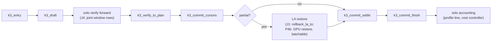

# ADR-065 J1: share the K3 transaction between solo and joint paths — HLD/LLD

Story: [J1 #512](https://github.com/robertelee78/hf2q/issues/512), [ADR-065 §J1](../adr/ADR-065-four-agent-joint-speculative-verify.md#j1-share-the-k3-transaction-between-solo-and-joint-paths).
Story type: Refactor. It closes when serving transcripts are `ExactTranscripts` against the previous default and the existing gates pass (ADR-065 "A story closes by type").
Blocked by: B1 #503, but only for the four-agent transcript comparison, which needs B1's campaign file. Source work may start now.
Downstream consumers: J2 #513 (per-slot capture), J4 #515 (joint verify windows), P4b #527 (GPU DeltaNet restore) and, through P4b, ADR-063 C2 #360.

Authored against `main` `d817dffa7371a2db85a43ed1d6502350906c33f5`. The source identities are listed at the end. Line numbers help reading only. The implementation manifest must cite symbols and hashes.

This is a design. Nothing was built, run or measured for it.

## 1. Scope

The program MUST factor the solo K3 tick into draft, verify-to-plan and commit functions without changing served output (ADR-065 J1 Requirement). The acceptance items are:

1. `decode_tick_mtp_k3` calls the extracted functions, and `plan_qwen35_verified_block` is unchanged byte for byte.
2. The existing speculation qualification tests pass, and serving transcripts are `ExactTranscripts` against the previous default.

Here "the previous default" is the pre-J1 `main` binary. J1 has no kill switch, because a refactor with an exactness gate does not need one. The comparison is therefore between two binaries: the frozen B1 phase-1 default (or the main commit J1 is rebased on, whichever B1's campaign file names) and the J1 binary. Both run the same artifact and Q5 case.

### What exists today

`Qwen35DecodeState::decode_tick_mtp_k3` (`src/serve/api/engine_qwen35.rs:5760-6149`) is one 390-line method holding six phases:

| Phase | Lines | Effects |
|---|---|---|
| Entry and gating | 5766-5802 | Takes the pending speculative output, or falls back to `decode_tick_mtp_warmup` when `remaining < 4` or `!mtp_cost.may_speculate()`. Reads `next_token` and `next_pos`. Requires target cursor == MTP cursor. |
| Draft | 5803-5878 | `ensure_la_capture(VERIFY_ROWS=4)` (sets the cache-global `la_capture_active_tokens`). Supervisor lease "draft". Three `mtp.forward_draft_greedy_for_token` steps. `truncate_mtp_to_for_slot(prior_mtp_len)` discards the draft K/V. Test hooks `first_fork::after_draft_discard` and `after_drafts`. |
| Verify forward (solo route) | 5881-5925 | Builds `verify_input = [next_token, d0, d1, d2]` and its positions. Lease "verify". `forward_gpu_with_nextn_hidden_buffer` writes 4 target K/V rows and 4 DeltaNet capture rows, then flips this slot's ping-pong parity once. Hook `first_fork::verifier_pre_catchup`. |
| Verify→plan | 5926-6028 | Checks logits and hidden shapes. `embed_tokens_gpu(verify_input)`. Lease "catch-up" around `mtp.process_target_batch` (MTP K/V catch-up from the verifier hidden rows). Takes the logits view. Hook `verified_buffers`. `Qwen35SpecSemanticState::from_decode` plus `plan_qwen35_verified_block` (the canonical accept walk), with hook `canonical_decision`. |
| Commit | 6030-6094 | `committed_cursor = prior_target_len + valid_input_tokens`. Truncates the full-attention cursor, then the MTP cursor. On a partial plan (`valid_input_tokens < 4`) it calls `rollback_la_to(slot, carry_hidden_row)` (host copy, `kv_cache.rs:2745-3025`). Then `clear_la_capture` and `validate_speculative_cursors_for_slot`. Then the carry hidden row (`nth_hidden_row`), hook `state_committed`, `pending_speculation_output` and `terminal_after_pending`, and `record_proposer_outcome`. |
| Accounting and tail | 6091-6148 | `equivalent_target_decisions`, the `HF2Q_MTP_PHASE_PROFILE` line, `record_proposer_timing`, `mtp_cost.observe_speculative_round` (which may disable MTP for the request), then `commit_speculation_output` of the first pending token. |

The failure handling is not uniform, and J1 must preserve it exactly:

| Failure point | Today's handling |
|---|---|
| Capture allocation | `clear_la_capture`, return the error. No reset. |
| Draft lease admission | Clear capture, return the error. |
| Draft forward or supervision | Clear capture, then `rollback_slot_mtp_draft_error(prior_mtp_len)`. |
| Draft discard | Same as the draft forward. |
| Verify admission | Clear capture, return the error. No reset. |
| Verify forward or supervision | Clear capture, `reset_for_slot`, return. |
| Shape, embed, catch-up admission, catch-up, logits view, semantic walk | Clear capture, `reset_for_slot`, return the error with its exact context string. |
| Inside the commit closure (6033-6052) | Clear capture, `reset_for_slot`, return. |
| Carry hidden | `reset_for_slot` only, because capture was already cleared. |

`decode_tick_history_lookup` (`engine_qwen35.rs:5442-5753`) has the same shape: verify, plan, then commit with `rollback_la_to` at 5672. It is not part of J1's requirement ("solo K3 tick").

The joint path today, `run_qwen35_joint_decode` (`src/serve/api/engine/qwen35_joint_decode.rs:261`), suppresses drafting. It refuses the whole turn while any capture is active (`:278-280`). Each lane's commit goes through `finish_joint_tick` (`src/serve/api/engine_qwen35/joint_decode.rs:121-165`), which reuses the serial ordinary or coherent commit. J4 is the first consumer that needs the K3 functions from a joint step.

## 2. HLD

Split the transaction at its natural state boundaries into pure-ish units over `Qwen35DecodeState` and `HybridKvCache`. Each unit owns exactly the mutations it performs today, in the same order, with the same failure handling. The solo verify forward stays where it is. It is the only part J4 replaces, with a joint REF(w) window, so the split goes around it.



The design rules are:

- **No arithmetic moves.** The solo route, `forward_gpu_with_nextn_hidden_buffer`, stays the solo route. J1 neither introduces REF(w) nor changes kernels, positions, capture depth or buffer roles. That decision belongs to J6.
- **The commit is split around the DeltaNet restore.** The restore is the only commit step that the joint path (J4) and P4b want to batch across slots. J1 therefore splits the commit into three functions:
  - `k3_commit_cursors` truncates both cursors and returns the restore request;
  - `k3_commit_settle` clears capture and validates the cursors;
  - `k3_commit_finish` installs the carry hidden row and the ledger.

  The solo wrapper calls cursors, the inline restore and settle inside today's fail-closed scope, then calls finish. Its observable order equals today's: truncate full, truncate MTP, restore, clear capture, validate cursors, carry hidden, ledger.
- **Solo-only policy stays in the wrapper.** The wrapper keeps the warm-up fallback, the cost controller, `HF2Q_MTP_PHASE_PROFILE` and `record_proposer_timing`. Joint rounds have different timing semantics. J4 owns its own accounting, and A2 owns depth policy.
- **`plan_qwen35_verified_block` (4729-4778) and `Qwen35VerifiedBlockPlan` (4712) are untouched.** The acceptance diff check is `git diff <base> -- src/serve/api/engine_qwen35.rs` showing no hunk inside that function's span.

## 3. LLD

### 3.1 Module and visibility

The new module is `src/serve/api/engine_qwen35/k3_transaction.rs`. It sits beside the existing `joint_decode.rs` child module, uses `use super::*`, and its items have visibility `pub(in crate::serve::api)` so that `engine/qwen35_joint_decode.rs` (J4) can call them. The test hooks keep their `#[cfg(test)] q1_speculation::…` call sites. The module is a child of `engine_qwen35`, so `super::q1_speculation` resolves unchanged.

### 3.2 Types

```rust
/// Entry cursors of one K3 round; `prior_target_len == prior_mtp_len` checked.
pub(in crate::serve::api) struct K3Entry {
    pub next_token: u32,
    pub next_pos: i32,
    pub prior_target_len: u32,
    pub prior_mtp_len: u32,
}

/// Draft result. The draft MTP K/V is already discarded and capture is armed
/// for `VERIFY_ROWS` rows.
pub(in crate::serve::api) struct K3Draft {
    pub entry: K3Entry,
    pub drafts: [u32; K3_DRAFT_DEPTH],
    pub verify_input: [u32; K3_VERIFY_ROWS],
    pub verify_positions: Vec<i32>,  // positions_for_range(next_pos, 4), as today
}

/// Verifier rows for one window: `K3_VERIFY_ROWS` logits rows and
/// post-output-norm hidden rows, in the solo route's layout.
pub(in crate::serve::api) struct K3VerifyRows {
    pub logits: MlxBuffer,
    pub hidden: MlxBuffer,
}

/// Planned transaction. `plan` is the unchanged `Qwen35VerifiedBlockPlan`.
pub(in crate::serve::api) struct K3Plan {
    pub draft: K3Draft,
    pub hidden: MlxBuffer,
    pub plan: Qwen35VerifiedBlockPlan,
    pub committed_cursor: u32,
    pub timing: K3PlanTiming,  // embed, catch-up, semantic Durations (profile line only)
}

/// DeltaNet restore owed after cursor settlement; `None` on full acceptance.
#[derive(Clone, Copy, Debug, PartialEq, Eq)]
pub(in crate::serve::api) struct K3LaRestore { pub slot: SlotId, pub capture_row: u32 }
```

`K3_DRAFT_DEPTH = 3` and `K3_VERIFY_ROWS = 4` become module constants and replace the function-local `DRAFT_DEPTH` and `VERIFY_ROWS` (5766-5767). `Qwen35VerifiedBlockPlan` and `Qwen35CanonicalDecision` keep their private-to-`engine_qwen35` visibility. The child module sees them, and the J4 caller only passes `K3Plan` through.

### 3.3 Functions (methods on `Qwen35DecodeState`)

| Function | Body moved from | Mutations | Failure handling (verbatim from today) |
|---|---|---|---|
| `k3_entry(&self, kv) -> Result<K3Entry>` | 5779-5791 | none | error only |
| `k3_draft(&mut self, qwen, kv, supervisor, entry) -> Result<K3Draft>` | 5793-5878 | arms capture; MTP K/V write then discard to `prior_mtp_len` | capture alloc / draft admission: clear capture, `Err`. Draft forward, supervision or discard: clear capture, `rollback_slot_mtp_draft_error` |
| `k3_verify_solo(&self, qwen, kv, supervisor, &K3Draft) -> Result<K3VerifyRows>` | 5881-5925 | target K/V rows, capture rows, parity flip | admission: clear capture, `Err`. Forward or supervision: clear capture, `reset_for_slot`, `Err` |
| `k3_verify_to_plan(&mut self, qwen, kv, supervisor, K3Draft, K3VerifyRows) -> Result<K3Plan>` | 5926-6030 | MTP K/V catch-up (4 rows) | every error: clear capture, `reset_for_slot`, `Err` with today's context strings |
| `k3_commit_cursors(&self, kv, &K3Plan) -> Result<Option<K3LaRestore>>` | 6034-6040 | target and MTP cursor truncation to `committed_cursor` | returned into the caller's fail-closed scope |
| `k3_commit_settle(&self, kv, &K3Plan) -> Result<()>` | 6047-6050 | `clear_la_capture`, then `validate_speculative_cursors_for_slot(committed_cursor)` | returned into the caller's fail-closed scope |
| `k3_commit_finish(&mut self, qwen, kv, K3Plan) -> Result<K3Committed>` | 6062-6090 | `verifier_hidden := carry row`; hook `state_committed`; pending output and terminal flag; `record_proposer_outcome(Mtp, …)` | carry hidden: `reset_for_slot` only, as 6067-6073 (capture is already cleared) |

The fail-closed scope covers `k3_commit_cursors`, the restore and `k3_commit_settle`. Today the order inside the closure (6033-6052) is truncate full, truncate MTP, restore if partial, clear capture, validate, and any error there triggers clear capture plus `reset_for_slot` (6054-6060). `k3_commit_finish` runs after the scope, exactly where today's carry-hidden and ledger code runs.

The solo wrapper after J1 reads like this. The error strings are elided here, and the implementation keeps today's.

```rust
fn decode_tick_mtp_k3(&mut self, qwen, kv_cache, supervisor) -> Result<Qwen35TickOutcome> {
    if let Some(token) = take_pending_speculation_output(&mut self.pending_speculation_output) {
        return self.commit_speculation_output(qwen, token);
    }
    if remaining < K3_VERIFY_ROWS || !self.mtp_cost.may_speculate() {
        return self.decode_tick_mtp_warmup(qwen, kv_cache, supervisor);
    }
    let round_started = Instant::now();
    let entry = self.k3_entry(kv_cache)?;
    let draft = self.k3_draft(qwen, kv_cache, supervisor, entry)?;   // draft_elapsed measured here
    let rows  = self.k3_verify_solo(qwen, kv_cache, supervisor, &draft)?;
    let plan  = self.k3_verify_to_plan(qwen, kv_cache, supervisor, draft, rows)?;
    let state_result = (|| -> Result<()> {
        if let Some(r) = self.k3_commit_cursors(kv_cache, &plan)? {
            kv_cache.rollback_la_to(r.slot, r.capture_row)
                .context("Qwen SlotAware MTP K3 recurrent rollback")?;   // P4b seam
        }
        self.k3_commit_settle(kv_cache, &plan)
    })();
    if let Err(error) = state_result {
        // Unchanged: clear capture, reset_for_slot, return (6054-6060).
    }
    let committed = self.k3_commit_finish(qwen, kv_cache, plan)?;
    // Profile line, record_proposer_timing, observe_speculative_round and the
    // first pending output, unchanged (6091-6148).
}
```

T-J1-3 pins this order by injecting failures at validation and at carry hidden.

### 3.4 What J4 gets

The J4 joint verify step needs no new transaction semantics. Per lane, it calls:

1. `k3_entry`, then `k3_draft`;
2. its window forward, producing `K3VerifyRows` sliced from the joint outputs;
3. `k3_verify_to_plan`;
4. `k3_commit_cursors`, for all lanes;
5. one batched DeltaNet restore (P4b), for all lanes;
6. `k3_commit_settle`, then `k3_commit_finish`, per lane.

Two J4/J2 obligations remain, and J1 records them without changing them:

- `clear_la_capture` inside `k3_commit_settle` is cache-global today. Calling it for the first settled lane would disarm capture for the others. J2 replaces it with a per-slot release, so J4 must not call `k3_commit_settle` per lane before J2 lands.
- `k3_verify_to_plan` takes its rows through `K3VerifyRows`. J4's rows come from REF(w) arithmetic, not from `forward_gpu_with_nextn_hidden_buffer`. The Class A/B contract is J4's, not J1's.

## 4. Data flow and state ownership

| State | Writer before J1 | Writer after J1 |
|---|---|---|
| `la_capture_active_tokens` (`kv_cache.rs:928`) | inline (armed at 5805; cleared at 13 sites in this method) | `k3_draft` arms it. Each failure arm and `k3_commit_settle` clear it, at the same points |
| MTP K/V and cursor | draft writes then truncates (5864); catch-up writes 4 rows (5971); commit truncates (6038) | `k3_draft`, `k3_verify_to_plan`, `k3_commit_cursors` |
| Target K/V and cursor | verify writes 4 rows; commit truncates (6035) | `k3_verify_solo`, `k3_commit_cursors` |
| DeltaNet conv/recurrent (current, by parity) | verify writes scratch and flips parity; partial commit overwrites current from capture | `k3_verify_solo`; the restore seam in the wrapper (P4b changes its implementation) |
| `verifier_hidden`, `pending_speculation_output`, `terminal_after_pending` | commit (6075-6082) | `k3_commit_finish` |
| `mtp_cost`, `self.mtp = None` on unprofitability | 6129-6137 | wrapper |

## 5. Failure semantics

These are unchanged by construction:

- Every pre-existing error path keeps its context string, its reset or rollback, and its position relative to capture clearing.
- The ADR-065 failure classes apply as they do today. Lane-local refusal before submission does not exist on the solo path. A submitted-forward failure resets this slot only. A worker-fatal `MlxError::CommandBufferError` in the chain still reaches `is_fatal_command_buffer_error` (`engine.rs:17903`) unstringified.
- Error wrapping must not degrade. Where today's code wraps with `.context(…)`, J1 keeps `.context`. Where it stringifies (`anyhow!("{e:#}")` at 5852 and 6003), J1 keeps the stringification. Changing either changes fatal classification. Unifying that is not J1's job.

## 6. Tests

Story-type gate (Refactor): the existing gates pass, plus `ExactTranscripts`.

| ID | Test | Kind |
|---|---|---|
| T-J1-1 | Every existing test in `src/serve/api/engine_qwen35/speculation_qualification_tests.rs`, `text_decode_tests.rs`, the `rollback_la_to_*` and `slot_anchor_*` tests in `kv_cache.rs`, the joint-decode unit tests and `cargo test --bin hf2q anchor_c1` | existing, CI |
| T-J1-2 | `plan_qwen35_verified_block` untouched: a CI-free reviewer check of an empty diff of its span. The existing full, partial, zero, EOS, length-boundary and cancellation tests stay green | review + existing |
| T-J1-3 | Commit-order pin. Uses the tiny multi-seq config (`tiny_dense_cfg_4layer_for_multi_seq_tests` pattern) and Metal under `hf2q_gpu_test_lock`. Injects a validation failure after cursor truncation and asserts capture cleared, slot reset, peer slots byte-identical and no ledger mutation | new unit |
| T-J1-4 | `k3_commit_cursors` returns `None` for full acceptance and `Some(row)` with `row == carry_hidden_row` for partial, zero and terminal-at-i plans (built through `plan_qwen35_verified_block` with a scripted `canonical_at`). Cursors equal `prior + valid_input_tokens` | new unit |
| T-J1-5 | Transaction exactness seed for J4: two clones of the same 4-slot cache run `k3_commit_cursors` + restore + `k3_commit_settle` + `k3_commit_finish` for slot 2 with identical rows. Their post-commit slot-state digests are byte-identical (target and MTP cursors, MTP K/V region, parity, current conv/recurrent, carry hidden), and slots 0, 1 and 3 are byte-identical to before | new unit (Class A building block) |
| T-J1-6 | Q1 actual transaction store: `q1_qwen_actual_t5_speculation_phase` (`#[ignore]`, `engine_qwen35/q1_speculation/runner.rs:105`) is run on the official Qwen3.8 artifact at base and at J1. The `hf2q.adr063.invariance` stores compare `ExactEqual` with `scripts/four_agent/q1_decision_policy.py` (store comparison) | real artifact; GPU lane required |
| T-J1-7 | `qwen38_slot_aware_speculation_auto_matches_off` (`speculation_real_artifact_tests.rs:358`) passes | real artifact; GPU lane required |
| T-J1-8 | Four-agent transcript comparison: B1 campaign case for Qwen3.8, base binary vs J1 binary, `q1_decision_policy.py transcripts` → `ExactTranscripts`, in two pairs. (a) `HF2Q_QWEN_SPECULATION` unset: the dense four-slot worker resolves to `off` (`qwen35_speculation.rs:51-52`, the D1 loss), so this pair proves the default serving path is untouched. (b) `HF2Q_QWEN_SPECULATION=auto` on both binaries: solo turns run K3, so this pair exercises the moved code under real four-agent interleaving | hardware; GPU lane, Q5 CalibrationPass |

Class A cohort invariance does not apply to J1 as an acceptance item, because J1 changes no joint arithmetic. T-J1-5 is the per-slot building block that J4's Class A tests reuse: a commit for one slot is a function of that slot's rows only and mutates nothing else.

## 7. Measurement plan

J1 makes no performance claim. Every hardware run (T-J1-6..8) records source commit, binary SHA-256, artifact digest, native version (`mlx-native =0.15.16` unless re-pinned) and case file, and passes Q5 `CalibrationPass`. Evidence goes under `/Users/robert/.local/state/hf2q/v0130/j1-512/`.

An optional diagnostic, never an acceptance item: `HF2Q_MTP_PHASE_PROFILE=1` lines on a single-agent `HF2Q_QWEN_SPECULATION=auto` run, base vs J1. It confirms that the extra function boundaries add no measurable `remainder=` time. No campaign or A/B is required for a Refactor.

## 8. Risks

| Risk | Mitigation |
|---|---|
| A moved `?` changes which reset runs (for example, carry hidden ends up inside the fail-closed scope) | The failure-handling table in §1 is the review checklist. T-J1-3 injects failures at validation and carry-hidden |
| Error stringification changes fatal classification | §5 rule; reviewer greps for `anyhow!("{` in the diff |
| Test-hook order moves and silently changes Q1 stores | T-J1-6 store equality is bitwise and covers every hook |
| J4 calls `k3_commit_finish` per lane before J2 and clears another lane's capture | Recorded as a J4/J2 obligation (§3.4). `clear_la_capture` stays cache-global in J1 |
| Pair (b) of T-J1-8 runs a non-default speculation policy, so its Q5 admission differs from the default case | Q5 admission is re-established for the `auto` case before pair (b) (ADR-065 execution prerequisites). The capture footprint for 4 rows × 4 slots is already part of the K3 path's allocation |

## 9. Non-goals

- Refactoring `decode_tick_history_lookup` (it keeps its own copy, and P4b changes its restore call).
- Changing `plan_qwen35_verified_block`, `Qwen35SpecSemanticState` or any kernel.
- Joint drafting or verify (J4), per-slot capture (J2), REF(w) (J4/J6), GPU restore (P4b), depth policy (A2) and cost-controller semantics.
- Any served-output or performance change.

## 10. Source identities read

| Path | SHA-256 |
|---|---|
| `src/serve/api/engine_qwen35.rs` | `47f755feeeed176aa5dd77179e430ceb2d09a6f0e5b14d883a8f2e1f5ce6bd34` |
| `src/inference/models/qwen35/kv_cache.rs` | `6bc46b78124b9e41b494a5136324e03b76edb5a584279271291d4d8b5cf4518e` |
| `src/serve/api/engine/qwen35_joint_decode.rs` | `535a6ef0847fafe6ec11388d4c665080e629199c883fefe31dfd8361fb20805b` |
| `src/serve/api/engine_qwen35/joint_decode.rs` | `cb11e0c3690da3d248f68598ad73ef08b4c0f53b57674d3f614852e01431b5f5` |
