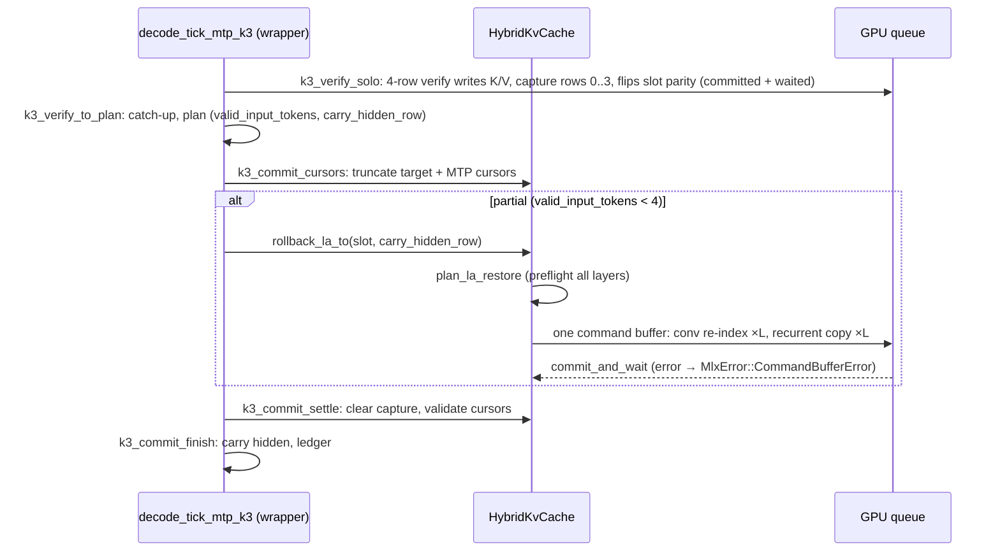

# ADR-065 P4a/P4b: GPU restore of DeltaNet state from capture — HLD/LLD

Stories:
- [P4a #526](https://github.com/robertelee78/hf2q/issues/526): native primitive. mlx-native owns it. Blocked by E6 #509.
- [P4b #527](https://github.com/robertelee78/hf2q/issues/527): hf2q integration. Blocked by B1 #503, J1 #512 and P4a.
- ADR text: [ADR-065 §P4a/§P4b](../adr/ADR-065-four-agent-joint-speculative-verify.md#p4a-provide-gpu-restore-of-deltanet-state-from-capture).
- Downstream consumers: ADR-063 C2 #360, whose anchor restore reuses this primitive (see [adr063-c2-design.md](adr063-c2-design.md)), and J4 #515 for joint verify rollback.

Authored against hf2q `main` `d817dffa7371a2db85a43ed1d6502350906c33f5` and the pinned `mlx-native =0.15.16` (crates.io source). Source identities are listed at the end. Line numbers help reading only.

This is a design. Nothing was built, run or measured for it. Every cost figure below is arithmetic from shapes or is marked [INFERENCE].

## 1. Scope

**P4a requirement.** The program MUST provide a GPU restore of captured DeltaNet state, including the parity-aware conv re-index, using existing copy primitives where E6 shows they suffice. Acceptance:
- restored state equals the host path bitwise for full, partial and zero acceptance;
- if E6 shows existing copy primitives suffice, the story closes with that record and no release;
- otherwise a kernel is released with parity tests on both metallib paths and a microbenchmark.

**P4b requirement.** The program MUST use the P4a restore for solo K3 and, where J4 has landed, joint verify rollback. Acceptance:
- exact pin of any P4a release from a clean registry build;
- full, partial and zero acceptance transaction cases pass;
- `ExactTranscripts` against the previous default;
- a four-agent A/B with fairness.

The outcome: partial-reject rollback no longer copies DeltaNet state through host memory.

### 1.1 The host path being replaced

`HybridKvCache::rollback_la_to(slot, accepted_idx)` (`src/inference/models/qwen35/kv_cache.rs:2745-3025`) loops over every linear-attention layer (`self.linear_attn`). For each layer it does two copies.

**Recurrent copy (2821-2873).**
- Maps `capture_states` with `as_slice::<f32>()`.
- Copies the slot/token row `[slot·T·E + t·E, +E)` into a fresh `Vec` (`to_vec`).
- Copies that into `recurrent_current_mut(slot)`, the buffer that is current for this slot's ping-pong parity (`kv_cache.rs:867`), at `slot·E`.
- Here `E = D_k·D_v·n_v_heads`, and `T` is the capture's token axis derived from the buffer's element count.

**Conv copy (2875-3022), with a re-index.**
- Maps `conv_capture_states`. Its layout is `[S, T, K−1, C]` with channels innermost, written by `ssm_conv_capture_forward_f32` (mlx-native `src/shaders/ssm_conv_capture.metal:21-30`).
- Copies the `(slot, t)` row into a `Vec`.
- Transposes into `conv_current_mut(slot)` (`kv_cache.rs:856`), whose slot region is `[C, K−1]` with `K−1` innermost: `dst[c·(K−1)+k] = src[k·C + c]` (3016-3022).

"Parity-aware" therefore means two things:
1. the destination is the buffer that the slot's `pp_flipped` bit (`kv_cache.rs:163`) marks current, which is the buffer the verify forward just wrote and flipped to;
2. the conv row is transposed from capture layout to state layout.

Callers:

| Caller | Site |
|---|---|
| Slot-aware MTP K3 commit | `src/serve/api/engine_qwen35.rs:6043`; after J1, the restore seam of `decode_tick_mtp_k3` |
| Slot-aware history-lookup commit | `engine_qwen35.rs:5672` |
| Serial K=N spec decode | `src/inference/models/qwen35/spec_decode.rs:939` |
| DFlash Qwen target | `src/inference/spec_decode/dflash/qwen35_target.rs:223` |
| Unit tests | `kv_cache.rs:9125-9240`, `10700-10950`, `11660-11680` |

Capture geometry is fixed by `CaptureAllocationPlan` (`src/inference/models/qwen35/kv_cache/allocation_plan.rs:330-415`):
- recurrent capture is `[D_k, D_v, n_v, T, S]` and conv capture is `[S, T, K−1, C]`, both f32;
- multi-slot caches (`S > 1`) retain a capture buffer only when its element count equals the requested one (376-379), so `T` equals the active depth;
- single-slot caches may retain a deeper buffer, where only `s = 0` exists and the token stride is still `E`.

### 1.2 Sizes at served shapes (arithmetic, not measurement)

| Artifact (Q5 case) | DeltaNet layers | E (f32) | Recurrent bytes / slot-layer | C | Conv bytes / slot-layer | Bytes restored per slot |
|---|---|---|---|---|---|---|
| Qwen3.8-27B dense (`q5_cases/qwen38.json`; ADR-044 geometry: 48 linear layers, 16 key / 48 value heads, dim 128, conv width 4) | 48 | 786,432 | 3,145,728 | 2·16·128 + 48·128 = 10,240 | 122,880 | 156,893,184 (149.6 MiB) |
| Qwen3.6-35B-A3B MoE (`q5_cases/qwen36.json`; ADR-013 MoE geometry: 40 layers, interval 4, 32 value heads) | 30 | 524,288 | 2,097,152 | 8,192 | 98,304 | 65,863,680 (62.8 MiB) |

The host path touches each restored byte four times: capture read, `Vec` write, `Vec` read and destination write. It also makes `2·L` heap allocations of up to 3 MiB per rollback (96 on Qwen3.8). [INFERENCE] On Apple Silicon, large fresh allocations can incur first-touch page faults. The restore cost is therefore unknown until measured (P4b-M0, §5.2). No claim is made here.

## 2. P4a — native primitive contract (mlx-native)

### 2.1 Normative contract: `DeltaNetCaptureRestore`

The contract is stated in mlx-native terms, with no external engine names (mlx-native `AGENTS.md` policy).

**Inputs, per DeltaNet layer `ℓ`:**

| Input | Content |
|---|---|
| `rec_cap` | f32 view, logical shape `[E, T, S]` (E fastest) |
| `conv_cap` | f32 view, logical shape `[S, T, Km1, C]` (C fastest) |
| `rec_dst[j]`, `conv_dst[j]` | f32 destination views of exactly `E` and `C·Km1` elements, one per item `j` |
| item `j` | `(s_j < S, t_j < T, rec_dst[j], conv_dst[j])` |

**Effect.** For every item `j`, every `e < E`, `c < C` and `k < Km1`:

```
bits(rec_dst[j][e])            := bits(rec_cap[(s_j·T + t_j)·E + e])
bits(conv_dst[j][c·Km1 + k])   := bits(conv_cap[((s_j·T + t_j)·Km1 + k)·C + c])
```

`bits(·)` is the raw 32-bit pattern. Equality is bitwise for every u32 value, including signaling and quiet NaN payloads, ±0, subnormals and ±∞. No arithmetic, conversion or flush-to-zero is permitted.

**Preconditions.** The caller validates these; the primitive refuses on violation:
- destination views are pairwise disjoint;
- no destination overlaps any source;
- all views lie within their buffers' logical extents;
- `E`, `C` and `Km1` are greater than 0;
- index arithmetic does not overflow u32 inside a view.

**Cohort invariance at primitive level (ADR-065 Class A).** The bytes written for item `j` depend only on `(rec_cap, conv_cap, s_j, t_j)`. They do not depend on the other items, the item order, the number of items (1–4) or which slots the items name. Bytes outside the destination views are unchanged, including peer slots' regions in the same physical buffers.

**Ordering and completion.** All work is encoded into a caller-provided `CommandEncoder`. Nothing creates encoders, commits or waits. Work encoded before the restore (the verify forward, or nothing) completes before the restore reads its sources, through command-buffer order or an explicit barrier the helper documents. Completion is the caller's commit and wait. A GPU fault surfaces as `MlxError::CommandBufferError` from that wait.

**Anchor images.** A tensor with capture layout and `T = S = 1` is a valid `rec_cap`/`conv_cap` pair. Restoring from such an image with `(s, t) = (0, 0)` is inside this contract; C2 relies on it (C2 §3.3). The contract covers capture-layout → state-layout only. The reverse direction (state → capture image) is not part of P4a.

### 2.2 Delivery path A: existing primitives suffice (decided by E6 item 4)

ADR-065 E6 item 4 asks whether the existing GPU copy primitives serve capture-to-state restore with the parity-aware conv re-index. The E6 reference is mlx-native `src/encoder.rs:1554-1569`. In 0.15.16 that range is the doc comment and signature of `CommandEncoder::blit_copy_bytes`, which starts at 1563. The candidate composition, per layer and item, is:

| Component | Primitive (mlx-native 0.15.16) | Arguments |
|---|---|---|
| Recurrent | `CommandEncoder::blit_copy_bytes` (`src/encoder.rs:1563`); byte-exact by Metal definition | source = `rec_cap` at byte offset `(s·T+t)·E·4`, destination = `rec_dst`, length `E·4` |
| Recurrent (alternative) | `ops::copy::dispatch_copy_f32` (`src/ops/copy.rs:145`, kernel `offset_copy_f32`) | whole buffers, element offsets `(s·T+t)·E` and `slot·E`, `count = E` |
| Conv re-index | `ops::copy::dispatch_strided_copy_f32` (`src/ops/copy.rs:68`, kernel `strided_copy_f32`, `src/shaders/copy.metal:24`) | `src = conv_cap.slice_view(((s·T+t)·Km1·C)·4, Km1·C)`, `dst = conv_dst`, `rows = C`, `cols = Km1`, `stride_row = 1`, `stride_col = C`. The kernel computes `dst[row·cols+col] = src[row·stride_row + col·stride_col]` = `dst[c·Km1+k] = src[k·C+c]` |

Path A passes only if E6 records all of the following, on both `MLX_PRECOMPILED_METALLIB=1` and `=0`:

1. `strided_copy_f32` (and `offset_copy_f32`, if chosen) is bitwise for every bit class in §2.1. The kernels move `float` values through registers, so this is an empirical property of the compiled code, not a definition. A single failing NaN or subnormal pattern sends P4a to path B.
2. View composition is correct: `slice_view` byte offsets for `s > 0`, `t > 0` and the conv capture's non-zero base.
3. The bounds checks are understood. `dispatch_strided_copy_f32` and `dispatch_copy_f32` validate against `MlxBuffer::byte_len()`, the whole Metal allocation (`src/buffer.rs:338`), not the view's `data_byte_len()` (`:347`). The native checks are therefore not view-exact. Path A is acceptable only with hf2q-side preflight of every range (§3.3), and the qualification record must say so.
4. Multi-item lists (1–4 items across 4 slots) leave peer bytes unchanged.

If E6 qualifies path A, P4a closes with a qualification record merged to mlx-native main. Proposed contents:
- `tests/deltanet_capture_restore_parity.rs`: parity of the composition against a host reference with the same indexing as `kv_cache.rs:2821-3022`, over both metallib paths, served shapes and a small shape;
- `docs/deltanet-capture-restore-qualification.md`: the contract of §2.1 and the bounds-check caveat.

No release is made. hf2q composes the primitives itself, because ADR-065 assigns encode-only helpers to hf2q.

Each `blit_copy_bytes` call ends any active compute pass and then opens and ends its own blit encoder (`src/encoder.rs:1636-1651`). Interleaving recurrent blits with conv compute dispatches would therefore reopen a compute pass after every blit. The hf2q helper encodes all conv strided copies (compute) for all layers and items first, then all recurrent copies. The two families have disjoint destinations and read-only sources, so no barrier is needed between them. That leaves one compute pass plus `L·items` blit encoders (48 per item on Qwen3.8) when the recurrent component uses blits, or a single compute pass when it uses `offset_copy_f32`. Unlike the f32 compute copies, `blit_copy_bytes` validates against view extents (`data_byte_len()`, 1579-1593) and rejects overlapping same-allocation ranges. The P4a microbenchmark chooses between blit and `offset_copy_f32` for the recurrent component; both are exact under path A.

### 2.3 Delivery path B: a native kernel (if E6 fails path A)

The proposed mlx-native op is `ops::deltanet_restore::dispatch_capture_restore_u32`, with kernel `deltanet_capture_restore_u32`. It needs a separate mlx-native issue stating §2.1. The issue is filed by the root, because tracker writes are not this author's to make.

- One dispatch per layer covers every item and both components. Loads and stores are raw `uint` (`device const uint*` / `device uint*`), so no float path exists.
- Bindings:
  - `rec_cap`, `conv_cap`;
  - `rec_dst_a`, `rec_dst_b`, `conv_dst_a`, `conv_dst_b` (the slot's two ping-pong buffers);
  - a constant item table `{s, t, parity_select, dst_slot}`, at most 4 items;
  - params `{E, C, Km1, T, S, n_items, n_seqs_dst}`.

  The destination for item `j` is `(parity_select ? b : a)` at `dst_slot·E` (or `dst_slot·C·Km1`). That reproduces `recurrent_current_mut` / `conv_current_mut` without the host choosing views.
- Grid: `(ceil(max(E, C·Km1)/256), n_items)` threadgroups of 256. Threads below `E` copy recurrent; threads below `C·Km1` copy conv via the transpose index.
- Validation in Rust: the same preconditions as §2.1, against `data_byte_len()` of views (not `byte_len()`).

Deliverables follow the ADR-065 "Native primitive" closure:
- parity tests on both metallib paths against the host reference, over the §2.1 bit classes, at served shapes (`E = 786,432` / `524,288`; `C = 10,240` / `8,192`; `Km1 = 3`; `T = 4`; `S = 4`; items 1–4) and a small shape;
- a distinct-matrix microbenchmark at served shapes reporting GPU time and encode time per layer and per restore;
- merged PR, published release, verified crates.io bytes.

### 2.4 Native out-of-scope

- State → capture-image snapshot.
- Deeper or variable `T` semantics.
- Gemma and DeepSeek state.
- Any change to `ssm_conv_capture_forward_f32` or the capture layout.
- Fusing the restore into the next forward.

## 3. P4b — hf2q integration

### 3.1 Interface

A new module, `src/inference/models/qwen35/kv_cache/la_restore.rs`, is a child of `kv_cache`, beside `allocation_plan.rs`.

```rust
/// Where a restore reads from. `CaptureRow` is the K3/history/J4 rollback
/// source; `AnchorImage` is ADR-063 C2's anchor payload, a capture-layout
/// image with T = S = 1 (P4a contract §2.1 "Anchor images").
pub enum LaRestoreSource<'a> { CaptureRow(u32), AnchorImage(&'a LaAnchorImage) }

/// Where a restore writes. `CurrentByParity` reproduces
/// `recurrent_current_mut`/`conv_current_mut` and leaves `pp_flipped`
/// unchanged (today's rollback). `NamedResetParity` writes the named
/// `recurrent`/`conv_state` regions and then sets `pp_flipped[slot] = false`
/// (today's `restore_slot_anchor`, `kv_cache.rs:1698-1716`).
pub enum LaRestoreDestination { CurrentByParity, NamedResetParity }

pub struct LaRestoreItem<'a> {
    pub slot: SlotId,
    pub source: LaRestoreSource<'a>,
    pub destination: LaRestoreDestination,
}

/// Validated plan: every per-layer source/destination byte range checked
/// against `data_byte_len()` and against each other before any encode.
pub(crate) struct LaRestorePlan { /* per layer: (src ranges, dst buffer+range) per item */ }

impl HybridKvCache {
    /// Preflight only; no mutation, no encode.
    pub(crate) fn plan_la_restore(&self, items: &[LaRestoreItem<'_>]) -> Result<LaRestorePlan>;
    /// Encode the plan into `enc` (path A composition or path B kernel).
    /// Does not commit or wait. Mutates nothing host-visible.
    pub(crate) fn encode_la_restore(&self, enc: &mut CommandEncoder,
                                    registry: &mut KernelRegistry,
                                    plan: &LaRestorePlan) -> Result<()>;
    /// Apply the host-side half of a completed plan (parity bits for
    /// `NamedResetParity` items). Called only after a successful wait.
    pub(crate) fn finish_la_restore(&mut self, plan: LaRestorePlan);
    /// Single-slot convenience used by every current rollback caller:
    /// `(CaptureRow(accepted_idx), CurrentByParity)`, plan, encode into a
    /// fresh command buffer, commit and wait, then finish.
    pub fn rollback_la_to(&mut self, slot: SlotId, accepted_idx: u32) -> Result<()>;
    /// Multi-slot rollback for J4: one command buffer for all items.
    /// Shipped by P4b only if J4 has landed; otherwise J4 adds it (§3.2).
    pub(crate) fn rollback_la_many(&mut self, items: &[(SlotId, u32)]) -> Result<()>;
}
```

P4b ships only the `CaptureRow` + `CurrentByParity` combination on a production path. C2 adds the `AnchorImage` + `NamedResetParity` caller ([adr063-c2-design.md](adr063-c2-design.md) §3.3). The enums are introduced by whichever of P4b or C2 lands first that needs the variant, so no variant ships without a caller.

- **Signature.** `rollback_la_to` keeps its signature and error contract: `SlotOutOfRange`, missing capture, `accepted_idx >= n_tokens_max`, layout-invariant errors. That makes the cutover reach all four production callers (§1.1) without call-site edits.
- **The host body is renamed, not deleted.** It becomes `rollback_la_to_host` and remains for two purposes only: the kill-switch arm (`HF2Q_QWEN_LA_GPU_RESTORE=0`) and the parity oracle in tests. It is not a fallback after a GPU failure (§3.4).
- **Kernel registry.** `HybridKvCache` gains a lazily created `restore_registry: Option<KernelRegistry>`, used only for the copy pipelines (path A: `strided_copy_f32` and optionally `offset_copy_f32`; path B: the restore kernel). It is created once per cache, which avoids threading the model's registry through the DFlash and serial callers. Unlike the graft splice (`kv_cache.rs:2311`), it does not compile pipelines per call. The metallib selection follows the same `MLX_PRECOMPILED_METALLIB` policy as the model registry. That `KernelRegistry` is `Send` with the cache is checked at implementation. If it is not, the registry is passed in from `with_gpu_cache_mut` at the two slot-aware callers, and the serial and DFlash callers use their model's registry.
- **Kill switch.** `HF2Q_QWEN_LA_GPU_RESTORE` takes `0|1`. It is read once at engine load into the cache (as `HF2Q_QWEN_SPECULATION` is read at load, `src/serve/api/qwen35_speculation.rs:221-224`) and logged in the startup line. Invalid values fail closed at load. The default is set by the A/B verdict (§5.3).

### 3.2 Data flow (solo K3 after J1)



- **Sources are complete before the restore runs.** The verify forward's terminal command buffer was waited on: logits were read on the CPU by the semantic walk, so the capture rows are complete. The restore command buffer is the next GPU work for this slot, and the next reader of the restored state is a later forward submitted after `commit_and_wait` returns. No fence beyond command-buffer order is needed.
- **Supervision.** The slot-aware K3 and history commits wrap the restore in `supervisor.arm("Qwen35 SlotAware MTP K3 restore", QWEN35_WORKER_TRANSACTION_TIMEOUT)` (history: "Qwen35 history restore"), so a hung wait is supervised like every other GPU stage of the round. The serial and DFlash callers have no supervisor today and get none.
- **Joint path.** If J4 has landed, its commit calls `rollback_la_many` once for every partially rejected lane, between `k3_commit_cursors` (all lanes) and `k3_commit_settle` (J1 §3.4). If J4 has not landed when P4b merges, P4b does not ship `rollback_la_many`, which would have no production caller. `plan_la_restore`/`encode_la_restore`/`finish_la_restore` already take item slices, and J4 adds `rollback_la_many` as a thin wrapper over them rather than a second restore path. The root should record that as a J4 obligation.
- **Profile line.** The `HF2Q_MTP_PHASE_PROFILE` field `rollback=` keeps measuring the wall time of the restore call, now including encode, commit and wait.

### 3.3 Preflight (`plan_la_restore`), all before any encode

For every layer:
- capture and conv capture are present;
- `recurrent.element_count() % n_seqs == 0`, and so on, with the same checks and error texts as today;
- `T` is derived as today, and `accepted_idx < T`;
- the destination buffer is chosen by the slot's `pp_flipped`, which mirrors `recurrent_current_mut` / `conv_current_mut`;
- every source and destination byte range lies within its buffer's `data_byte_len()`;
- destination ranges are pairwise disjoint across items;
- the item slots are unique.

Any failure returns `Err` with nothing encoded and nothing mutated. This matches today's host path, which also validates each layer before writing it. The difference is that today a late-layer validation failure leaves earlier layers already written. P4b strictly improves that to all-or-nothing preflight.

### 3.4 Failure semantics

| Failure | Effect | Handling |
|---|---|---|
| Preflight refusal | Nothing mutated | Error to the caller. The K3 and history commits run their existing fail-closed path (clear capture, `reset_for_slot`), as for today's host errors |
| Encode error (pipeline compile, argument validation) | Nothing committed; partially encoded commands are dropped with the uncommitted encoder | Same as preflight refusal |
| `CommandBufferError` on wait | Destination bytes of the participating slots are unknown | The error is wrapped with `.context(...)`, never stringified, so `is_fatal_command_buffer_error` (`src/serve/api/engine.rs:17903-17911`) classifies it as fatal. Per the ADR-065 failure classes, a worker-fatal error fail-stops the worker: the existing fatal path terminates the affected requests and publishes no partial state. Any `reset_for_slot` the caller runs first only zeroes host-visible bytes and is harmless |
| Supervisor timeout | As today for any supervised stage | Unchanged policy |

There is no host fallback after a GPU attempt. Once a restore was submitted, the destination state is unknown. Retrying on the host would copy correct bytes, but it would also mask a GPU fault that ADR-065 requires to fail-stop.

Non-participating slots are never written: destinations are slot regions, and preflight proves disjointness. A failed multi-slot restore (J4) poisons only the participating lanes, unless the error is fatal, in which case the whole worker stops (ADR-065 shared-submitted-forward failure semantics).

## 4. Tests

### 4.1 P4a (mlx-native)

| ID | Test |
|---|---|
| T-P4a-1 | Parity against the host reference for `(s, t)` ∈ {0..S−1} × {0..T−1}, `S = T = 4`, served shapes and a 2-layer small shape. Payloads come from a seeded u32 generator with forced coverage of NaN payload bits, signaling NaN, ±0, the minimum and maximum subnormal, ±∞ and ±FLT_MAX. Bitwise compare on `MLX_PRECOMPILED_METALLIB=1` and `0` |
| T-P4a-2 | Acceptance classes as rows: full (no item, a no-op), partial (`t ∈ {1, 2}`) and zero (`t = 0`). The restored state equals the host path's bytes (the host reference reproduces `kv_cache.rs:2821-3022`) |
| T-P4a-3 | Cohort and order invariance: items `{(s, t)}` for every subset of 4 slots in every order. Each item's destination bytes equal the single-item run, and peer regions equal a sentinel fill |
| T-P4a-4 | Anchor-image form: `T = S = 1`, `(0, 0)`, both metallib paths (C2 dependency) |
| T-P4a-5 | Negative preflight: overlapping destinations, out-of-range `s/t`, a view past its logical end, zero dims. Each refuses with nothing encoded |
| T-P4a-6 (path B only) | Microbenchmark at served shapes: GPU time per layer and per restore of 1 and 4 items, distinct matrices per layer |

### 4.2 P4b (hf2q)

| ID | Test | Kind |
|---|---|---|
| T-P4b-1 | The existing `rollback_la_to_*` tests (`kv_cache.rs:9125-9240`, `10700-10950`, `11660-11680`) pass unchanged on the GPU arm, and again with the kill switch at 0 | unit, Metal |
| T-P4b-2 | GPU vs host parity on a tiny Qwen config with real `HybridKvCache` geometry: random capture payloads with the §2.1 bit classes, both parities per slot, every `(slot, idx)`. Current-buffer bytes and parity bits equal `rollback_la_to_host`, and scratch and peer bytes are unchanged | unit, Metal |
| T-P4b-3 | A multi-item plan (`plan_la_restore` + `encode_la_restore` + `finish_la_restore`, one command buffer) with 2–4 slots in permuted orders equals sequential single restores byte for byte (Class A building block for J4; it also covers `rollback_la_many` when shipped) | unit, Metal |
| T-P4b-4 | Preflight atomicity: corrupt the last layer's conv capture shape. The call errors and the bytes of every layer are unchanged. Today's host path partially writes, so this is a deliberate behaviour improvement | unit, Metal |
| T-P4b-5 | Transaction cases: the speculation qualification suite (`src/serve/api/engine_qwen35/speculation_qualification_tests.rs`: full, partial and zero acceptance followed by 8 ordinary decisions; chained mixed rounds; EOS in or after the block; length boundary; cancellation mid-drain) green with the switch at 1 and at 0 | unit |
| T-P4b-6 | Q1 actual transaction store: `q1_qwen_actual_t5_speculation_phase` on the official Qwen3.8 artifact, switch 0 vs 1. Stores are `ExactEqual` (`scripts/four_agent/q1_decision_policy.py`), including the `state_committed` snapshots after partial rounds | real artifact, GPU lane |
| T-P4b-7 | `qwen38_slot_aware_speculation_auto_matches_off` passes with the switch at 1 | real artifact, GPU lane |
| T-P4b-8 | Cancel smoke (`scripts/four_agent/cancel_smoke.py`, `q5_cases/cancel-qwen38.json`) with the switch at 1 | hardware |
| T-P4b-9 | Serving transcripts `ExactTranscripts`, switch 1 vs 0 on the same binary, from the A/B runs (§5.3) at `HF2Q_QWEN_SPECULATION=auto` | hardware |
| T-P4b-10 | If J4 has landed: the J4 transaction matrix (mixed full, partial and zero across lanes) re-run with P4b on. Class A cohort invariance of post-commit DeltaNet state (current conv/recurrent and parity) between REF(w) alone and cohorts of 1–4 windows | real artifact, GPU lane |

Clean-registry pin (P4b acceptance item 1): under path B, hf2q's `Cargo.toml` pins `mlx-native = "=<P4a release>"`, and a clean `CARGO_HOME` build resolves it from crates.io. The receipt records `Cargo.lock` and the crate checksum. Under path A, no pin changes, and the receipt states that no P4a release exists.

## 5. Measurement plan

All hardware runs need the GPU lane granted by the root. Each records source commit, binary SHA-256, artifact digest, native version and case file, and passes Q5 `CalibrationPass`. Evidence goes under `/Users/robert/.local/state/hf2q/v0130/p4b-527/` (P4a qualification receipts: `…/p4a-526/`).

### 5.1 Why the default four-agent configuration barely exercises P4b

With `HF2Q_QWEN_SPECULATION` unset, the dense Qwen3.8 four-slot worker resolves speculation to `off` (`qwen35_speculation.rs:51-52`; ADR-063 D1 measured a 1.020 makespan loss). Single-slot workers default to `auto`. The changed code runs only on K3 and history partial rejections. Therefore:
- the four-agent A/B arms both run at `HF2Q_QWEN_SPECULATION=auto`. That is a declared campaign parameter, not an ADR-065 kill switch, so "previous default" is still the same binary with only `HF2Q_QWEN_LA_GPU_RESTORE` toggled;
- the N=1 control is an engaged arm, not a ±2.5-point non-engagement control, because single-agent K3 is the path this changes. It is reported with its own verdict.

### 5.2 P4b-M0: restore cost attribution (diagnostic, before the A/B)

- ADR-065 E1 already attributes a "rollback (CPU)" stage class. If E1's receipts exist, P4b cites their solo-K3 rollback share.
- Otherwise, one single-agent `auto` run per arm with `HF2Q_MTP_PHASE_PROFILE=1` gives the distribution of `rollback=` ms on rounds with `partial=true` and the partial-round rate.
- No decision rule hangs on M0. It sizes expectations and supplies the E1-style stage split for the record.

### 5.3 P4b A/B (acceptance)

The ADR-065 two-arm rule applies:
- one binary; arms `HF2Q_QWEN_LA_GPU_RESTORE=0` (A, previous default) vs `=1` (B);
- ABBA paired blocks with warm-up; 6 blocks unless a labelled pilot (never pooled) selects 8, 12, 16 or 20;
- paired log-makespan Student-t 95% interval;
- verdicts in the order Loss, Win, Equivalent, Inconclusive;
- fairness ceilings frozen by B1 (per-run, per-slot p95 semantic TTFT and maximum semantic SSE gap) must hold in every candidate run and slot;
- quality: the arms are `ExactTranscripts` (T-P4b-9), so B inherits task quality. A non-exact pair blocks the story pending diagnosis;
- the Q5 case is the B1 campaign file's Qwen3.8 case derived at `auto`. Q5 admission is re-established for the P4b binary (the capture footprint is unchanged: the GPU path allocates nothing; path B adds only pipeline state).

Default mapping. ADR-065 says "default set by the A/B verdict" but gives no mapping for P4b. Proposed, for root confirmation before the campaign runs:

| Verdict | Default | Reason |
|---|---|---|
| Win | on | — |
| Equivalent | on | Exact transcripts plus a bounded no-difference result. The story's outcome (no host copy) and J4's need for a batched restore favour the GPU path at no measured cost |
| Loss or Inconclusive | off | The verdict is recorded. The switch stays, and the host path remains the default |

## 6. Risks

| Risk | Mitigation |
|---|---|
| Float copy kernels are not bit-preserving for some payloads (path A) | E6 / T-P4a-1 bit-class coverage. Failure moves P4a to path B, which uses u32 loads and stores only |
| Native bounds checks use `byte_len()`, not view extents | hf2q preflight checks every range against `data_byte_len()` (§3.3). Path B validates views natively |
| Encoder-switch overhead from blits | Compute-first ordering (§2.2). The microbenchmark selects `offset_copy_f32` if it is cheaper |
| Command-buffer submit and wait (one per partial round) costs more than the host copy at small `E` | P4b-M0 plus the A/B decide the default. The Qwen3.6 MoE shape (62.8 MiB) is the smallest served case |
| A stringified error hides a GPU fault from fatal classification | §3.4 rule; a unit test asserts the error chain contains `MlxError::CommandBufferError` under injected failure (mlx-native test hook or mock encoder) |
| The cache-owned `KernelRegistry` is not `Send` | The alternative in §3.1 (registry passed in at the slot-aware callers) |
| J4 lands later and adds its own host rollback | The slice-taking plan/encode/finish API exists; J4 adds only the thin `rollback_la_many` wrapper, plus the J4 obligation recorded by the root (§3.2) |

## 7. Non-goals

- Fusing the restore into the next target forward. This would be deferred restore with a "pending restore" slot state that every reader must honour; it can be revisited only with a deciding receipt.
- Changing capture layout or depth, J2 per-slot capture ownership, the ping-pong parity scheme, or zero-copy full-rejection rewinds (`rewind_la_ping_pong_for_slot`, `kv_cache.rs:3035`).
- Converting `snapshot_prefix_from_capture` (`kv_cache.rs:3383-3402`, host transpose at 3667-3676; SerialFifo latest-turn checkpoint) or `snapshot_slot_anchor`/`restore_slot_anchor`. C2 covers anchor restore.
- Gemma and DeepSeek state; approximate or BF16 state.
- Any served-output change.

## 8. Source identities read

| Path | SHA-256 |
|---|---|
| `src/inference/models/qwen35/kv_cache.rs` | `6bc46b78124b9e41b494a5136324e03b76edb5a584279271291d4d8b5cf4518e` |
| `src/serve/api/engine_qwen35.rs` | `47f755feeeed176aa5dd77179e430ceb2d09a6f0e5b14d883a8f2e1f5ce6bd34` |
| `src/serve/api/engine.rs` | `9383b87263ea7dc252a8ac4bb64eb16780169a82d792dfafc7987772f95f574f` |
| mlx-native 0.15.16 `src/encoder.rs` | `275ea47915de3724e630ac578c8aa3745cf872e026720e71ebf3085d0b65944b` |
| mlx-native 0.15.16 `src/ops/copy.rs` | `e9c7a5b493c3258dbff22dba51a53e51d7eb52330a2b11298ccb19de5bdf62bb` |
